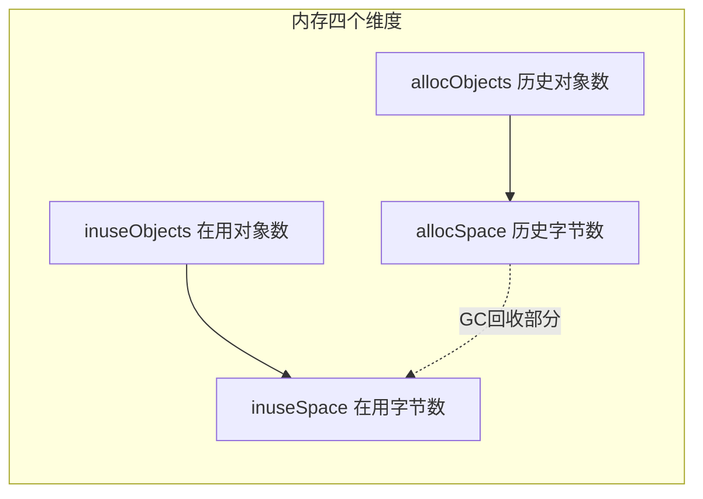

## 纲要

- 内存 profile 生成：标准库 `runtime/pprof` 下 `Lookup("heap").WriteTo` 输出，或 `runtime.MemProfileRate` 控制采样；与 CPU 写法几乎一致
- 复现场景：每秒往一个 slice 里 `append` 1MB，制造持续增长的内存占用
- 交互终端 `top`：列含义从「CPU 时间」换成「内存容量（MB）」，`flat`/`cum` 语义不变
- `list 函数`：定位到具体哪行（如 `append buff`）导致内存占比高
- 浏览器视图四个维度：`allocObjects`（历史分配对象数）、`allocSpace`（历史分配字节）、`inuseObjects`（正在使用对象数）、`inuseSpace`（正在使用字节）
- `inuse` 与 `alloc` 的区别：`alloc` 统计采样期间历史所有分配（含已被 GC 回收的），`inuse` 只统计经历 GC 仍未被回收的
- HTTP 形态：`/debug/pprof/allocs` 与 `/debug/pprof/heap` 内容一致
- heap profile 文本：默认采样频率每 512KB 采样一次；输出含对象数、字节数、函数栈分配明细与 `memstats`

## 正文

### 生成内存 profile

内存 profile 的生成方式与 CPU 类似，区别在采样类型和输出目标。标准库写法如下：

```go
// 根据讲稿逻辑补充：生成 heap profile 的标准写法
package main

import (
	"os"
	"runtime/pprof"
	"time"
)

func allocMemory() {
	var buff [][]byte
	for i := 0; i < 60; i++ {
		buff = append(buff, make([]byte, 1024*1024)) // 每秒追加 1MB
		time.Sleep(time.Second)
	}
}

func main() {
	f, _ := os.Create("mem.pprof")
	// 采样期间持续分配内存
	allocMemory()
	// 把 heap profile 写到文件
	if err := pprof.Lookup("heap").WriteTo(f, 0); err != nil {
		panic(err)
	}
	f.Close()
}
```

`pprof.Lookup("heap").WriteTo(f,0)` 取的是当前堆的采样快照。`runtime.MemProfileRate` 控制采样频率，默认每分配约 512KB 采样一次（设为 1 表示全量，开销极大，仅调试用）。

### 交互终端：单位从时间变成空间

用 `go tool pprof mem.pprof` 进入终端，`top` 的输出与 CPU 大同小异，只是**单位从「时间」换成了「内存容量」**：

```bash
go tool pprof mem.pprof
(pprof) top
```

`flat` 是函数自身占用的内存，`cum` 是函数自身加子函数占用的内存——和 CPU 完全同义，只是量纲变了。比如 `allocMemory` 的 `cum` 可能显示 13.49MB，说明它和它调的子函数一共吃掉了约 13MB。

用 `list allocMemory` 能看到具体是哪一行导致内存高——通常是 `append buff` 那一行。`list` 左侧显示的就是该行对应的内存 `flat`/`cum` 占比，与 CPU 分析方式一致。

### 浏览器视图的四个维度

CPU 只有「时间」一个维度，内存则丰富得多。`go tool pprof -http=:8083 mem.pprof` 的右上角能切换四种视角：

| 维度 | 含义 |
| --- | --- |
| `allocObjects` | 采样期间**历史所有**分配过的对象数 |
| `allocSpace` | 采样期间历史所有分配过的字节数 |
| `inuseObjects` | 当前**正在使用**（未被回收）的对象数 |
| `inuseSpace` | 当前正在使用的字节数 |

理解 `alloc` 与 `inuse` 的差异至关重要：**`alloc` 包含已经被 GC 回收的对象，而 `inuse` 只统计经历 GC 后仍未被回收的部分**。排查内存泄漏时，`inuseSpace` 持续增长才是真正的泄漏信号；`allocSpace` 高只能说明分配频繁，不代表泄漏。



### HTTP 接口与 heap 文本

通过 HTTP 看内存时，`/debug/pprof/allocs` 和 `/debug/pprof/heap` 取到的内容**完全一样**，点任意一个即可。点进去后是 heap profile 的原始文本，各部分含义：

- 开头样本名 `heap profile`；
- 第一组数字：`1`（正在使用对象数）、其占用字节数、`1`（历史分配对象数）、历史分配字节数；
- `heap/1048576` 这类数字代表采样频率：平均**每分配 512KB（即 1048576 字节 / 2）**采样一次。注意不是「每次分配都精确检查」，而是从长时间看的平均频率；
- 函数栈明细：如 `1: 2048 [1: 2048]` 表示「该栈上分配了 1 个对象、2048 字节」，与之相对的是整段采样的汇总；
- 末尾 `memstats`：整个程序的内存概览（堆用了多少等）。

分析内存问题时，核心仍是找到「分配对象数或字节数最多的函数栈/函数名」，再回到代码优化。

## Demo 示例

可独立运行的内存增长示例，运行后生成 `mem.pprof`。

```go
package main

import (
	"os"
	"runtime/pprof"
	"time"
)

func allocMemory() {
	var buff [][]byte
	for i := 0; i < 10; i++ {
		buff = append(buff, make([]byte, 1024*1024)) // 每次 1MB
		time.Sleep(time.Second)
	}
	_ = buff
}

func main() {
	// 每分配 512KB 采样一次（默认值，显式写出便于理解）
	// runtime.MemProfileRate = 512 * 1024
	allocMemory()
	f, err := os.Create("mem.pprof")
	if err != nil {
		panic(err)
	}
	defer f.Close()
	if err := pprof.Lookup("heap").WriteTo(f, 0); err != nil {
		panic(err)
	}
}
```

### 运行说明

```bash
go mod init mem-pprof-demo
go run main.go
# 终端分析
go tool pprof mem.pprof
# 浏览器分析
go tool pprof -http=:8083 mem.pprof
# 或访问 http://127.0.0.1:8080/debug/pprof/ 点 heap / allocs
```

### 代码说明

- `pprof.Lookup("heap").WriteTo(f,0)` 输出当前堆快照，`debug=0` 为二进制
- `allocMemory` 持续 `append` 制造内存增长，`top` 中其 `cum` 即累计分配量
- 默认 `MemProfileRate = 512*1024`，生产无需改动；设为 1 全量采样仅限调试
- HTTP 下 `allocs` 与 `heap` 等价；重点看 `inuseSpace` 判断真实泄漏

### 技术点总结

- 内存 profile 与 CPU 分析命令一致，只是量纲从时间变为容量
- 浏览器四维度：`alloc` 含 GC 回收、`inuse` 仅计未回收，泄漏看 `inuse`
- `list` 能定位到具体哪行代码分配内存最多
- heap 文本默认每 512KB 采样一次，含对象数、字节数与函数栈明细
- HTTP 中 `allocs` 与 `heap` 内容相同，可任选
