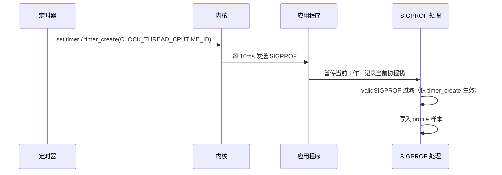

## 纲要

- CPU profile 的本质：周期性向进程发 `SIGPROF`，在信号处理里记录「当前执行栈」，从而统计 CPU 时间花在哪些函数
- 采样频率：默认 100 Hz（即每 10ms 一次），由 `runtime/pprof` 的赫兹参数控制
- 旧版 Go 用 `setitimer(ITIMER_PROF)` 设置进程级定时器，信号只投递到一个线程 → 多线程下采样不公平，profile 倾斜
- 新版（讲稿称 Go 1.18）改用 `timer_create(CLOCK_THREAD_CPUTIME_ID)`，为每个线程创建独立定时器，解决公平性
- runtime 内的判定：`validSIGPROF` 区分 `setitimer` 与 `timer_create` 两种定时器；只有 `timer_create` 产生的信号才被统计，避免重复采样
- `m` 结构体代表一个系统线程（`m == nil` 时退化为 `setitimer`），`profileTimerValid` 在 `setThreadCPUProfile` 时置 true

## 正文

### 统计思路：靠 SIGPROF 信号采样

要统计「函数的 CPU 使用时长」，本质上就是统计 CPU 工作时间花在了哪些函数上。实现方式是让程序设置一个定时器，周期性地给进程发送 `SIGPROF` 信号；应用程序在收到信号后，暂停当前工作，把**当前正在执行的协程栈**记录下来。

采样率默认是 100 Hz——也就是每 10ms 采一次。这个「赫兹」对应到 `runtime/pprof` 里 `StartCPUProfile` 传入的赫兹参数，100 即代表 10ms 一次。

### 旧实现的问题：setitimer 的线程不公平

早期 Go 版本通过 `setitimer(ITIMER_PROF)` 系统调用设置定时器，每 10ms 发送一次 `SIGPROF`。这里埋着一个关键问题：一个进程里往往运行着多个线程，而 `SIGPROF` 信号**只会被其中一个线程接收**——只有接收信号的那个线程，才能把自己绑定的协程栈提取出来并记账。

`setitimer` 设置的是进程级定时器，内核随机挑一个线程投递信号。当多个线程负载不均时，信号无法「公平地」落到每个线程头上，于是统计结果会发生倾斜：某些线程的栈被反复采到，另一些线程几乎采不到。这正是当年 GitHub 上 Go 官方记录过的一个 bug——在 Linux 上使用 `setitimer` 会导致 profile 文件倾斜。

### 新实现：timer_create 为每个线程建定时器

解决办法是改用 `timer_create` 系统调用，并传入 `CLOCK_THREAD_CPUTIME_ID` 参数——含义是「为每个线程都创建一个独立的定时器」。这样每个线程都会按自己的定时器收到 `SIGPROF`，都能独立采集函数栈，从根源上解决了线程选择不公平的问题。讲稿提到该优化在 Go 1.18 中实现。

值得注意的是，新版本里其实**同时存在** `setitimer` 与 `timer_create` 两套定时器，但并不会造成重复采样——具体由 runtime 里的过滤逻辑决定（见下节）。

### runtime 源码里的定时器选择逻辑

进入 Go 源码，CPU 采集的入口是 `runtime/pprof` 的 `StartCPUProfile`，内部把赫兹（默认 100）下传到 `setCPUProfileRate`。这个函数会注册两个定时器设置路径：

- `setProcessCPUProfileRate`：底层走 `setitimer(ITIMER_PROF)` 发 `SIGPROF`
- `setCPUProfile`：底层走 `timer_create(CLOCK_THREAD_CPUTIME_ID)`，为每个线程建定时器

在信号处理的 `sighandler` 中，`validSIGPROF` 负责判定当前进程到底用的是哪种定时器。判定依据是 `m`（machine 结构体，每个 `m` 挂载一个系统线程）是否存在：

- 若 `m == nil`（没有线程），则用 `setitimer` 方式
- 若已设置线程级定时器，`profileTimerValid` 会被置为 true（这个标志在调用 `setThreadCPUProfile` 时打开），此时只认可 `timer_create` 产生的 `SIGPROF`，而**忽略 `setitimer` 发出的信号**

通过这层过滤，即便两套定时器并存，统计函数栈时也不会重复计数——真正生效的只有 `timer_create` 那一路。这与其它语言的做法在原理上一致：都是发一个 `SIGPROF` 类的信号，让程序对当前线程 / 协程的栈做快照。

```go
// 根据讲稿逻辑补充：开启 CPU profile，采样率 100Hz（约每 10ms 一次）
package main

import (
	"os"
	"runtime/pprof"
	"time"
)

func main() {
	f, _ := os.Create("cpu.pprof")
	// StartCPUProfile 内部即设置 SIGPROF 定时器并按赫兹采样
	pprof.StartCPUProfile(f)

	busyWork(2 * time.Second) // 模拟 CPU 密集逻辑

	pprof.StopCPUProfile()
	f.Close()
}

func busyWork(d time.Duration) {
	deadline := time.Now().Add(d)
	for time.Now().Before(deadline) {
		_ = make([]byte, 64)
	}
}
```

```bash
go tool pprof cpu.pprof
(pprof) top        # 按 CPU 占用排序的函数
(pprof) web        # 生成火焰图 / 调用图
```



## 技术点总结

- CPU profile 用「定时发 `SIGPROF` + 记录当前栈」的方式，把 CPU 时间归因到具体函数
- 默认 100 Hz（10ms 一次），赫兹由 `runtime/pprof` 控制
- 旧版 `setitimer` 是进程级定时器，信号只落到一个线程，多线程下采样倾斜
- 新版 `timer_create(CLOCK_THREAD_CPUTIME_ID)` 为每个线程建定时器，解决公平性（讲稿称 Go 1.18）
- runtime 通过 `validSIGPROF` + `profileTimerValid` 过滤，保证两套定时器并存时不重复采样
- `m` 结构体代表系统线程，`m == nil` 时退化为 `setitimer`
