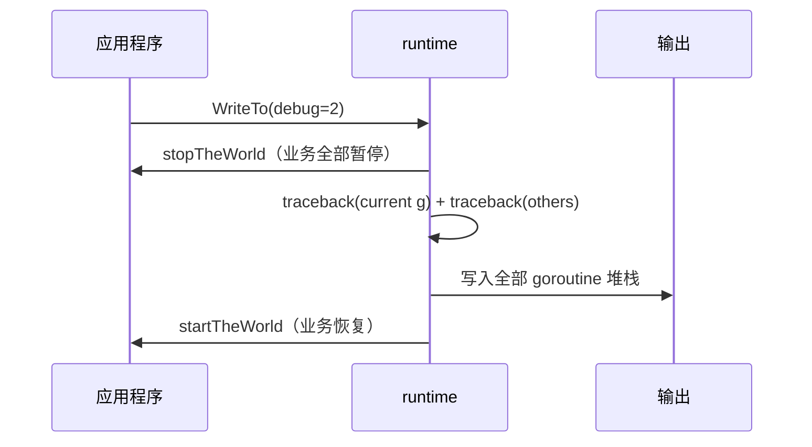
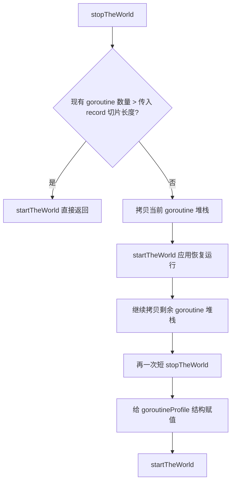
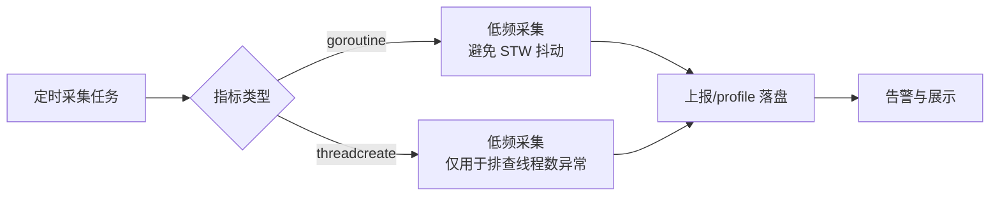

## 纲要

- goroutine profile 的入口是 `writeGoroutine`，`debug >= 2` 走「全量堆栈」路径，其余走「按标签聚合」路径
- 两条路径都需要 `stopTheWorld`，这是 goroutine profile 采集会造成性能抖动的根因
- `goroutineProfileWithLabels` 通过 `//go:linkname` 链接到 runtime 内部实现
- Go 1.21 起做了优化：先拷贝当前 goroutine 堆栈就 `startTheWorld`，剩余 goroutine 的堆栈在程序恢复运行后再拷贝
- threadcreate profile 逻辑简单：遍历全局线程链表，取每个线程创建时保存的堆栈
- 采集 goroutine profile 的成本与 goroutine 数量正相关，APM 系统里必须控制采集频率

## goroutine profile 的两条路径

从 `pprof.Lookup("goroutine").WriteTo(w,debug)` 进去，runtime 内部的 `writeGoroutine` 会先判断 `debug`：

| debug 取值 | 行为 | 性能影响 |
| --- | --- | --- |
| `>= 2` | 调用 `writeGoroutineStacks`，把应用中**所有 goroutine 的完整堆栈**打印出来 | 最大，需整体 STW 后拷贝 |
| `< 2` | 按 goroutine 标签 + 堆栈聚合，输出二进制或文本 profile | 相对小，但仍需 STW |

### debug >= 2：全量堆栈

这条路径内部调用的是 `runtime.Stack(buf,true)`。第二个参数为 `true` 意味着要采集所有 goroutine，于是 runtime 先执行 `stopTheWorld`，把整个应用的业务执行停住，再逐个拷贝堆栈：



暂停期间应用完全无法处理请求，goroutine 数量越多、堆栈越深，停顿越长。

### debug < 2：按标签聚合

普通模式在一个循环里声明两个切片——一个存 goroutine 标签、一个存堆栈记录，然后调用 `fetch` 函数把信息填充进去，最后交给 `printCountProfile` 输出成二进制或文本。

核心在 `fetch`。有意思的是，在 `pprof` 包里它只有一个声明，真正的实现在 runtime 包中，靠的是这条编译指令：

```go
//go:linkname goroutineProfileWithLabels runtime.goroutineProfileWithLabels
```

`//go:linkname` 会让 Go 编译器在链接阶段，把这个符号的实现链接到注释后面指定的函数上。这是标准库打通「对外 API」与「runtime 内部实现」的常用手法。

## 旧版本实现（以 Go 1.18 为例）

1. `stopTheWorld`
2. 拷贝当前 goroutine 的堆栈
3. `foreachG` 遍历其余 goroutine，逐个拷贝堆栈
4. `startTheWorld`

由于第 2、3 步全部在 STW 期间完成，goroutine 规模一大，一次采集就可能带来几十甚至上百毫秒的抖动。这也是为什么在 APM 系统里**不能高频采集 goroutine profile**。

## Go 1.21 的优化

新版本的实现调整了 STW 的边界：



关键变化：

- 若现有 goroutine 数量已超过调用方传入的切片容量，直接放弃拷贝并返回，避免无意义的停顿
- 只把「当前 goroutine 的堆栈」放在 STW 期间拷贝，其余 goroutine 的堆栈在应用恢复运行之后再拷
- 源码注释也明确说明：采集期间新创建的 goroutine 可能不会出现在结果里，但对分析而言，拿到采集时刻的大致堆栈就够了
- 最后再有一次极短的 STW，只为给结果结构赋值

收益是：goroutine 数量越多、堆栈越深，新版带来的延迟抖动越小。但要注意，`debug >= 2` 那条路径依旧是老实现，仍然会长时间 STW。

## threadcreate profile 的统计

线程创建的统计要简单得多，入口是 `writeThreadCreateProfile`，整体结构与 goroutine profile 类似：同样通过 `fetch` 函数拿到堆栈记录切片，再写进二进制或文本文件。

`fetch` 内部调用的是 `runtime.ThreadCreateProfile`，它做两件事：

1. 取全局线程链表（runtime 里用 `m` 表示操作系统线程，全局链表由 `allm` 及其 `alllink` 串起来）
2. 遍历链表，从每个线程的结构体里取出 `createstack` 字段——这个字段保存的正是**线程被创建时的调用堆栈**

拿到堆栈后填充进 `StackRecord`，写入 profile 文件，`go tool pprof` 就能展示「哪些函数在不停创建系统线程」。

```go
// 根据讲稿逻辑补充：等价于 runtime.ThreadCreateProfile 的采集用法
package main

import (
	"fmt"
	"os"
	"runtime"
	"runtime/pprof"
)

func main() {
	// 触发一批线程创建：阻塞在 syscall 会让 runtime 新建/复用系统线程
	done := make(chan struct{})
	for i := 0; i < 200; i++ {
		go func() {
			runtime.LockOSThread() // 绑定系统线程，容易触发新线程创建
			<-done
		}()
	}

	// 直接通过 pprof 的 Profile 对象输出
	f, _ := os.Create("threadcreate.out")
	if err := pprof.Lookup("threadcreate").WriteTo(f, 0); err != nil {
		panic(err)
	}
	f.Close()

	// 也可以用 runtime 的 API 直接取记录
	records := make([]runtime.StackRecord, 64)
	n, ok := runtime.ThreadCreateProfile(records)
	fmt.Printf("threadcreate records: %d, ok: %v\n", n, ok)

	close(done)
}
```

## 在 APM 系统中的落地注意点



- goroutine profile 的代价与 goroutine 数量成正比，建议由「指标监控」先发现数量异常，再触发 profile 采集，而不是无脑定时采
- 尽量使用 Go 1.21 及以上版本，享受新版 STW 优化
- 排查问题时再用 `debug=2` 的全量堆栈模式，日常监控用默认模式
- threadcreate 指标适合用来定位「cgo 调用过多」「`LockOSThread` 滥用」这类导致系统线程暴涨的问题

## API 速览

| API | 签名 | 说明 |
| --- | --- | --- |
| `pprof.Lookup("goroutine")` | `func Lookup(name string) *Profile` | 取 goroutine Profile |
| `(*Profile).WriteTo` | `func (p *Profile) WriteTo(w io.Writer,debug int) error` | `debug>=2` 输出全量堆栈文本 |
| `runtime.Stack` | `func Stack(buf []byte,all bool) int` | `all=true` 时采集全部 goroutine 堆栈，内部触发 STW |
| `runtime.ThreadCreateProfile` | `func ThreadCreateProfile(p []StackRecord) (n int,ok bool)` | 填充线程创建堆栈，`ok=false` 表示切片容量不足 |
| `runtime.NumGoroutine` | `func NumGoroutine() int` | 当前 goroutine 数量，适合做监控指标而非 profile |

## Demo 示例

### 运行说明

```bash
mkdir -p gprofile-demo && cd gprofile-demo
go mod init gprofile-demo
# 把示例代码保存为 main.go
go run main.go
go tool pprof -http=:8080 goroutine.out
go tool pprof -http=:8081 goroutine_debug2.txt
```

### 代码

```go
package main

import (
	"fmt"
	"os"
	"runtime"
	"runtime/pprof"
	"sync"
	"time"
)

func spawn(id int, wg *sync.WaitGroup, stop chan struct{}) {
	defer wg.Done()
	<-stop // 让 goroutine 停留在明确的等待点，堆栈可读性好
}

func main() {
	// 制造一批稳定存在的 goroutine
	var wg sync.WaitGroup
	stop := make(chan struct{})
	for i := 0; i < 2000; i++ {
		wg.Add(1)
		go spawn(i, &wg, stop)
	}

	fmt.Printf("goroutines: %d\n", runtime.NumGoroutine())

	// 1. 默认模式：按标签 + 堆栈聚合
	f, err := os.Create("goroutine.out")
	if err != nil {
		panic(err)
	}
	if err := pprof.Lookup("goroutine").WriteTo(f, 0); err != nil {
		panic(err)
	}
	f.Close()

	// 2. debug=2：全量堆栈文本（会 STW，仅排查时使用）
	f2, err := os.Create("goroutine_debug2.txt")
	if err != nil {
		panic(err)
	}
	if err := pprof.Lookup("goroutine").WriteTo(f2, 2); err != nil {
		panic(err)
	}
	f2.Close()

	// 3. 直接采集到内存切片，便于在 APM 中做自定义处理
	records := make([]runtime.StackRecord, runtime.NumGoroutine()+16)
	n, ok := runtime.GoroutineProfile(records)
	fmt.Printf("goroutine profile records: %d, ok: %v\n", n, ok)

	close(stop)
	wg.Wait()
	time.Sleep(time.Millisecond * 100)
}
```

### 代码说明

- 示例代码根据讲稿逻辑补充，用于对比两种 goroutine profile 采集方式
- 默认模式输出二进制，可直接用 `go tool pprof` 看火焰图与调用图
- `debug=2` 输出的是全量堆栈文本，会触发完整 STW，生产环境慎用
- 示例中 goroutine 数量固定为 2000，可以通过调整数量观察采集耗时的变化
- `runtime.GoroutineProfile` 传入的切片容量不足时 `ok` 为 false，需要先预留足够容量（这也是 Go 1.21 优化里那个「切片长度 vs goroutine 数量」判断的由来）

### 技术点总结

- goroutine profile 与 threadcreate profile 的采集都需要停世界，采集本身有成本
- `//go:linkname` 是标准库把对外 API 桥接到 runtime 内部实现的手段
- Go 1.21 把大部分堆栈拷贝挪出了 STW 区间，显著降低了 goroutine 数量庞大时的延迟抖动
- `debug=2` 的全量堆栈模式仍是重操作，只适合人工排查
- threadcreate 记录的是线程创建时的堆栈，用来定位系统线程数暴涨的源头
