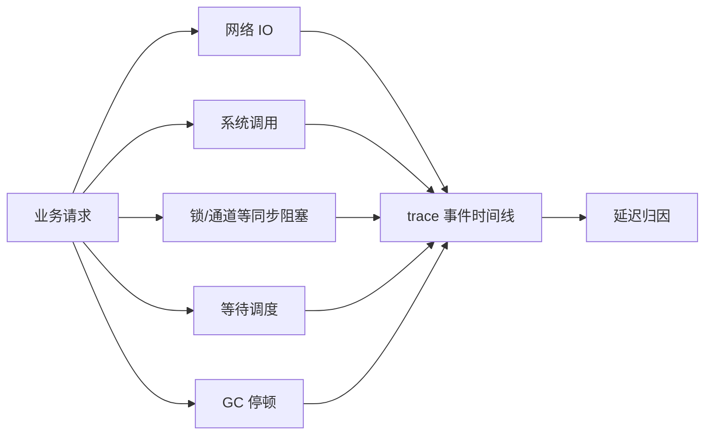
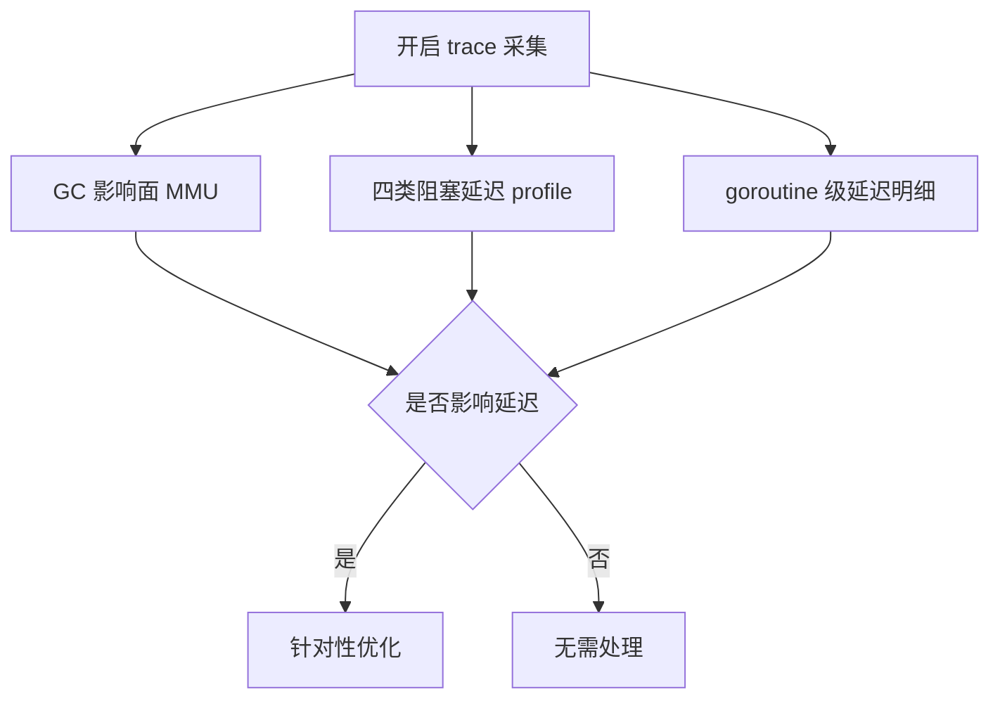

## 纲要

- pprof 回答「谁消耗了资源」，trace 回答「时间花在等什么上」——两者互补
- trace 由 runtime 在内部自动埋点，与链路追踪中业务手动埋点是同一思路，只是执行者换成了 runtime
- trace 的开销：Go 1.21 之前约 10%~20% CPU，Go 1.22 起官方声明优化到 1%~2%
- `go tool trace` 提供六大分析维度：时间线、goroutine 分析、网络阻塞、同步阻塞、系统调用阻塞、调度等待延迟
- 另可分析用户自定义任务/区域，以及 GC 对应用的影响（MMU 图）
- 落地时重点关注三件事：GC 影响面、各类延迟指标、goroutine 级别的延迟明细

## trace 是什么，解决什么问题

前面讲链路追踪时，我们是在业务代码和组件库里主动埋点，把一次请求的调用过程串起来。runtime trace 的思路也是埋点，只不过埋点的人变成了 Go runtime 自己：它在内部对调度、系统调用、网络、GC 等各类事件打点，形成一条完整的程序运行轨迹。

它和 pprof 的分工非常清晰：

| 工具 | 关注点 | 典型问题 |
| --- | --- | --- |
| pprof（cpu / heap） | 资源消耗量 | 哪个函数吃 CPU、哪段代码分配内存最多 |
| trace | 时间线上的等待 | 请求为什么变慢，慢在哪一类等待上 |

典型场景是：CPU、内存、QPS 这些指标看起来一切正常，但程序就是比平时慢。这类**延迟性问题**，指标监控和链路追踪都不太好定位，正是 trace 的主场。



## 采集方式

采集代码与 CPU profile 几乎一致，只是把 Profile 对象换成 trace：

```go
// 根据讲稿逻辑补充：在原有 CPU profile 采集代码基础上改造
package main

import (
	"os"
	"runtime/trace"
	"time"
)

func main() {
	f, err := os.Create("trace.out")
	if err != nil {
		panic(err)
	}
	defer f.Close()

	if err := trace.Start(f); err != nil {
		panic(err)
	}
	defer trace.Stop()

	// 业务代码
	time.Sleep(time.Second * 5)
}
```

生成的是二进制文件，分析命令不是 `go tool pprof` 而是：

```bash
go tool trace trace.out
```

> 也可以在应用中挂 HTTP 接口，通过 `GET /debug/pprof/trace?seconds=5` 直接下载 trace 文件（需引入 `net/http/pprof`）。

## trace 视图总览

打开后首页会列出几类分析入口：

| 视图 | 用途 |
| --- | --- |
| View trace | 时间线总览 |
| Goroutine analysis | 按创建堆栈聚合的 goroutine 分析 |
| Network blocking profile | 网络阻塞导致的延迟 |
| Synchronization blocking profile | 锁/通道等同步原语导致的延迟 |
| Syscall blocking profile | 系统调用导致的延迟 |
| Scheduler latency profile | 等待调度导致的延迟 |
| User-defined tasks / regions | 用户自定义任务与区域 |
| Minimum mutator utilization | GC 对应用的影响面 |

### 时间线视图

时间线把 trace 采集期间发生的所有事件铺在时间轴上，自上而下分成若干栏：

- **Goroutines**：某一时刻处于 `GCWaiting`、可运行（`Runnable`）、正在运行（`Running`）的 goroutine 数量
- **Heap**：已分配内存、下一次 GC 的触发阈值；图上一出现陡降，基本就是发生了一次 GC
- **Threads**：线程数量以及正在执行系统调用的线程数量
- **Procs**：GPM 模型里的处理器队列 `P`，编号 0、1、2……右侧是在该 P 上运行的 goroutine 及其运行时长

交互式操作：`w` 放大、`s` 缩小、鼠标左键拖动。

结合 GPM 模型看时间线很有意思：某个 goroutine 在 P0 上跑了一段后被切走；因为程序在打印日志而陷入系统调用，runtime 为了不让 CPU 空转，会把该 goroutine 与 P 解绑，让线程去队列里取别的 goroutine 执行；系统调用返回后，它被重新绑定到 P2 上继续跑。这类「绑来绑去」的过程，就是调度延迟的来源之一。

不过生产环境一秒钟就能产生海量事件，时间线会密到看不清。真正常用的是下面几个维度。

### goroutine 分析与四类阻塞 profile

goroutine 分析记录的是**从 trace 开始之后，创建 goroutine 的函数堆栈**。这和 pprof 的 goroutine profile 不同：后者看的是 goroutine 当前正在执行的堆栈，前者看的是「它是被谁创建出来的」。

点进某个创建堆栈后，可以看到每个 goroutine 的时间拆解：

- 执行用户代码的时间
- 等待网络 IO 的时间
- 同步阻塞时间
- 系统调用阻塞时间
- 等待调度的时间
- GC 清理与 GC 暂停时间

四类阻塞 profile 的分析方式与 pprof 完全一致（`top`、`graph`、火焰图），只是数值含义变成了「延迟时长」。定位思路是：先看哪一类延迟最高，再针对那一类深挖到具体函数。

其中**调度等待延迟**需要特别解释一下：goroutine 因为网络或系统调用阻塞后会停下来；阻塞解除时它的状态变成可运行（`Runnable`），但**并不会立刻被执行**——只有被 Go 调度器真正调度到、拿到 P 之后才开始跑。从「可运行」到「正在运行」之间的这段间隔，就是调度等待延迟。`Scheduler latency profile` 衡量的正是它。

### 用户自定义任务与区域

trace 允许用户在业务代码里标记自定义任务与区域。不过实际落地中很少这么做——要做业务维度的埋点，直接用链路追踪记录 span 即可，而且 trace 的开销摆在那里。

### MMU：GC 对应用的影响

`Minimum mutator utilization`（MMU）图反映的是 GC 对业务的影响面：

- 纵坐标：扣掉 GC 占用的 CPU 之后，应用执行自身业务逻辑所占的 CPU 比例
- 横坐标：时间窗口大小（如 10μs、100μs、1ms、1s……）

读法：

- 窗口为 10μs 时纵坐标是 0，说明这 10μs 内程序全在做 GC，业务一行代码都没跑
- 随着窗口拉大，纵坐标逐渐上升并趋于平缓，最终接近 100%，说明 GC 的影响被摊薄了，整体影响不大
- 如果曲线长期停在 0.8 左右，就意味着每秒有约 200ms 花在 GC 上；GC 期间程序会 STW 等待，这 200ms 就直接变成了请求延迟，此时必须对内存分配做优化

## 落地时关注什么



- **GC 影响面**：MMU 曲线是否长期偏低
- **延迟性统计指标**：网络、同步、系统调用、调度等待，哪一类最高
- **goroutine 分析**：最细致的一层，能看到统计期间每个 goroutine 的执行时长与各类阻塞时长

## API 速览

| API | 签名 | 说明 |
| --- | --- | --- |
| `trace.Start` | `func Start(w io.Writer) error` | 开始采集，写入给定 `io.Writer` |
| `trace.Stop` | `func Stop()` | 停止采集 |
| `trace.NewTask` | `func NewTask(ctx context.Context,taskType string) (context.Context,*Task)` | 创建自定义任务 |
| `trace.NewRegion` | `func NewRegion(ctx context.Context,regionType string) *Region` | 创建自定义区域 |
| `(*Task).End` | `func (t *Task) End()` | 结束任务 |
| `(*Region).End` | `func (r *Region) End()` | 结束区域 |

## Demo 示例

### 运行说明

```bash
mkdir -p trace-demo && cd trace-demo
go mod init trace-demo
go run main.go          # 生成 trace.out
go tool trace trace.out # 浏览器打开分析页面
```

### 代码

```go
package main

import (
	"context"
	"fmt"
	"net/http"
	_ "net/http/pprof"
	"os"
	"runtime/trace"
	"sync"
	"time"
)

// 制造锁竞争，用于观察 Synchronization blocking profile
func syncBlock(ctx context.Context) {
	var mu sync.Mutex
	var wg sync.WaitGroup
	for i := 0; i < 4; i++ {
		wg.Add(1)
		go func() {
			defer wg.Done()
			for j := 0; j < 500; j++ {
				mu.Lock()
				time.Sleep(200 * time.Microsecond)
				mu.Unlock()
			}
		}()
	}
	wg.Wait()
}

// 制造大量分配，用于观察 Heap 曲线与 MMU
func gcPressure() {
	for i := 0; i < 20; i++ {
		buf := make([]byte, 8*1024*1024)
		_ = buf
		time.Sleep(50 * time.Millisecond)
	}
}

func main() {
	f, err := os.Create("trace.out")
	if err != nil {
		panic(err)
	}
	defer f.Close()

	if err := trace.Start(f); err != nil {
		panic(err)
	}
	defer trace.Stop()

	// 同时暴露 HTTP 接口，便于用 /debug/pprof/trace 远程拉取
	go func() {
		fmt.Println(http.ListenAndServe("127.0.0.1:6060", nil))
	}()

	// 自定义任务与区域
	ctx, task := trace.NewTask(context.Background(), "demoTask")
	region := trace.NewRegion(ctx, "syncBlockRegion")
	syncBlock(ctx)
	region.End()

	region2 := trace.NewRegion(ctx, "gcPressureRegion")
	gcPressure()
	region2.End()
	task.End()

	time.Sleep(time.Second)
}
```

### 代码说明

- 代码根据讲稿逻辑补充，覆盖了 trace 的几类典型延迟来源
- `trace.Start` / `trace.Stop` 之间即为采集区间，建议控制在 5~30 秒，太长会让文件与分析页面都难以处理
- 引入 `net/http/pprof` 后，可用 `curl -o t.out 'http://127.0.0.1:6060/debug/pprof/trace?seconds=10'` 远程拉取 trace
- `syncBlock` 产生锁竞争，可在 `Synchronization blocking profile` 中看到
- `gcPressure` 持续分配大块内存，可在时间线的 Heap 曲线与 MMU 图中看到 GC 影响
- 自定义任务/区域在 `User-defined tasks` 中查看；业务埋点建议优先用链路追踪

### 技术点总结

- trace 用于分析延迟，pprof 用于分析资源消耗，二者定位不同的问题
- Go 1.22 起 trace 开销降到 1%~2%，更早版本在生产环境需谨慎开启
- 调度等待延迟是「可运行但未被调度」的时间，容易被忽视
- goroutine 分析记录的是创建堆栈，与 pprof 的当前堆栈语义不同
- MMU 图是判断 GC 是否影响业务延迟的直接依据
