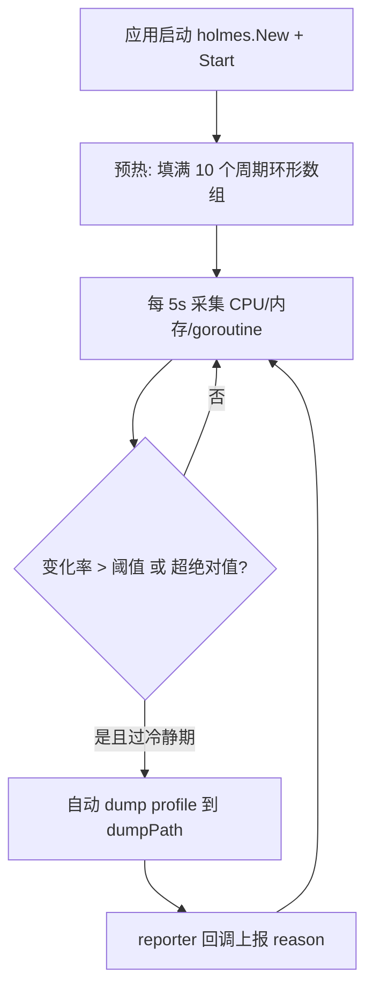

## 纲要

- 手动 pprof 的痛点：需显式命令或点 HTTP 接口生成 profile，深夜无人值守宕机时往往已丢失现场
- holmes 的定位：持续监测 CPU / 内存 / goroutine 的变化率，超过阈值自动 dump profile 到本地，保留问题现场
- 三步接入：`holmes.New(...)` 配置 → 开启要采集的指标 → `Start()` 启动后台监测
- 核心配置项：采集间隔（如 5s）、保存目录 dumpPath、二进制格式、reporter（每次触发回调，便于接告警）、变化率 min / max / 倍数、冷静期 cooldown
- 内存 / 协程的特殊保护：goroutine 有 `max` 上限（如 10 万）防止 STW 打挂服务；memLimit 可改内存基线（默认按主机内存百分比）
- 预热机制 warmingUpCycle：启动后先填充 10 个周期再算变化率，避免初始均值为 0 误触发

## 正文

### 为什么需要自动化 pprof

前面已经把 pprof 的玩法讲得比较完整了——无论是通过命令生成 profile，还是通过 HTTP 接口点击查看。但二者在生产环境都不够完美：你都得「显式」去触发。

设想一个场景：线上的 Go 服务在半夜突然宕机，原因可能是 CPU 飙高、内存暴涨等。要定位根因，我们需要的是「出问题时是哪段代码在吃资源」。可如果宕机之前没人手动去生成 profile，问题现场就永远丢失了，事后只能干瞪眼。

holmes 这个库就是为这种「无人值守」场景准备的：它持续监测 CPU / 内存 / goroutine 的**变化率**，一旦变化率过大，就自动把对应指标的 profile 二进制文件生成到本地。等我们事后分析时，就能用当时的 profile 还原现场、精准定位到函数。

### holmes 的接入方式

引入 holmes 后，通过 `holmes.New` 创建一个实例，开启要采集的指标（CPU / goroutine / memory），最后调用 `Start` 即可。此后整个应用就进入了「自动检测对应指标变化率」的状态——一旦触发阈值，自动把对应指标的 profile 落盘。

### 关键配置：变化率、阈值与冷静期

`holmes.New` 时传入的配置项大致如下（以 CPU 为例）：

1. **采集频率**：例如 5 秒一次。holmes 内部用定时器周期性采集 CPU / 内存 / goroutine 等资源。
2. **dumpPath**：profile 二进制文件生成到哪个目录。
3. **格式**：这里选二进制文件（也可选文本，但二进制方便用 `go tool pprof` 看火焰图）。
4. **profileReporter**：报告者对象。每次自动生成一次 profile，都会通过这个 reporter 把信息（含触发原因）暴露给业务层——后续接告警时，就能把「触发了 CPU / 内存变化率告警」及时推给开发。
5. **CPU 变化率配置**：holmes 看的是「一段时间内的变化率」，且支持配置最小值与最大值。
 - **倍数**（如 2 倍）：从 1 涨到 2，达到变化率要求。
 - **min 值**：CPU 使用率比 min 还低时，再怎么变化也不告警（比如 2% 的 CPU 太低，没意义）。
 - **max 值**：CPU 大于整机某比例（如 80%）时，不管变化率多少都告警——此时程序已处于危险状态，应当立刻 dump profile。
6. **冷静期（cooldown）**：采样是 5 秒一次，采完立刻分析变化率；但并不是每次达标都生成 profile。冷静期保证「本次生成时刻」与「上次生成时刻」至少间隔 1 分钟，避免频繁 dump 浪费采样成本。

与之相关的 `diff`（变化率）变量，是把「前一段时间的均值」与「当前值」做比较。holmes 会把采集到的 profile 信息存进一个**环形数组**，最终取数组里所有元素的平均值，再与当前采集值比较。讲稿里的「25」即表示「当前值是之前值的 125%」时才自动生成。

### goroutine 与内存的特别保护

memory dump / goroutine dump 的配置项与 CPU 类似，前面几项都是变化率相关。但有两处差异值得注意：

- **goroutine dump 的 max**：它会限制 goroutine 数量，达到阈值（如 10 万）后，即使变化率达标也**不再**自动 dump。原因是 goroutine dump 成本很高——它需要 stop the world 来阻塞程序；若 goroutine 数量已经很大，强行 dump 可能让程序雪上加霜直接宕机。这个 max 选项就是保证应用在「安全范围」内做 dump。
- **memLimit（内存基值）**：默认情况下内存看的是「占主机内存的百分比」（如配置 10 表示主机内存的 10% 作为基线，ABS 最大值配 50 表示主机内存的 50%）。一旦设置了 `memLimit`，基线就不再按主机内存算，而是按你配置的内存大小算。例如配置内存基值 10MB、ABS 上限 50（即 5MB），应用内存超过 5MB 就会自动 dump。

讲稿里的例子：程序不断往 buffer 字节数组里分配 1MB 内存，运行后因为配置的内存上限就是 5MB，超过之后 holmes 便自动生成内存 profile。

### 运行效果：自动 dump 并报告 reason

holmes 启动后有一个 **warmingUpCycle（预热周期）**：程序刚启动时不会立刻算变化率，而是先采集 10 个周期的数据（每 5 秒一次，共 50 秒）把环形数组填满。这样不至于一开始数组均值为 0，导致变化率瞬间超标误触发。

预热完成后，当内存超过 5MB 时程序自动 dump。关闭程序后，能看到 reporter 打印的信息——尤其是 `reason` 字段，会说明生成内存 profile 的原因：「当前内存已大于内存最大绝对值（5MB）」。debug 日志也会提示内存 dump 正处于 1 分钟冷静期。在 TMP 目录下能找到自动生成的 profile 文件（虽以 `.log` 后缀，实际是可被 `go tool pprof` 分析的二进制），用它即可还原现场。

```go
// 根据讲稿逻辑补充（holmes 公开 API 以官方仓库 github.com/mosn/holmes 为准）
package main

import (
	"time"

	"github.com/mosn/holmes"
)

func main() {
	h, _ := holmes.New(
		holmes.WithCollectInterval("5s"),        // 采集频率
		holmes.WithDumpPath("/tmp"),             // profile 保存目录
		holmes.WithCPU(10, 80, 25, time.Minute), // min%, max%, 变化率(25=>1.25倍), 冷静期
		holmes.WithMem(10, 50, 25, time.Minute), // 默认按主机内存百分比
		holmes.WithGoroutine(100, 100*1000, 25, time.Minute), // max 限制防止 STW 打挂
		// 每次自动 dump 时通过 reporter 回调，便于接告警
		holmes.WithProfileReporter(myReporter{}),
	)
	h.Start()

	// 业务主逻辑：持续分配内存以触发阈值
	buf := make([][]byte, 0)
	for {
		buf = append(buf, make([]byte, 1<<20)) // 每次 1MB
		time.Sleep(time.Second)
	}
}

type myReporter struct{}

func (myReporter) Report(p holmes.ProfileType, reason string, buf []byte) {
	// reason 例：当前内存已大于最大绝对值；可在此推送告警
	println("holmes dump:", p.String(), "reason:", reason)
}
```



## 技术点总结

- holmes 解决「无人值守时丢失问题现场」：监测变化率，超阈值自动 dump profile
- 接入三步走：`New` 配置 → 开启指标 → `Start` 启动后台监测
- CPU 配置含倍数（变化率）、min（过低不报）、max（过高必报）、冷静期（避免频繁 dump）
- goroutine dump 有 max 上限，防止 STW 把服务打挂；memLimit 可改内存基线
- 预热周期先填满环形数组再算变化率，避免初始均值为 0 误触发
- reporter 在每次 dump 时回调，是后续接入告警的钩子
