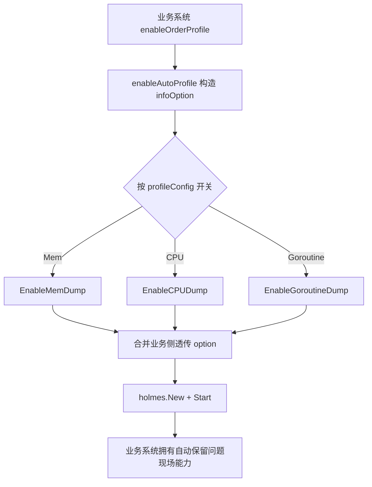

## 纲要

- 目标：让 dogAPM 框架具备「自动保留问题现场」的能力，且是否开启由业务系统按需决定
- 开关外部化：用结构体承载各 profile 指标（CPU / 内存 / goroutine）的 bool 开关，由业务系统传入
- 选项透传：业务系统可额外传入 holmes 的 option（如 memoryLimit），初始化时一并注入
- 函数选项卡（Option 模式）：`enableAutoProfile` 返回 `infoOption` 函数类型，框架的 `info` 方法接收，后续加配置不改业务代码
- 自定义 reporter：把触发信息以 error 级别打印，便于后续接入告警
- 用法示例：orderservice 调用 `enableOrderProfile`，开启三项指标监测

## 正文

### 为什么在框架层接入

前面我们已经能在单个程序里用 holmes 做自动化 pprof 了。但现在目标是把它沉淀进 dogAPM 框架，让框架下的所有业务系统都能「开箱即用地保留问题现场」。

holmes 的方法调用本身和前面的 demo 类似，但有两点不同：第一，是否开启内存 / CPU 这类监测功能，需要**从外部**、也就是从业务系统传进来，由业务方自己决定要不要开；第二，业务系统还能额外传入 holmes 的 option 配置。

### 开关与 option 透传

框架侧定义一个结构体，里面用若干 bool 字段表示各 profile 指标是否开启（true 即开启，来自外部参数）。同时支持业务系统传入一批 holmes 相关的 option，框架会把这些 option 作为 holmes 实例的配置一起初始化。

例如业务系统开启了「内存监测」，框架就调用对应的 `enableMemProfile`；最后统一调用 holmes 实例的 `Start` 方法，启动整个程序的 profile 性能指标监测与采集。

整个 `enableAutoProfile` 函数会返回一个 `infoOption` 函数类型——这是为了和 dogAPM 既有的「函数选项卡」风格保持一致：应用程序最终通过 `info` 方法，传入 `infoOption` 类型的函数开启自动化 pprof 监测。

### 函数选项卡模式的好处

这种「返回 `infoOption` 函数类型、由 `info` 方法接收」的设计，正是函数选项卡（Functional Options）模式。它的好处是：**后续想加任何额外的 holmes 配置，都只需在调用处多传一个 option，业务代码本身一行都不用改**。

实际上 holmes 自己的 `New` 方法也是这种模式——传入的每一个 `WithXxx` 都是 option。框架只是在它外面再包了一层 `infoOption`，把「开启哪些指标」「用哪些配置」的选择权交还给业务系统。

### orderservice 接入示例

以 orderservice 为例：如果它需要开启自动化 pprof 采集，就调用 `enableOrderProfile`，并传入属性——比如把 CPU / 内存 / goroutine 三项指标全部开启，这样完整的自动化监测就拉起来了。

如果后续还想做额外的 holmes 配置（比如传一个 `memoryLimit` 限制内存基线大小），只需要在调用处再追加一个 option，框架在初始化 holmes 实例时会一并透传进去。reporter 也由框架自定义：把收到的触发信息以 error 形式打印出来，给后续告警留好钩子。

```go
// 根据讲稿逻辑补充：框架层用 Option 模式把 holmes 能力挂到业务系统上
// （holmes 公开 API 以官方仓库 github.com/mosn/holmes 为准）
package main

import "github.com/mosn/holmes"

// profileConfig 由业务系统传入，决定是否开启各指标的自动监测
type profileConfig struct {
	EnableCPU      bool
	EnableMem      bool
	EnableGoroutine bool
}

// infoOption 是 dogAPM 既有的函数选项卡类型
type infoOption func(*appContext)

type appContext struct {
	holmes *holmes.Holmes
}

// enableAutoProfile 返回 infoOption：按开关开启对应指标，并透传业务侧额外 option
func enableAutoProfile(cfg profileConfig, opts ...holmes.Option) infoOption {
	return func(c *appContext) {
		options := []holmes.Option{
			holmes.WithCollectInterval("5s"),
			holmes.WithDumpPath("/tmp"),
		}
		if cfg.EnableMem {
			options = append(options, holmes.EnableMemDump())
		}
		if cfg.EnableCPU {
			options = append(options, holmes.EnableCPUDump())
		}
		if cfg.EnableGoroutine {
			options = append(options, holmes.EnableGoroutineDump())
		}
		options = append(options, opts...) // 透传业务侧额外 option，如 memoryLimit

		h, _ := holmes.New(options...)
		h.Start()
		c.holmes = h
	}
}

// enableOrderProfile 是 orderservice 的接入点：开启三项指标监测
func enableOrderProfile(c *appContext) {
	enableAutoProfile(
		profileConfig{EnableCPU: true, EnableMem: true, EnableGoroutine: true},
		holmes.WithMemoryLimit(10<<20), // 把内存基线改为 10MB
	)(c)
}

func main() {
	ctx := &appContext{}
	// 业务系统只需一行，即可开启自动化 pprof，且后续加配置不改这里
	enableOrderProfile(ctx)
	// ... 业务主逻辑 ...
	select {}
}
```



## 技术点总结

- 框架层接入 holmes 的目标：让业务系统「按需 + 开箱即用」地保留问题现场
- 监测开关外部化：用结构体 bool 字段由业务系统控制是否开启各指标
- option 透传：业务侧额外配置（如 memoryLimit）在初始化 holmes 时一并注入
- 函数选项卡模式：`enableAutoProfile` 返回 `infoOption`，`info` 方法接收，新增配置不改业务代码
- 自定义 reporter 以 error 级别打印触发信息，为后续告警留钩子
- orderservice 只需调用 `enableOrderProfile` 并传入开关即可接入
