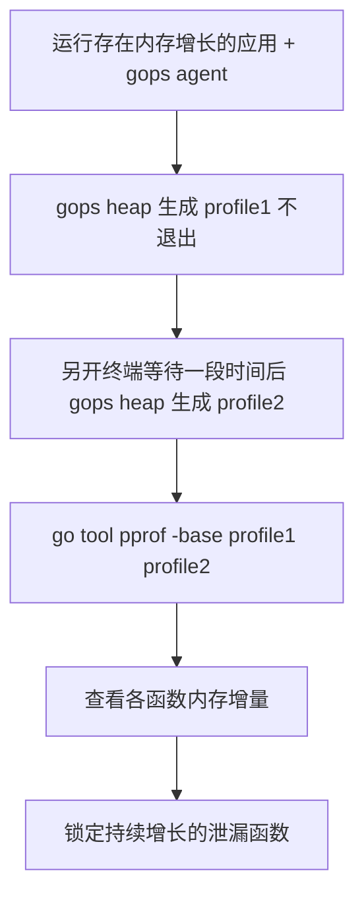

## 纲要

- 误区：占用内存多的函数不一定泄漏，可能只是临时需要、之后会被回收
- 正确思路：对比两个时间点的 profile，看「这段时间内内存仍在增长」的函数——泄漏函数会持续不释放
- pprof 的 `base` 参数：以第一个 profile 为基准，第二个文件内存减去第一个文件内存，得到各函数增量
- 百分比口径：`base` 用两者差值绝对值之和作基数；`diffbase` 用第一个 profile 的内存总量作基数
- 实操流程：用 gops 生成两份 profile（注意退出终端会删除临时文件，需另开终端再生成一份），再用 `go tool pprof -http` 配合 `base` 对比
- 可推广：同样方法比较 goroutine / thread profile，定位协程泄漏

## 正文

### 内存多 ≠ 内存泄漏

前面讲过用 `go tool pprof` 看哪个函数占用内存最多。但这里有个容易踩的坑：**分配内存多的函数，并不一定存在内存泄漏**。

有可能这个函数当时确实需要那么多内存，而这部分内存在之后能被正常回收。要判断内存泄漏，关键不是「它现在占了多少」，而是「过完一段时间后，它分配的内存是不是越来越多、且收不回去」——泄漏一定是因为函数逻辑里存在内存不释放的问题，导致时间越长、堆积越多。

### base 对比法：找持续增长的栈

科学一点的做法是：**比较两个时间点的 profile 文件，找出这段时间内内存仍在增加的函数**，然后重点看这些「增量函数」即可。

pprof 提供了一个 `base` 参数选项，专门用来比较两个 profile 之间的差值。用法是以第一个 profile 作为基准（base），第二个文件统计到的内存会**减去**第一个文件统计到的内存，从而得到每个函数在两个时间点之间的净变化。

### base 与 diffbase 的百分比口径差异

讲稿里用 `allocm`（runtime 创建系统线程的函数，讲稿误写作 `alockm` / `alookm`）举了个例子：程序不断往 buffer 里分配内存，先后生成两份 profile 做对比。

用 `base` 对比时：第二个文件比第一个文件增加了 87MB，但同一区间里也有部分减少了 44MB。此时：

- **`base` 口径**：百分比基数 = 所有差值绝对值之和 = `87 + 44 = 131`，于是 `42 / 131 ≈ 32%`。它能清晰反映出「这段时间内哪个函数内存变化最大」。
- **`diffbase` 口径**：不用差值绝对值之和，而是用**第一个 profile 的内存总量**作为基数。如果第一个 profile 里 `allocm` 当时采集到约 46MB，新增约 42MB，那么 `42 / 46 ≈ 94%`。

两种口径都能看出每个函数经历过一段时间后内存如何变化，只是分母不同——选哪个取决于你想强调「相对总增量的占比」还是「相对初始基线的占比」。无论哪种，都有助于快速锁定内存泄漏的函数。

### 完整实操步骤

结合前面的 gops，完整流程如下：

1. 运行应用（复用之前的内存分析代码，不断往 buffer 里追加 1MB 数据）。
2. 用 `gops heap <pid>` 生成**第一份** profile。注意：如果此时退出 `go tool pprof` 交互终端，它会自动删除临时 profile 文件，所以先**不要退出**。
3. 另开一个终端，等程序再运行一段时间，再用 `gops heap <pid>` 生成**第二份** profile。
4. 用 `go tool pprof -http` 配合 `-base` 选项对比两份文件，第二个文件减去第一个文件，即可看到哪个函数在持续增加内存。

类似地，这套「对比两时间点 profile」的方法也适用于 goroutine / thread profile，用来定位协程泄漏。

```go
// 根据讲稿逻辑补充：模拟内存只增不减的泄漏，便于用 base 对比定位
// （gops 公开 API 以官方仓库 github.com/google/gops 为准）
package main

import (
	"time"

	"github.com/google/gops/agent"
)

var leak [][]byte

func main() {
	_ = agent.Listen(agent.Options{}) // 启用 gops，便于终端生成 profile

	go func() {
		for {
			// 每次分配 1MB 且从不释放 -> 内存持续增长
			leak = append(leak, make([]byte, 1<<20))
			time.Sleep(time.Second)
		}
	}()
	select {}
}
```

```bash
# 终端 1：生成第一份 profile（保持交互终端不退出）
gops heap <pid>

# 终端 2：等程序再运行一段时间，生成第二份 profile
gops heap <pid>

# 用 base 对比：第二个文件减去第一个文件，定位持续增长的栈
go tool pprof -http=:8080 -base profile1.pprof profile2.pprof
# 想用第一个 profile 的内存总量作基数时，改用 -diffbase
go tool pprof -http=:8080 -diffbase profile1.pprof profile2.pprof
```



## 技术点总结

- 「占用内存多」不等于泄漏；泄漏的特征是「时间越长、分配越多且不释放」
- 排查正解：对比两个时间点的 profile，聚焦内存仍在增长的函数
- `base`：第二份减第一份，百分比基数 = 差值绝对值之和
- `diffbase`：百分比基数 = 第一份 profile 的内存总量；二者分母不同、结论互补
- 实操注意：gops 退出交互终端会删临时文件，需另开终端再生成第二份
- 同样方法可推广到 goroutine / thread profile，定位协程泄漏
