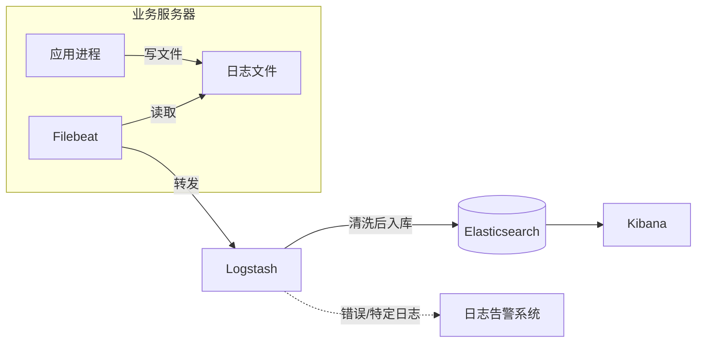

## 纲要

- 架构主线：服务器部署 Filebeat → 发送日志到 Logstash → Logstash 过滤清洗 → 入库 ES 或转发日志告警
- Filebeat 角色：驻留在每台服务器，负责把本地日志文件采集并转发，自身不做复杂处理
- Logstash 角色：日志的「质检车间」，对原始日志做过滤、字段抽取、格式转换
- Elasticsearch 角色：日志存储与检索底座，支持按任意字段搜索
- Kibana 角色：查询与可视化入口，消费 ES 里的日志
- 记住整条链路是后续所有实战的骨架

## 素材索引



## 一条贯穿全章的架构线

动手搭建之前，先把整条日志收集链路记牢。它长这样：

1. **业务服务器**上跑着我们的应用，应用把日志写到本地文件；
2. 同一台机器上部署 **Filebeat** 进程，它盯着日志目录，把新增内容读取出来并转发；
3. 日志被送到 **Logstash**，在这里做过滤和清洗——比如把一整段 JSON 文本拆成可独立检索的字段；
4. 清洗后的日志一条路进 **Elasticsearch** 存储，另一条路可按规则发给**日志告警系统**（错误日志即时告警）；
5. 存入 ES 的日志，最终通过 **Kibana** 检索、查看、分析。

本章后续所有的配置与代码，都是在这条主线上做填充。理解它，后面每一步才知道「自己在哪一层、为什么这么配」。

## 各组件职责边界

- **Filebeat 尽量轻**：它只负责「读文件 + 转发」，不负责解析。把重活留给 Logstash，是为了不让采集进程拖慢业务应用。生产上 Filebeat 和业务同机部署，因此必须限制它的资源占用。
- **Logstash 做脏活**：字段抽取、格式归一化、按条件路由（哪些进 ES、哪些进告警），都在这层完成。
- **ES 只管存和查**：日志以文档形式落库，每个字段自动建索引，所以后续能按 `uid`、`level`、`app`、`hostname` 任意组合检索。
- **Kibana 不碰数据管道**：它只是 ES 的查询界面，负责把检索结果展示出来。

## 用 Go 串起管道概念

下面用一段极简的 Go 代码把「采集 → 清洗 → 存储」的职责划分表达出来（根据讲稿逻辑补充，仅示意分层，不依赖外部组件）：

```go
// pipeline/pipeline.go —— 根据讲稿逻辑补充（示意分层，非生产代码）
package main

import (
	"encoding/json"
	"fmt"
)

// RawLog 是应用写出的原始日志行
type RawLog struct {
	Message string `json:"message"`
}

// Collector 对应 Filebeat：只负责把原始日志吐出来
func Collector(raw <-chan RawLog) <-chan RawLog {
	out := make(chan RawLog)
	go func() {
		for r := range raw {
			out <- r // Filebeat 不做处理，原样转发
		}
	}()
	return out
}

// Washer 对应 Logstash：从 message 里抽出结构化字段
func Washer(in <-chan RawLog) <-chan map[string]interface{} {
	out := make(chan map[string]interface{})
	go func() {
		for r := range in {
			var doc map[string]interface{}
			_ = json.Unmarshal([]byte(r.Message), &doc) // 解析 JSON 文本
			doc["level"] = doc["level"]                  // 抽出 level 等可被检索的字段
			out <- doc
		}
	}()
	return out
}

// Storage 对应 Elasticsearch：落库
func Storage(in <-chan map[string]interface{}) {
	for doc := range in {
		fmt.Printf("stored: %v\n", doc) // 实际写入 ES
	}
}

func main() {
	raw := make(chan RawLog, 1)
	raw <- RawLog{Message: `{"level":"error","uid":0,"app":"order"}`}
	close(raw)
	Storage(Washer(Collector(raw)))
}
```

这段代码的边界划分与真实架构一致：Collector（Filebeat）不做解析，Washer（Logstash）抽字段，Storage（ES）落库。

## 技术点总结

- 日志收集四段式：采集（Filebeat）→ 清洗（Logstash）→ 存储（ES）→ 展示（Kibana）
- Filebeat 保持轻量，只转发不解析；解析重活交给 Logstash
- 清洗后的字段才能被 ES 检索，这是「日志可查」的关键
- 整条链路是全章实战的骨架，先记架构再动手
