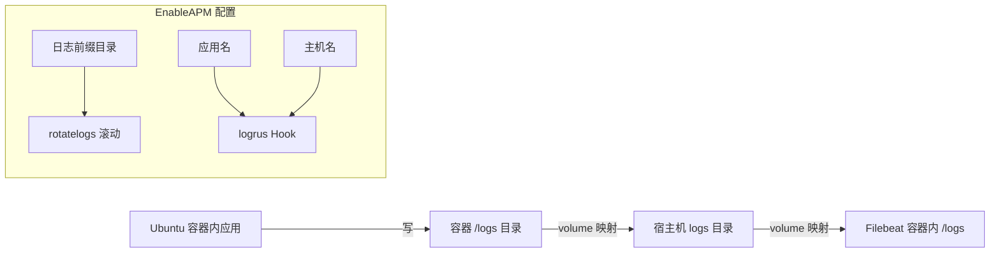

## 纲要

- 改造目标：把 dogAPM 的日志输出从「控制台」改为「文件」，为后续 Filebeat 采集做准备
- 容器卷映射：Ubuntu 容器内日志目录通过 volume 映射到宿主机，Filebeat 再映射宿主机目录到自己容器内
- 配置入口：在 `EnableAPM` 方法上新增「日志前缀目录」「最大文件数」等参数
- 文件滚动：用 `file-rotatelogs`（rotatelogs）按 `%Y%m%d` 命名、每 24 小时滚动、限定保留文件数
- 全局维度：用 logrus 的 Hook 给每条日志自动附加 `host` 与 `app` 两个字段，便于后续按维度检索

## 素材索引



## 为什么要从控制台改文件

之前我们的服务跑在 Ubuntu 容器里，日志直接打到控制台。现在要接入日志收集，第一步就是让日志落到**文件**：这样 Filebeat 才能去读文件。

但容器间文件系统是隔离的，Filebeat 读不到别的容器内部的文件。解决办法是**卷映射（volume）两级跳**：

1. 把 Ubuntu 容器内的日志目录（如 `/logs`）映射到宿主机目录；
2. Filebeat 容器再把宿主机的这个目录映射到自己内部的 `/logs`。

于是 Filebeat 实际读的是「自己容器内 /logs」，经由两层映射，等价于读到了应用容器产生的日志文件。

## 改造 EnableAPM 配置

日志输出方式归 APM 统一管理，所以在 `EnableAPM` 方法上加参数：

- **日志前缀目录**：由业务端传入；
- **应用名称**：拼接在前缀后，区分不同应用（获取应用名的方法之前已封装好）；
- **最大文件数**：日志不能无限占盘，超过就按过期策略清理。

## 用 rotatelogs 做文件滚动

日志输出对象从 logrus 默认的 stdout 改为一个文件 writer。这里用 `github.com/lestrrat-go/file-rotatelogs`（讲稿读作 rotatelogs）实现滚动：

- 用 `%Y%m%d` 模板，日志文件按当天日期命名；
- 设定每 24 小时生成一个新文件；
- 限定保留的文件数量（如只保留最近两天的日志）；
- 创建 writer 失败直接 `panic`——这是基础设施配置，失败不该静默继续。

随后把 `orderservice` 等三个服务的路径改成根目录 `/logs`，重新编译、丢进 build 目录、重启 docker-compose 所有容器，发请求即可在宿主机 `logs` 目录看到日志文件生成。

## 给每条日志加全局维度

文件里的日志目前缺「应用名」和「主机名」，对后续收集检索不利。用 logrus 的 **Hook** 机制，给每条日志自动注入这两个维度字段：

```go
// dogapm/log_hook.go —— 根据讲稿逻辑补充（自包含可运行，go get github.com/sirupsen/logrus github.com/lestrrat-go/file-rotatelogs）
package main

import (
	"os"
	"path/filepath"
	"time"

	"github.com/lestrrat-go/file-rotatelogs"
	"github.com/sirupsen/logrus"
)

// dimHook 给每条日志附加 host 与 app 两个维度
type dimHook struct {
	host string
	app  string
}

func (h *dimHook) Levels() []logrus.Level { return logrus.AllLevels }
func (h *dimHook) Fire(e *logrus.Entry) error {
	e.Data["host"] = h.host
	e.Data["app"] = h.app
	return nil
}

func main() {
	// 1) 文件滚动 writer：按天切割，保留 2 份
	rl, err := rotatelogs.New(
		filepath.Join("/logs", "app-%Y%m%d.log"),
		rotatelogs.WithLinkName("/logs/app.log"),
		rotatelogs.WithMaxAge(2*24*time.Hour),
		rotatelogs.WithRotationTime(24*time.Hour),
	)
	if err != nil {
		panic(err)
	}

	log := logrus.New()
	log.SetOutput(rl)                 // 输出从 stdout 改为文件
	log.SetFormatter(&logrus.JSONFormatter{})
	log.AddHook(&dimHook{host: os.Getenv("HOSTNAME"), app: "order"}) // 注入维度

	log.WithField("uid", 0).Error("invalid order id") // 每条日志都带 host/app
}
```

运行后，每条日志都会带上 `host`、`app` 字段，形如：

```json
{"level":"error","app":"order","host":"node-1","uid":0,"time":"...","msg":"invalid order id"}
```

这正是后续 Logstash 抽取字段、ES 建索引所需的「干净结构化日志」。

## 模拟环境与生产的差异

注意本实战用容器模拟了「生产多台服务器」：生产上每台宿主机各自跑一个 Filebeat 收整台机的日志；这里只是把容器内日志目录映射到宿主机，Filebeat 再映射宿主机目录到自己内部——本质是 Filebeat 收的是「自己容器内」目录下的日志。理解这层关系，避免把映射链路搞混。

## 技术点总结

- 日志落文件是接入 Filebeat 的前提，靠「容器 → 宿主机 → Filebeat 容器」两级 volume 映射打通
- `EnableAPM` 新增日志前缀目录、最大文件数等参数
- rotatelogs 按 `%Y%m%d` 滚动、限文件数，失败即 panic
- logrus Hook 给每条日志自动加 `host`/`app` 维度，是结构化日志的关键一步
