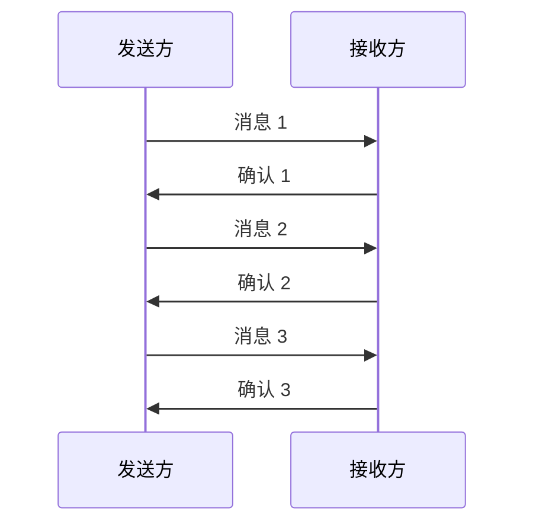
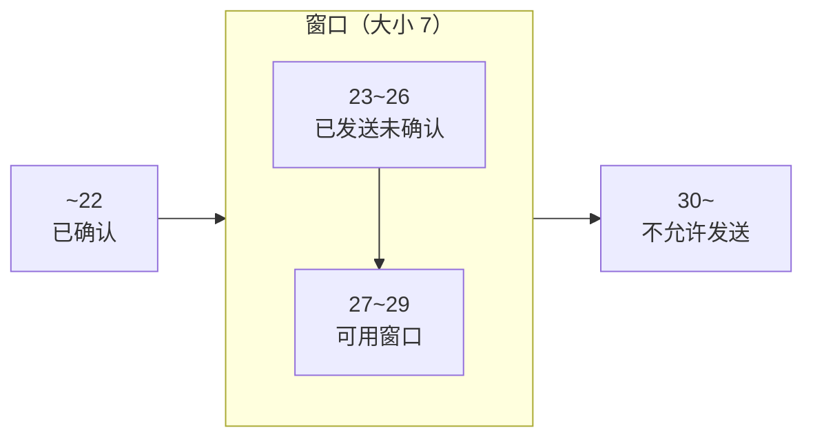
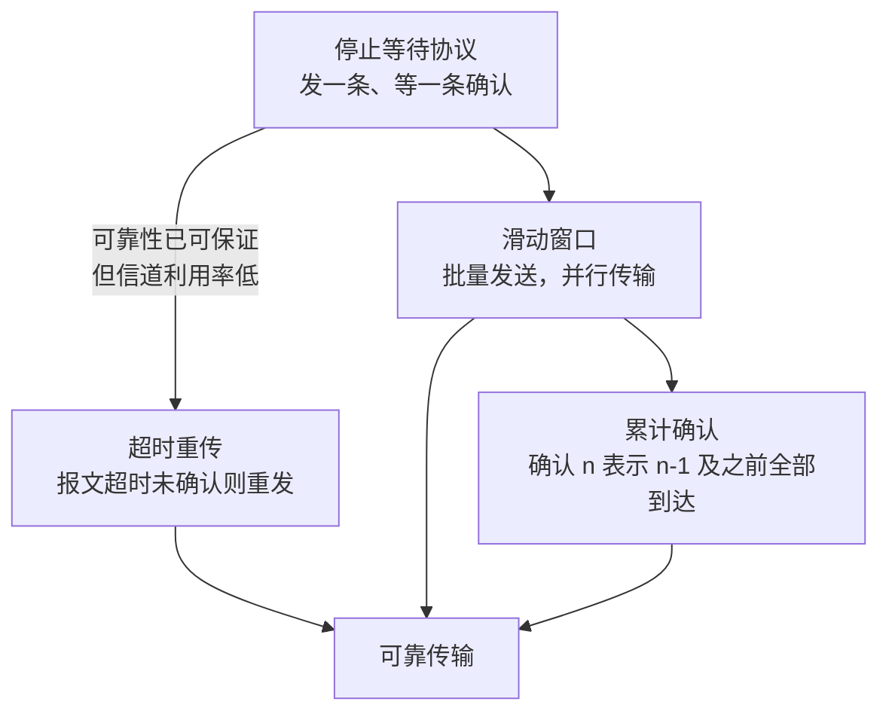

## 纲要

- 可靠传输的起点：停止等待协议与超时重传
- 停止等待协议的瓶颈：信道利用率太低
- 滑动窗口：批量发送、批量确认，把串行改并行
- 累计确认：只对最后收到的字节做确认
- 窗口的三段划分：已确认、已发送未确认、可用窗口
- 窗口耗尽时的表现，以及窗口如何持续向前滑动

## 从停止等待协议说起

TCP 提供的是面向连接的可靠传输服务。要理解"可靠"是怎么实现的，可以先思考一个问题：如果让你设计一个保证可靠的协议，你会怎么做？

最简单的方案是**停止等待协议**：

每发一条消息，必须等到对方的确认，才能发下一条。这个协议在无差错的情况下确实能保证数据可靠到达。

再看异常情况：

- **消息丢失**：消息 1 在传输途中丢了，发送方迟迟收不到确认 1
- **确认丢失**：消息 1 到达了，但确认 1 丢了，发送方同样收不到确认

两种情况下发送方的处理是一致的：**超时重传**。发送方为每个已发送但未确认的报文启动定时器，超时未收到确认就重新发送该报文。这个机制对发送方与接收方都适用。

有了停止等待协议 + 超时重传，可靠性已经可以保证了。但问题在于**信道利用率太低**：一来一回的确认是严格的串行交互，发送方大量时间花在等待上，链路大部分时间是空闲的。

于是有了自然的优化思路：既然单条发送、单条确认效率低，能不能**批量发送、批量确认**？这正是滑动窗口要解决的问题。

## 窗口与滑动窗口

先回顾窗口字段：它占 TCP 首部 2 个字节，取值范围 0 ~ 65535，指明**允许对方发送的数据量大小**，解决的是缓冲区有限、不能无限缓存数据的问题。

滑动窗口用一个具体例子最容易理解。假设双方要传输 1 ~ 12 共 12 个字节的数据，窗口大小为 6：

- 初始状态下，1、2 两个字节已收到确认，窗口可以向前滑动
- 发送方继续发送 3 ~ 8 共 6 个字节的数据（窗口大小决定了一次可发多少）
- 当 3、4、5 被确认后，窗口再次向前滑动，可以发送 6 ~ 11

在这个过程中，对每一个字节都单独发一个确认显然没有必要。于是引入**累计确认**：

> 不需要对每个字节分别确认，只确认最后收到的那个字节即可。确认 5 号字节，就表示 5 号及之前的所有数据都已正确收到。

累计确认大幅减少了确认报文的数量，减轻了双方的负担。滑动窗口 + 累计确认共同构成 TCP 可靠传输的性能基石。

## 窗口的内部划分

窗口并不是一个整体，它内部有不同的状态。看一个更复杂的例子：窗口大小为 7，22 号及之前的字节已确认。

| 区域 | 字节范围 | 状态 |
| --- | --- | --- |
| 窗口之前 | ~ 22 | 已发送且已确认 |
| 窗口内前段 | 23 ~ 26 | 已发送、未确认（占用窗口） |
| 窗口内后段 | 27 ~ 29 | 可用窗口（可立即发送） |
| 窗口之后 | 30 ~ | 不允许发送 |

由此得到几个关键结论：

- **可用窗口 ≠ 窗口大小**。上例中窗口大小为 7，但 23 ~ 26 已发出未确认，真正可用的只有 27 ~ 29 这 3 个字节
- **窗口能否前滑取决于确认**。当 23、24 被累计确认后，窗口向前滑动 2 个字节，覆盖到 30、31，可用窗口扩大为 5 个字节
- **最极端的情况是窗口内全部处于"已发送未确认"**。此时不允许继续发送数据，窗口也不能滑动，**可用窗口为 0**——发送方必须停下来等待确认

## 窗口为什么会一直滑动下去

TCP 是面向字节流的协议，数据像水流一样持续产生、持续确认。正是因为数据在不断发送、不断被确认，窗口才能持续地向前滑动。

这也是滑动窗口的设计精髓：**在有限的缓冲资源下，通过"发送—确认—滑动"的循环，支撑起近乎无限的数据流**。头部中的序列号、确认号与窗口三个字段配合，用两个字节的窗口值撬动了任意长度的字节流传输。

## 回到可靠传输的完整图景

三个机制的分工：

- **停止等待协议**：可靠传输的基础模型
- **超时重传**：兜住异常情况的可靠性
- **滑动窗口 + 累计确认**：在不牺牲可靠性的前提下，把信道的利用率提上来

## 面试答题要点

- 回答"TCP 如何保证可靠传输"时，按层次说：基础是停止等待协议，异常靠超时重传兜底，效率靠滑动窗口与累计确认提升
- 滑动窗口的回答要点：窗口是 TCP 首部中指明"允许对方发送的数据量"的字段；窗口随确认不断前滑，使得有限缓冲区可以承载持续的字节流
- 一定要提到累计确认：确认号 n 表示 n-1 及之前的所有字节都已正确收到
- 加分点：区分"窗口大小"与"可用窗口"——已发送未确认的部分会占用窗口，全部占用时可用窗口为 0，发送暂停
