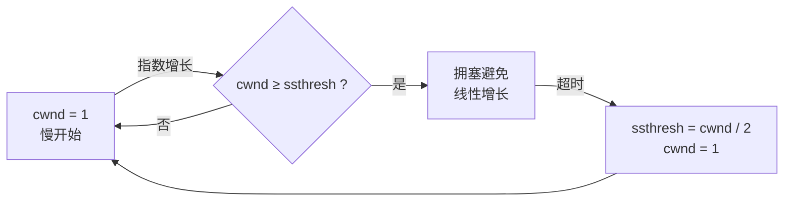
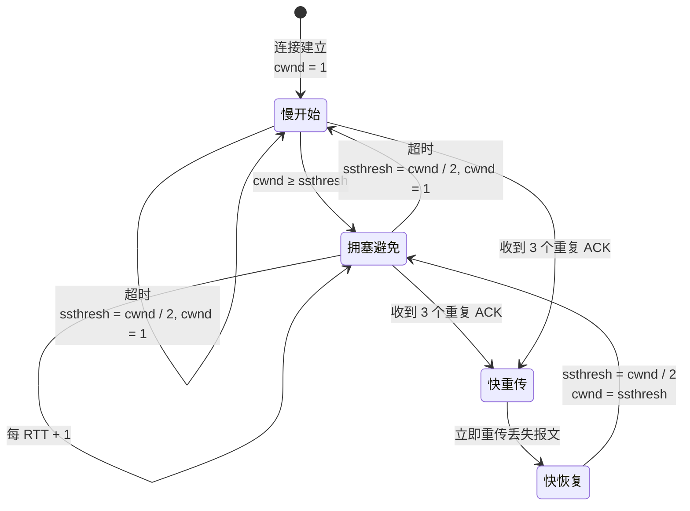

## 纲要

- 网络拥塞的定义：对带宽、缓存、处理机等资源的需求超过可用部分，是一个**全局性**问题而非单点问题
- 拥塞控制的目标：防止过多数据注入网络，避免路由器与链路设备过载
- 三个前置概念：拥塞窗口（cwnd）、慢开始门限（ssthresh）、传输轮次（RTT）
- 四大算法
    - 慢开始（Slow Start）：cwnd 按指数规律增长
    - 拥塞避免（Congestion Avoidance）：cwnd 按线性规律增长
    - 快重传（Fast Retransmit）：收到三个重复 ACK 立即重传，不等超时
    - 快恢复（Fast Recovery）：跳过慢开始，直接从新门限执行拥塞避免
- 超时与重复 ACK 两种拥塞信号的处理分支完全不同

## 什么是网络拥塞

网络拥塞指的是：网络中的某一类资源——带宽、缓存（路由器/交换机的队列）、处理机（转发芯片的算力）等——**需求超过了该资源可提供的可用部分**，从而导致网络性能变坏的现象。

需要特别强调两点：

- 这里的"资源"不只是带宽。家用网络拓扑里有终端、路由器、网关、地区 ISP；企业网络拓扑里有更多层级的路由器与网关。链路上的**任意一台设备**都可能因为资源不足而成为拥塞点。
- 一条数据从源到目的往往要跨越多跳设备，因此拥塞往往是多因素叠加的结果。**拥塞控制是一个站在全局角度思考的问题，不是单点问题。**

## 拥塞与吞吐量的关系

用"负载—吞吐量"坐标来描述拥塞控制的价值：

| 曲线 | 表现 |
| --- | --- |
| 理想拥塞控制 | 进入重度拥塞前，负载与吞吐量保持线性增长；之后吞吐量不再明显提升，但保持稳定 |
| 实际拥塞控制 | 到达阈值后增长放缓，曲线比理想情况更平缓，吞吐量略有损失但可接受 |
| 无拥塞控制 | 到达阈值后吞吐量**直线下降**，网络中的大量设备无法正常工作 |

结论：没有拥塞控制，网络会越过"膝点"进入崩溃区——大量重传、队列溢出、有效吞吐反而更低。

## 三个核心概念

在理解算法之前，先明确三个变量：

- **拥塞窗口 cwnd（Congestion Window）**：发送方维持的一个状态变量，可动态变化。发送方实际的发送窗口取「拥塞窗口」与「接收方通告窗口」中的较小值，因此 cwnd 直接决定了发送方一次能注入多少数据。
- **慢开始门限 ssthresh**：拥塞窗口超过该阈值时，从慢开始切换到拥塞避免。它是两种算法的**转折点**。
- **传输轮次与 RTT**：一次报文发送并收到确认的过程，称为一次传输轮次；一个轮次的往返时间即 RTT（Round-Trip Time）。cwnd 的增长是以轮次为单位计算的。

## 慢开始与拥塞避免

### 慢开始

连接刚建立时拥塞窗口 cwnd = 1（一个 MSS），随后按**指数规律**增长。

以发送方与接收方的一次交互为例：

- 第 1 轮：发送 1 个报文，收到 1 个确认 → cwnd = 2
- 第 2 轮：发送 2 个报文，收到 2 个确认 → cwnd = 4
- 第 3 轮：发送 4 个报文，收到 4 个确认 → cwnd = 8

窗口值呈 1 → 2 → 4 → 8 的翻倍趋势。之所以叫"慢开始"，是因为起点极低（cwnd=1），尽管增长速度其实是指数级的。

### 拥塞避免

当 cwnd ≥ ssthresh 时，进入拥塞避免阶段，窗口改为**线性增长**：每个 RTT 只增加 1 个 MSS，即 cwnd += 1（严格说是 cwnd += 1/cwnd 每收到一个 ACK）。

举例：ssthresh = 16。

- 第 0~4 轮：cwnd 从 1 涨到 16，属于慢开始
- 第 4~12 轮：cwnd 从 16 线性涨到 24，属于拥塞避免

### 发生超时

一旦出现超时（重传计时器溢出），说明网络很可能真的拥塞了，处理非常激进：

- 新的 ssthresh = 超时时的 cwnd / 2（例中 cwnd = 24，故新 ssthresh = 12）
- 新的 cwnd = 1，重新执行慢开始

## 快重传与快恢复

超时重传的代价太大：发送方要一直等到重传计时器超时才反应，期间网络基本处于空转。快重传 + 快恢复就是为了解决"**个别报文丢失被误判成网络拥塞**"的问题。

### 快重传

流程如下（以报文 M3 丢失为例）：

- 发送方依次发出 M1、M2、M3、M4……
- M3 在网络中丢失，接收方只收到 M1、M2，之后收到的 M4、M5 都属于"失序报文"
- 接收方**立即**回送对 M2 的重复确认（共 3 次），而不是等自己发数据时再捎带确认
- 发送方一旦收到**三个重复 ACK**，立刻判定 M3 丢失并重传，无需等待超时

这里的关键点是「立即确认」而非「捎带确认」。确认号位于 TCP 首部，接收方在有数据要发送时可以顺带确认前面的数据（捎带确认）；快重传要求的是立刻发出一个**纯确认报文**，让发送方尽早感知。

### 快恢复

快重传之后不回到慢开始，而是直接进入拥塞避免：

- 新的 ssthresh = 当前 cwnd / 2（例中从 16 降为 8）
- 新的 cwnd = 新的 ssthresh（而不是 1）
- 从该点开始执行拥塞避免

因为省掉了从 cwnd = 1 重新爬升的慢开始过程，传输速率不会大幅跌落，这就是"快恢复"的由来。

## 完整状态流转

把四个算法串成一张图：

两条分支的运算规则对比：

| 触发条件 | 新 ssthresh | 新 cwnd | 下一步 |
| --- | --- | --- | --- |
| 超时（重传计时器溢出） | cwnd / 2 | 1 | 慢开始 |
| 3 个重复 ACK | cwnd / 2 | ssthresh（= cwnd / 2） | 拥塞避免 |

记忆要点：**超时是重罚（回到 1），重复 ACK 是轻罚（降到一半直接线性增长）。**

## 面试回答思路

被问到"请介绍常见的 TCP 拥塞避免算法"时，不要只背四个名词，建议按数据传输的实际流程串起来讲：

- 先定义拥塞，并点明它是全局问题
- 引出 cwnd、ssthresh、RTT 三个变量
- 讲慢开始的指数增长与拥塞避免的线性增长，以及 ssthresh 作为转折点
- 讲超时后的重置规则（新门限减半、窗口回到 1）
- 补上快重传（三个重复 ACK + 立即确认）与快恢复（跳过慢开始、窗口直接等于新门限）
- 最后用「超时重罚 / 重复 ACK 轻罚」收尾
