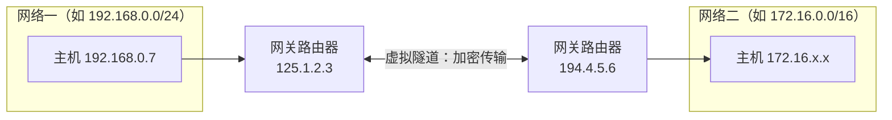

## 纲要

- VPN 的产生背景：跨地域机构的安全通信需求
- 虚拟隧道：在公共网络上虚拟出一条专用通道
- 专用 IP 地址（内网地址）的三类地址块与不可路由特性
- NAT 技术：内网地址与公网地址的转换
- 隧道数据的加密与三类典型隧道协议
- VPN 工作在 OSI 模型的网络层

## VPN 的产生背景

很多机构并不需要把全部计算机都直接暴露在公共网络上，同时机构成员跨地域通信又有强加密、强安全的需求。这两点诉求催生了 VPN（Virtual Private Network，虚拟专用网）。

典型场景：

- **企业内网**：一家公司在广州、杭州等多个园区办公，园区之间需要互通，但不希望数据在公网传输时有泄露风险
- **校园网**：校园网内可以免费下载论文等授权资源，这些资源仅限校园网用户访问；学生离校后需要先接入学校提供的 VPN，才能继续访问
- **工业专用网**：对安全性与隔离性要求更高的专用网络

## 虚拟隧道

VPN 要解决的问题可以抽象成这样一张图：网络一与网络二处在不同地域（例如一个在广东、一个在其他城市），它们需要通信，但中间的公共网络环境复杂且不可信。VPN 的做法是在两者之间建立一条**虚拟隧道**，让外部看来它们之间仿佛有一条专用的物理线路。

要点在于：这条隧道**真实并不存在**，它是通过技术手段虚拟出来的。隧道两端对外的网关路由器持有全球唯一的公网 IP（如上图的 125.1.2.3 与 194.4.5.6），而网络内部则使用专用地址。

## 专用 IP 地址

专用 IP 地址即日常所说的**内网地址**，指只能用于机构内部通信的 IP 地址。接入互联网的主机必须拥有全球唯一的 IP 地址，而专用地址不满足唯一性，因此：

- 专用地址**不能**作为全球地址接入互联网
- 路由器对目的地址为专用地址的数据报**一律不转发**
- 专用地址只能在本地网络内部使用

RFC 1918 定义了三类专用地址块：

| 类别 | 地址范围 |
| --- | --- |
| A 类 | 10.0.0.0 ~ 10.255.255.255 |
| B 类 | 172.16.0.0 ~ 172.31.255.255 |
| C 类 | 192.168.0.0 ~ 192.168.255.255 |

C 类地址在生活中最常见：家庭路由器对外有一个公网 IP，家里的电脑、手机、电视拿到的都是 192.168.x.x 的内网地址。

## NAT 与隧道中的数据流转

专用地址与 VPN 的关系通过一个完整的数据流来看最清楚：

- 网络一内部的主机使用内网 IP（如 192.168.0.7）通信
- 数据发往网络二时，先到达本网络的网关路由器
- 网关路由器做一次地址转换，把**内网 IP 替换为公网 IP**
- 替换后的数据经虚拟隧道在公网传输
- 到达对端网关路由器后，再做一次反向转换，把公网 IP 替换回对端的**内网 IP**
- 数据最终交付到目标主机

这个地址转换的技术就是 **NAT（Network Address Translation，网络地址转换）**。反向传输也是同样的过程：内网地址经 NAT 换成公网地址 → 公网传输 → 对端 NAT 换回内网地址。

隧道中的数据还有额外一层处理：既然建立隧道的目的是安全，那么隧道上传输的 IP 数据报的**数据部分会先加密再传输**，即使被截获也无法还原内容。

## 典型隧道协议

| 协议 | 特点 |
| --- | --- |
| IPSec | 增强 VPN 安全性的标准协议，包含用户身份认证与查验、数据完整性校验，并提供数据加密、数字签名等技术 |
| PPTP | 封装 PPP 数据包的标准信息，支持隧道交换与隧道传输 |
| L2TP | 支持多路隧道的安全协议 |

三者的共同点是都包含**身份验证过程**——这一点与 HTTPS 有相似之处，区别在于 VPN 工作在网络层，直接作用于 IP 报文这一层。

## VPN 的定位

把 VPN 放回协议栈来看：它工作在 **OSI 七层模型中的网络层**，在 IP 报文这一层完成封装、加密与地址转换。理解这一点，就能理解为什么 VPN 一旦建立，上层的所有应用流量（HTTP、数据库连接等）都能自动走这条安全通道——因为它对上层是透明的。

## 面试答题要点

- 什么是 VPN：在公共网络上通过技术手段虚拟出一条专用隧道，为跨地域的机构成员提供安全通信
- 回答原理时分四点：虚拟隧道、专用 IP 地址、NAT 地址转换、隧道数据的加密
- 专用地址要能说出三类：10.0.0.0/8、172.16.0.0/12、192.168.0.0/16，并说明路由器不转发目的地址为专用地址的数据报
- 隧道协议举出 IPSec、PPTP、L2TP，说明它们都有身份验证过程
- 加分点：指出 VPN 工作在 OSI 模型的网络层，因此上层应用无需感知
