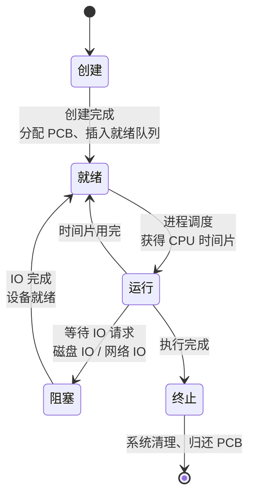

## 纲要

- 进程五状态模型：创建、就绪、运行、阻塞、终止
- 状态迁移的触发条件：进程调度、时间片用完、IO 请求、IO 完成、创建完成、执行结束
- 创建态要分配 PCB 并插入就绪队列；终止态要归还资源与 PCB
- `fork()` 是用户进程创建子进程的系统调用入口
- 两对易混概念
    - 阻塞 / 非阻塞：强调**程序在等待调用结果时的状态**
    - 同步 / 异步：强调**消息通知机制**
- 同步对应阻塞、异步对应非阻塞，但两组概念分属不同维度

## 进程五状态模型

一个进程从生到死，可以划分为五个状态：

| 状态 | 含义 |
| --- | --- |
| 创建（New） | 进程正在被创建，已拥有 PCB，但其他资源尚未就绪 |
| 就绪（Ready） | 除 CPU 外的所有必要资源都已分配到位，一旦获得 CPU 使用权即可立即执行 |
| 运行（Running） | 已获得 CPU 资源，程序正在执行 |
| 阻塞（Blocked） | 因某些资源未就绪（磁盘、网卡等）而无法继续执行，主动放弃 CPU |
| 终止（Terminated） | 进程结束，由系统清理并归还资源与 PCB |

需要注意的细节：

- **就绪态就是"只差 CPU"的状态**，随时可被调度执行。
- 在单处理机（单核 CPU）环境中，**任一时刻只能有一个进程处于运行态**。
- 阻塞态的进程会主动放弃 CPU，把 CPU 让给其他就绪进程，这本身是一种提高利用率的设计。

### 状态迁移

### 创建态与终止态的细节

**创建态**时操作系统要做大量准备工作：

- 分配 PCB（进程控制块）
- 初始化进程标识符、优先级、上下文等字段
- 将进程插入就绪队列

创建进程的不只是操作系统本身，用户进程也可以创建——通过操作系统提供的 `fork()` 函数。

**终止态**时操作系统要做清理工作：

- 清理进程占用的各类资源并归还给操作系统
- 归还 PCB

## 阻塞与非阻塞

用一个 IO 调用过程来对比。

**阻塞**：调用发出后，从调用到返回之间有一段"准备（prepare）"时间。磁盘、网卡这类外设的读写速度远不及 CPU，进程在这段时间里什么都不做，被挂起、切换出 CPU，直到数据返回才继续执行。

**非阻塞**：调用发出后立即 return。进程不等数据，转而去执行别的工作；等到 IO 真正完成后，由设备通知进程"数据已 ready"，进程才切换回来读取数据。整个过程中进程**始终没有暂停运行**。

两者的本质区别：

| 维度 | 阻塞调用 | 非阻塞调用 |
| --- | --- | --- |
| 等待期间进程状态 | 被挂起，切换出 CPU | 继续运行，不暂停 |
| 返回时机 | 得到结果后才返回 | 立即返回，结果通过后续通知获取 |
| CPU 利用率 | 等待期 CPU 可让给其他进程 | 本进程继续占用 CPU 干别的活 |

## 同步与异步

同步与异步是对**消息通知机制**的描述，与阻塞/非阻塞不是一个维度：

- **同步**：发出调用后，在没得到结果之前，该调用**一直不返回**。一旦返回，就意味着数据已经准备好了。
- **异步**：调用发出后**立即返回**，但这个返回并不携带结果。被调用者后续通过状态、通知或回调函数，把结果交给调用者。

一个形象的例子：程序要读取一个 1G 的文件。

- 同步：调用后一直等着，直到数据读完才拿着结果继续干活
- 异步：调用后对方答"好的我知道了，现在还没准备好，等好了通知你"；一段时间后通知到达，进程再回来取数据

## 两组概念的关系

| 概念对 | 关注点 | 对应关系 |
| --- | --- | --- |
| 阻塞 / 非阻塞 | 程序在等待调用结果时的**状态** | 阻塞 → 同步；非阻塞 → 异步 |
| 同步 / 异步 | 结果的**通知机制** | 同上 |

可以这样理解：阻塞/非阻塞描述的是"我（调用方）在等待时是什么姿态"，同步/异步描述的是"结果怎么回到我手上"。常见的组合是同步阻塞（读写磁盘、读写网络的普通写法）和异步非阻塞（IO 多路复用、回调、Future/Promise）。

## 面试回答思路

面试官问"同步和异步的区别"时，单纯背定义说服力很弱，建议：

- 先画进程状态流转，说明阻塞态是怎么产生的（等待外设 → 主动放弃 CPU）
- 再对比阻塞与非阻塞的 IO 时序图，点出"等待期间进程是否暂停运行"
- 然后把同步/异步落到**通知机制**上讲：同步是"不拿到结果不返回"，异步是"先返回，后通知"
- 最后强调两组概念的分工：状态 vs 通信机制
