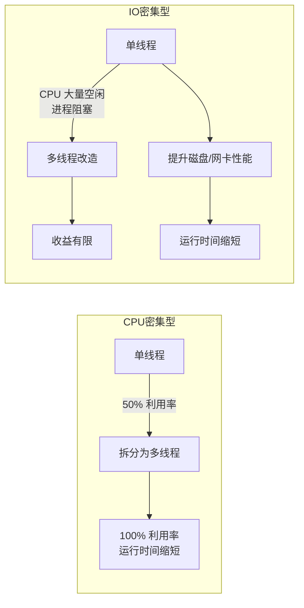

## 纲要

- CPU 密集型（CPU Bound）：完成时间取决于 CPU 运算速度，CPU 利用率高
- IO 密集型（IO Bound）：完成时间取决于 IO 设备速度，CPU 利用率低、大部分时间在等待
- 混合密集型：两者兼有，如 AI 模型训练、视频解码
- 优化方向完全不同
    - CPU 密集型 → 拆任务、上多线程、加核
    - IO 密集型 → 提升存储/网卡性能，多线程改造收益有限
- 服务器选型：按资源侧重匹配机型

## 两个典型例子

先看两个程序：

- 计算 1024000 的阶乘
- 往磁盘写入 1G 的文件

前者几乎全部时间都在做算术运算，后者几乎全部时间都在等磁盘把数据写完。它们分别代表了两种完全不同的程序运行类型。

## CPU 密集型

**CPU 密集型**（又称计算密集型，CPU Bound）：程序完成的时间主要取决于 **CPU 的运算速度**。

特征：

- 运行时 CPU 利用率很高
- 可能导致其他进程响应变慢（表现为"卡顿"）
- 对**处理器资源**要求高，对存储器等其他资源要求相对低

计算 1024000 的阶乘就是典型代表。

### 如何优化

进程运行前需要准备处理器资源、存储器资源等。CPU 密集型任务高频使用处理器资源，因此优化思路是**提高 CPU 的并行利用率**：

- 假设是双核 CPU，单进程单线程只能吃到 50% 的 CPU 利用率
- 把任务合理拆分成多个线程交给多核执行，可以充分利用 CPU 资源
- 既提升资源利用率，也减少程序的整体运行时间

## IO 密集型

**IO 密集型**（IO Bound）：任务频繁读写网络、磁盘等外围设备，完成时间主要取决于 **IO 设备的速度**。

特征：

- CPU 利用率很低
- 大部分时间都在**等待设备完成**
- 对存储器/网络设备要求高，对处理器资源要求相对低

往磁盘写入 1G 文件就是典型代表。

### 为什么多线程改造效果有限

对 IO 密集型任务做多线程改造，收益往往不明显，原因是：

- 任务大部分时间在等待 IO 设备把数据写完
- 等待期间进程处于**阻塞状态**，被挂起、并不占用 CPU
- 既然 CPU 本来就是空闲的，再加线程也无法让磁盘写得更快

因此 IO 密集型的优化方向是：**提升 IO 设备本身的性能**——磁盘 IO 就换更快的存储介质，网络 IO 就提升网卡性能。

## 常见程序的归类

| 程序 / 场景 | 类型 | 说明 |
| --- | --- | --- |
| 游戏画面渲染 | CPU 密集型 | 内含大量数学运算；画面可切分并行，实际多用 GPU 渲染 |
| 复制粘贴 | 计算密集型 | 本质是对文件内容的复制处理 |
| 图片浏览类 Web 应用 | IO 密集型 | 涉及磁盘 IO 与网络 IO |
| 网络游戏 / 运算类 Web | 计算密集型 | 取决于具体功能 |
| 图片卷积处理 | 计算密集型 | 大量矩阵运算 |
| 下载工具 | IO 密集型 | 先网络下载，再写入磁盘 |
| AI 模型训练 | 混合密集型 | 既需读写海量数据，又需大量运算 |
| 视频解码 | 混合密集型 | 需读取视频内容，也需解码运算 |

## 线上部署与机型选择

从企业角度看，面试官更希望候选人对服务部署有实际认知。三类任务对资源的要求不同：

| 任务类型 | CPU | 内存 | 磁盘 / 网卡 |
| --- | --- | --- | --- |
| 计算密集型 | 要求高 | 要求高 | 一般 |
| IO 密集型 | 要求不高 | 要求高 | 读写速度要求高 |
| 混合密集型 | 要求高 | 要求高 | 要求高 |

几种典型的线上机型与其适配场景：

| 机型配置 | 侧重 | 适配场景 |
| --- | --- | --- |
| 16 核 + 128G 内存 + SATA/SSD 存储 | 侧重存储 | IO 密集型任务部署 |
| 56 核 + 128G 内存 + SATA 磁盘 | 侧重 CPU 与内存，磁盘读写较低 | 计算密集型任务部署 |
| 72 核 + 512G 内存 + SSD | CPU、内存、磁盘性能都很高 | 混合密集型、高并发高性能部署 |

### IO 密集型任务部署的注意事项

回答"IO 密集型任务部署需要注意什么"时，抓住这条主线：

- 首先明确：这类任务完成时间取决于 **IO 设备的速度**
- 磁盘 IO 场景 → 提升外围存储设备的读写性能（换 SSD、做 RAID、优化文件系统）
- 网络 IO 场景 → 提升网卡性能（更高带宽、更好的多队列网卡）
- 不要盲目堆 CPU 核数或加线程，收益有限

## 面试回答思路

- 先举例子说明两类任务：阶乘计算 vs 写 1G 文件
- 给出定义与特征，重点对比"完成时间取决于谁"
- 讲优化路径的差异：CPU 密集型用多线程吃满多核；IO 密集型靠提升设备性能
- 结合线上机型说明选型逻辑
- 收尾点题：IO 密集型部署的核心是提高磁盘或网卡的 IO 能力
