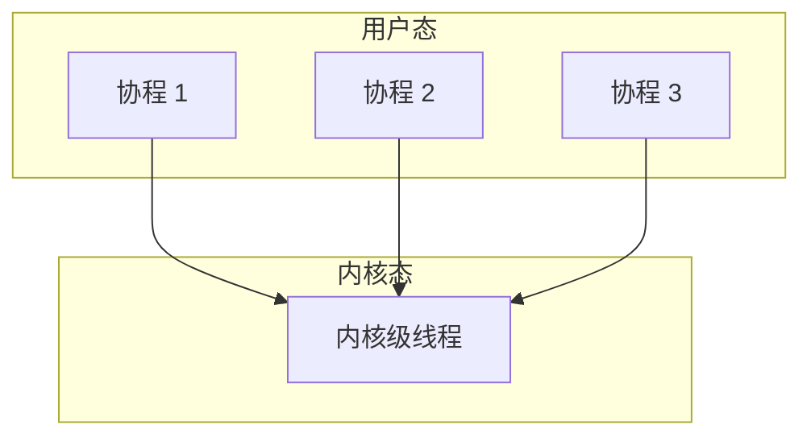
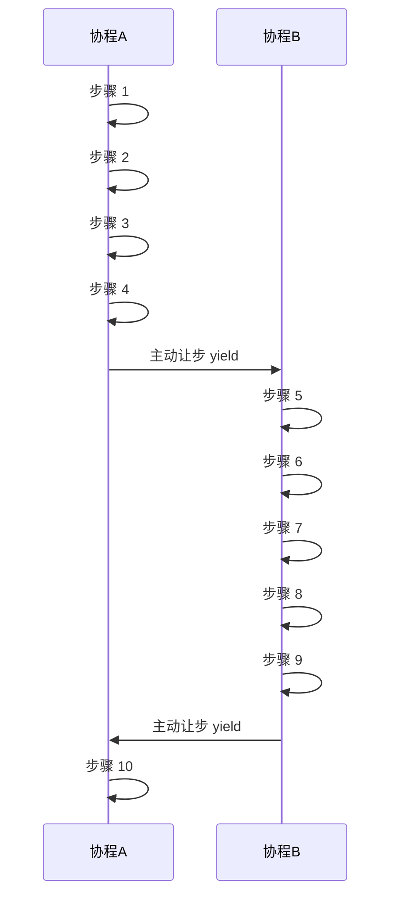

## 纲要

- 上下文与上下文切换：上下文的三级构成、切换流程、量化成本
- 协程的定义：微线程 / 协作式线程，本质是用户级线程
- 协程与线程、进程的粒度关系，以及"多对一"映射模型
- 协作式调度的运行过程：主动让步，内核无感知
- 协程的优缺点、适用与不适用场景
- 面试高频追问：协程能否发挥多核 CPU 的优势

## 上下文与上下文切换

Linux 是多任务操作系统，允许远多于 CPU 核数的任务同时"在运行"。这依赖多道程序设计与分时机制：系统在极短的时间片内把 CPU 轮流分配给各个任务，宏观上形成多任务并行的错觉，微观上任何一个时刻单核只运行一个任务。

CPU 在切换任务前，必须知道"这个任务从哪里加载、从哪里继续运行"，这份数据就是进程的上下文（Context）。上下文通常分为三部分：

| 层级 | 内容 |
| --- | --- |
| 寄存器级上下文 | 程序计数器、通用寄存器、栈指针等 |
| 任务级上下文 | 进程控制块中的调度信息、状态、优先级 |
| 系统级上下文 | 页表基址、内核栈、资源句柄等 |

一次完整的上下文切换流程如下：


关键在于：这个切换动作本身由内核完成，必然伴随**用户态到内核态的切换**，需要通过系统调用陷入内核。因此每次切换都要付出额外的时间成本。

## 上下文切换的成本量化

在一台 8 核 16G 的服务器上实测（以 `cs` 即 context switch 次数为指标）：

| 系统状态 | 每秒上下文切换次数 |
| --- | --- |
| 空闲 | 约 2000 ~ 3000 次 |
| 繁忙 | 约 43000 ~ 44000 次 |

单次上下文切换耗时在 **2 ~ 5 微秒**之间。取上限估算繁忙时的开销：

```
5μs × 44000 次 / 1000 / 8 核 ≈ 25ms
```

也就是说，系统繁忙时每个核每秒大约有 25 毫秒耗在上下文切换上。这部分时间是纯损耗，不产生任何业务价值。

再结合进程与线程来对比：

- 同一进程内的多线程切换：线程共享进程资源（地址空间、文件描述符等），切换时不需要搬移进程级资源，成本较低；
- 不同进程的线程切换：需要切换页表、刷新 TLB、搬移进程资源，成本明显更高。

无论哪一种，切换都要经过内核。要进一步压低成本，思路只剩一个：把切换动作从内核态搬回用户态。这就是协程出现的动机。

## 协程的定义与本质

协程（Coroutine）在很多资料里也叫**微线程**或**协作式线程**。其中"协作式线程"这个称呼最能体现其本质：



- 平时所说的"线程"，默认是**内核级线程**，由操作系统创建、调度和管理，内核维护其数据结构；
- 协程是**用户级线程**，由用户态程序（语言运行时或框架）自行创建与调度，内核既感知不到也无法干预。

从包含关系看：进程拥有若干线程，线程拥有若干协程，粒度依次变小；一个线程下的多个协程与该线程是**多对一**的关系。

## 为什么叫"协作式"

协程全部运行在用户态，调度由用户程序自己完成，内核不参与抢占。所谓"协作"，是指多个协程之间**主动让步**（yield），而不是被抢占式调度器抢走 CPU：



原本串行执行的程序逻辑被拆成红、绿两段，分别挂在两个协程上：协程 A 执行到某一步主动让出，协程 B 接着执行；B 执行到某一步再让回给 A。整个过程在内核看来依然是**串行**的一条执行流，因为它只看到承载它们的那一个内核级线程。

## 协程的优缺点

优点：

- 调度、切换、管理全部在用户态完成，不需要陷入内核，开销远小于线程切换；
- 协程本体极轻，创建成本低，可以支撑非常高的并发规模；
- 没有抢占，协程内的执行顺序相对可预期，临界区处理更简单。

缺点：

- 内核无法感知协程的存在。一旦某个协程出现调度问题（例如死循环、长时间不让出），内核无从干预，整个线程上的所有协程都会被拖死；
- 由于内核只能调度线程，协程本身**无法发挥多核 CPU 的优势**。单个线程上的所有协程本质上只能跑在一个核上。

要利用多核，常见做法是启动多个内核级线程（通常与核数相当），由运行时把协程分发到这些线程上，形成"多对多"模型（例如 Go 的 GMP 调度器）。但就协程本身的定义而言，"协程能发挥多核优势"这个说法是错的。

## 适用场景

协程的核心价值是**用更低的切换成本换取更高的并发接入能力**，因此最适合：

- 高并发网络 IO 接入，例如海量长连接、网关、RPC 服务端；
- 需要大量并发等待单元、但每个单元计算量很小的业务。

不太适合 CPU 密集型的纯计算任务：这类任务本身几乎不产生切换收益，反而需要多核并行，用线程或进程更合适。

## 面试回答模板

问：为什么需要协程？协程是什么？

> 协程是比线程更细粒度的执行单元，本质是用户级线程，也叫协作式线程。它的调度、切换、管理都在用户态完成，不经过内核，因此上下文切换成本远低于线程。之所以需要协程，是因为传统进程/线程切换需要陷入内核，单次开销在微秒级，系统繁忙时每秒几万次切换会吃掉可观的 CPU 时间；协程把这部分成本降到极致，从而支撑更高的并发。

问：多协程能否发挥多核 CPU 的优势？

> 不能。协程运行在用户态，内核感知不到协程，只能调度它所看到的内核级线程，因此单个线程上的多个协程只能串行地跑在一个核上。要利用多核，需要依靠运行时把协程分发到多个内核级线程上，那是调度模型的功劳，不是协程本身的能力。
