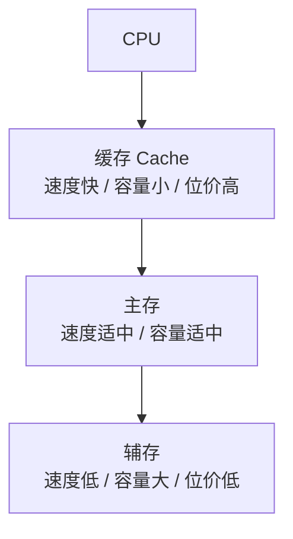

## 纲要

- 存储器的选购指标与"位价"概念
- 存储器的三级层次：缓存、主存、辅存
- 局部性原理：层次结构得以成立的前提
- 缓存—主存层次解决什么问题，主存—辅存层次解决什么问题
- 从硬件层次到软件架构：Redis / Memcached 的缓存设计同源
- 缓存的真实作用：冷热分离、降低热点负载、提升吞吐

## 从选购存储器的指标说起

组装机器时常见的存储器有内存条（DDR4）、固态硬盘、机械磁盘。挑选时通常关注三个指标：读写速度越快越好、存储容量越大越好、价格越低越好。

这三个指标可以综合成一个更有表达力的指标——**位价**，即每比特（bit）的价格。它把容量与价格合二为一，便于横向比较不同存储器的性价比。

## 存储器的层次结构

按粗略划分，存储器分为三层：

| 层次 | 代表硬件 | 速度 | 位价 |
| --- | --- | --- | --- |
| 缓存 | CPU 内部高速缓存、寄存器 | 快 | 高 |
| 主存 | 内存条 | 适中 | 适中 |
| 辅存 | 固态硬盘、机械磁盘 | 低 | 低 |

这个划分凭直觉也能做出来，但真正值得追问的是：**计算机为什么必须设计成这样分层？** 答案就是局部性原理。

## 局部性原理

局部性原理指的是：CPU 访问存储器时，无论是存取指令还是存取数据，所访问的存储单元都趋向于聚集在一个较小的连续区域中。

这是一条统计性规律，但在计算机系统中具有极强的普适性——操作系统与系统架构中大量的设计都建立在这个前提之上。正因为访问是"扎堆"的，才有必要把"热点那一小撮数据"放到更快但更小的介质里。

基于局部性原理，存储层次可以划分为两层：

### 缓存—主存层次

- 原理：局部性原理；
- 实现：在 CPU 与主存之间增加一层速度快但容量较小的 Cache，它可以集成在 CPU 内部，与运算单元放在一起；
- 目的：**解决主存速度不足的问题**。

CPU 主频可达数 GHz，而主存的读写频率要低得多，两者之间存在明显的速度鸿沟。高速缓存的存在让 CPU 尽可能从身边取数据，从而跑得更快。

### 主存—辅存层次

- 原理：同样是局部性原理；
- 实现：在主存之外增加辅助存储器，如机械磁盘、SD 卡、U 盘；
- 目的：**解决主存容量不足的问题**。

一部高清电影可能有 4~5GB，如果机器只有 4GB 内存，主存根本装不下。这时就由辅存先把数据保存起来，播放时再按需读入主存。大型游戏、高清多媒体资源同理。

两个层次的对比：

| 层次 | 解决的问题 | 实现方式 |
| --- | --- | --- |
| 缓存—主存 | 主存速度不足 | CPU 与主存之间增加高速缓存 |
| 主存—辅存 | 主存容量不足 | 主存之外增加辅助存储器 |

## 从硬件层次到软件架构

这套设计思路被完整地搬到了生产环境的系统架构中，典型代表就是 Redis、Memcached 这类缓存组件。

在后端服务里，除了 MySQL 这类持久化存储，我们会在其之上再加一层高速缓存服务。对于热点数据，优先读写缓存，再落地到数据库。

这种做法与硬件层次结构同源，作用可以归纳为三点：

- **分离冷热数据**：热点数据留在高速介质，冷数据留在低速介质；
- **降低热点数据的服务负载**：大量读请求在缓存层就被消化，数据库不必承受全部流量；
- **提升整体吞吐与并发**：响应速度变快，单位时间内能处理的请求更多，服务质量随之提升。

值得体会的是：后端架构里很多理念都能在计算机基础与操作系统设计中找到原型。这些设计经过几十年迭代沉淀下来，掌握基础知识的价值正在于此——面对新问题时，你能直接复用已被验证过的模式，而不是从头试错。

## 面试回答模板

问：请简述什么是局部性原理。

> 局部性原理是指 CPU 访问存储器时，无论是存取指令还是存取数据，所访问的存储单元都趋向于聚集在一个较小的连续区域中。它是一条统计性规律，但在系统设计中被广泛应用，存储器的层次结构、缓存的引入都建立在这个前提之上。

问：存储器分为缓存、主存和辅存，它们分别解决了什么问题？

> 缓存速度快但位价高，主存速度与位价适中，辅存速度低但位价低。缓存与主存这一层，通过在 CPU 和主存之间增加一层高速小容量的 Cache，解决的是主存速度不足的问题；主存与辅存这一层，通过在主存之外增加磁盘等辅助存储器，解决的是主存容量不足的问题。两者都基于局部性原理。

问：请简述系统设计中缓存的作用。

> 缓存的设计本质上是对局部性原理的复用。它在低速存储之上加一层高速存储，把热点数据留在高速层，冷数据留在低速层，从而分离冷热数据；大量读请求在缓存层就被消化，降低了后端存储的服务负载；响应速度提升后，整个服务的吞吐与并发能力也随之提高。这也是生产环境中广泛使用 Redis、Memcached 的原因。
