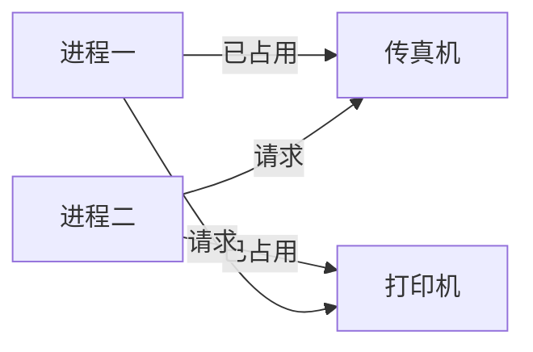
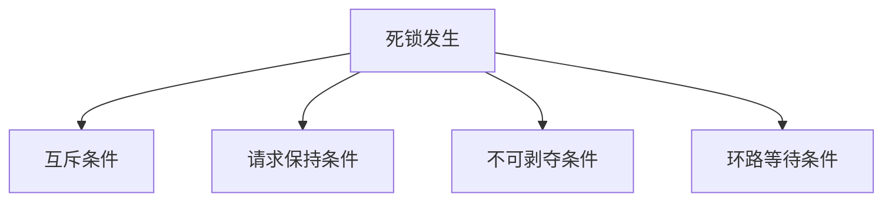
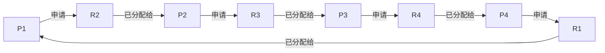

## 纲要

- 死锁的定义：两个及以上进程/线程因竞争资源或彼此通信而相互阻塞
- 死锁产生的两大原因：竞争资源、调度顺序不当
- 四个必要条件：互斥、请求保持、不可剥夺、环路等待
- 必要条件的含义：死锁发生则四者必同时满足
- 预防死锁：破坏任意一个必要条件
- 银行家算法：避免死锁的经典思路

## 什么是死锁

死锁是指两个或两个以上的进程（或线程），在执行过程中由于**竞争资源**或者由于**彼此通信**而造成的一种阻塞现象；若无外力作用，它们将无法继续推进下去，此时系统就处于死锁状态。这些永远在相互等待的进程或线程，称为死锁进程（死锁线程）。

一个生活化的例子是十字路口：四辆车分别想从西往东、南往北、东往西、北往南通过，恰好在路口互相卡住。每辆车都被前车挡住，同时也挡着别人。如果没有人主动让路、也没有交警协调（外力），四辆车就会永远僵持下去。

计算机系统严格按逻辑执行，没有人类那样的灵活处理，因此设计不当就很容易产生死锁。

## 死锁产生的两大原因

### 竞争资源

共享资源的数量不满足各个进程的需求，进程在运行中因争夺资源而导致死锁。

典型例子：进程一和进程二都需要使用传真机和打印机。

进程一占用传真机后又申请打印机，进程二占用打印机后又申请传真机。双方要的资源都被对方占着，自身又因为没有执行完成而不释放已占有的资源，于是双双进入僵持等待。

### 调度顺序不当

还是上面的例子，把四个步骤标记为 A、B、C、D。按 A→B→C→D 的顺序调度会产生死锁，但调整成 A→D→B→C：先让进程一使用传真机，再使用打印机，两者用完即释放，之后进程二就可以顺利取得打印机和传真机。

可见，同样的资源与需求，仅仅改变调度顺序就能化解死锁。因此调度顺序不当也是死锁的成因之一。

## 死锁的四个必要条件

先明确"必要条件"的含义：若 A 则 B，那么 B 是 A 的必要条件。放到死锁上就是——**如果死锁发生，下面四个条件一定同时满足**。

### 互斥条件

进程或线程对资源的使用是**排他性**的：某个资源在一段时间内只能由一个进程（或线程）占用，其他需要使用该资源的只能等待。

对应前面的例子：进程一使用传真机时，进程二无法使用，满足互斥条件。

### 请求保持条件

进程**至少保持一个资源**，同时又提出了**新的资源请求**；而新资源被其他进程占用导致请求被阻塞，被阻塞的进程**并不释放自己已保持的资源**。

对应例子：进程一保持传真机，又请求打印机，满足请求保持条件。

### 不可剥夺条件

进程获得的资源在**未使用完成之前不能被强行剥夺**，只能由进程自身在使用完毕后主动释放；其他进程或用户不能强制回收它占有的资源。这一条由操作系统来保证。

对应例子：进程一占有的传真机，进程二无法强制让它释放，满足不可剥夺条件。

### 环路等待条件

发生死锁时，必然存在一个**进程与资源之间的环形链**。例如有 P1、P2、P3、P4 四个进程，分别占有资源 R1、R2、R3、R4，而 P4 又申请 R1、P1 又申请 R2……进程与资源相互之间形成了一个环。

传真机与打印机的例子同样存在这样的环路：进程一等打印机、进程二等传真机，两者形成环。

## 如何预防死锁

理论上的结论很简洁：**破坏四个必要条件中的任意一个，即可预防死锁**。

### 摒弃请求保持条件

系统规定进程在运行之前**一次性申请全部所需资源**，运行期间不再提出新的资源请求。既然不会在运行中"保持旧资源 + 请求新资源"，请求保持条件就不成立，死锁也就不可能发生。

代价是资源利用率偏低，且需要预先知道全部需求。

### 摒弃不可剥夺条件

规定进程在请求新资源而得不到满足时，**必须释放当前占有的所有资源**。资源可以被剥夺，不可剥夺条件即被破坏，死锁得以避免。

代价是可能导致已完成的工作作废、需要重新执行。

### 破坏环路等待条件

把系统中的所有可用资源做**线性排序**，规定进程申请资源时必须按**递增顺序**申请：必须先申请序号小的，才能申请序号大的。这样进程与资源之间不可能形成环，环路等待条件被破坏。

这是工程上最常用、也最实用的一种预防手段，例如统一规定加锁顺序。

### 银行家算法

除了预防，还可以在资源分配时做**避免**：银行家算法就是典型代表。

它的理念是把申请资源的进程看作银行家的客户：客户在申请贷款时必须声明自己需要的**最大资金量**（最大资源需求）；银行家只有在满足"贷出后系统仍处于安全状态、且客户能够按时归还"的前提下才予以分配。

通过这种"先声明最大需求 + 只在安全时才分配"的约束，系统始终不会进入不安全状态，从而避免死锁。具体判定过程涉及安全序列的搜索，这里不展开。

## 面试回答模板

问：请简述什么是死锁，为什么会产生死锁？

> 死锁是两个或两个以上的进程或线程，在执行过程中由于竞争资源或彼此通信而造成的阻塞现象，若无外力作用它们都无法继续推进。产生原因主要有两类：一是竞争资源，共享资源数量不足，进程之间争夺资源形成僵持；二是调度顺序不当，同样的资源与需求，调整执行顺序就能避免死锁。

问：请谈谈你对死锁必要条件的理解。

> 必要条件的意思是"如果死锁发生，则这些条件一定成立"。死锁有四个必要条件：互斥条件，资源是排他性使用的，一段时间内只能被一个进程占用；请求保持条件，进程至少保持一个资源，又提出新的资源请求，被阻塞后仍不释放已保持的资源；不可剥夺条件，进程获得的资源在未使用完之前不能被强行剥夺，只能由自身释放；环路等待条件，必然存在进程与资源之间的环形等待链。

问：如何预防死锁？

> 破坏四个必要条件中的任意一个即可。常用做法有三种：一是摒弃请求保持条件，要求进程运行前一次性申请全部资源；二是摒弃不可剥夺条件，规定请求新资源失败时必须释放已占有的资源；三是破坏环路等待条件，把所有资源线性排序并规定按递增顺序申请。此外还可以在分配阶段用银行家算法做避免，即先声明最大需求、只在系统仍处于安全状态时才分配。
