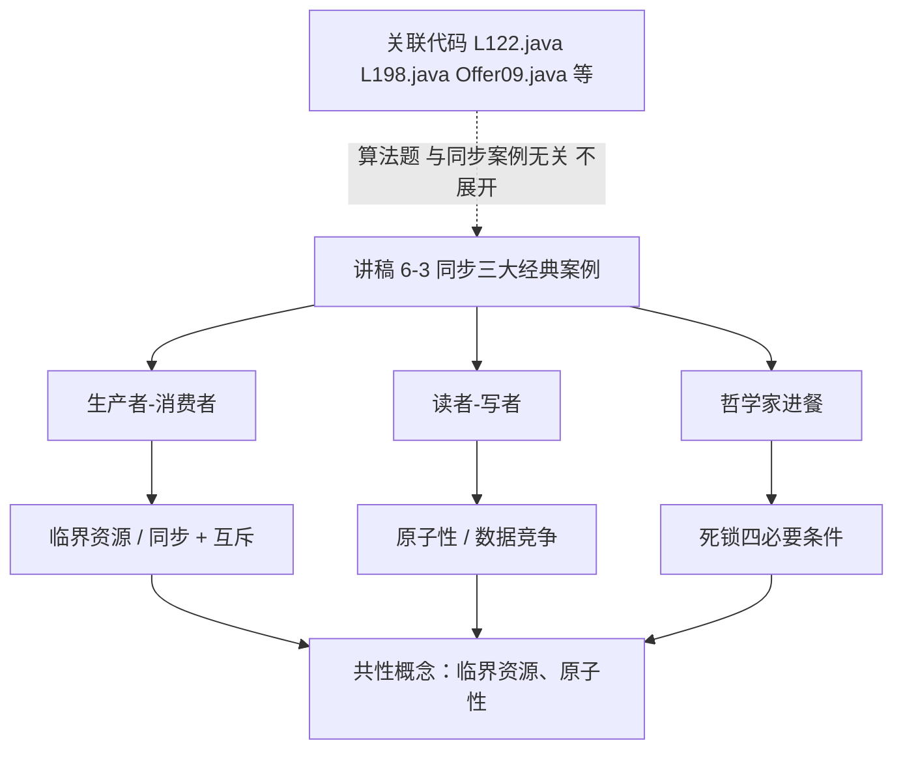
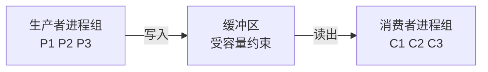
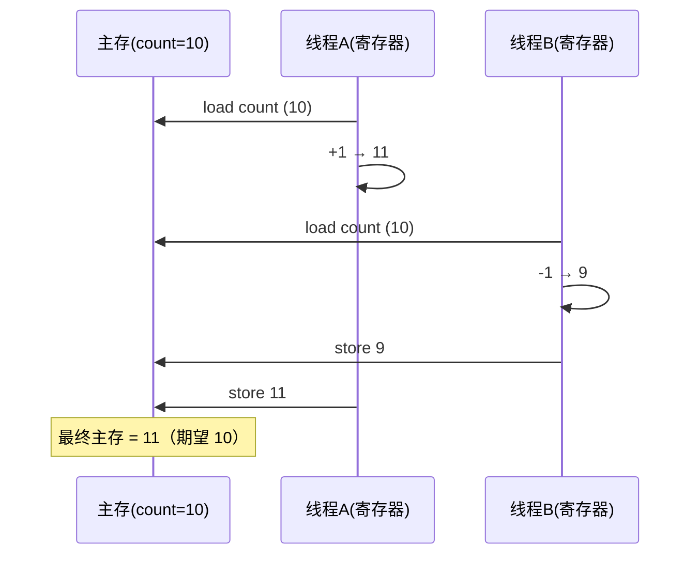
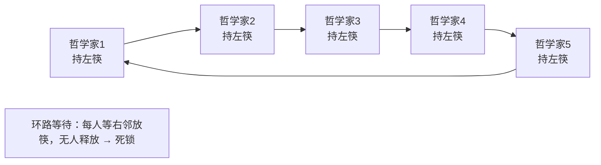

## 纲要

- 三大经典同步问题：生产者-消费者、读者-写者、哲学家进餐
- 生产者-消费者：缓冲区即临界资源，存在"缓冲区满 / 空"驱动的同步关系，以及多进程并发访问的互斥关系
- 读者-写者：读-写、多写未串行化导致数据竞争，本质是原子性缺失；工程上对应 MySQL 版本号、Redis 与数据库缓存一致性
- 哲学家进餐：请求-保持与环路等待诱发死锁，需进程 / 线程间消息通信来打破
- 共性抽象：临界资源、原子性，并与死锁四必要条件建立关联

## 素材索引

- 讲稿：`work/source/8.mksz540-后端校招面试直通车，提前锁定大厂offer[完结]/{6}--第6章计算机系统之锁、同步与通信/[6.2]--6-3线程-进程同步问题三大经典案例详解`
- 关联代码：本篇为概念解析，不嵌入代码。

## 生产者与消费者问题

设定一组生产者进程、一组消费者进程，以及两者之间的一块缓冲区：生产者在缓冲区满之前不断写入数据，消费者在缓冲区空之前不断读取数据。这种"生产者 → 缓冲区 → 消费者"的结构在工程里极为常见，大到消息队列，小到一次简单的数据生产与消费。

其中包含两类关系：

同步关系

- 当缓冲区已满时，生产者必须等待消费者先消费，否则继续写入会导致数据溢出丢失
- 当缓冲区为空时，消费者必须等待生产者先生产，否则无可消费的数据
- 二者通过缓冲区状态相互制约，构成同步

互斥关系

- 生产者和消费者各自都可能是多进程，多个进程同时读写缓冲区时，必须保证互斥访问，否则会出现数据不一致

因此生产者-消费者模型里既有同步关系，也有互斥关系，二者都属于需要操作系统同步机制来解决的核心问题。

## 读者与写者问题

在存储器分层（寄存器、缓存、主存、辅存）因速度差异而构成的体系里，很容易出现读者-写者问题。考虑一个变量 `count = 10`，两个线程分别对它做 `+1` 与 `-1`，看看计算机实际是如何执行的。

单线程视角下，一次 `+1` 大约需要三步硬件动作，减一同理：

1. 将 `count` 从主存读入寄存器
2. CPU 在寄存器上执行加一（或减一）
3. 将寄存器结果写回主存

完成 `+1` 和 `-1` 总共约六条指令，最终 `count` 仍为 `10`。但如果这两组操作由不同线程并发执行，指令就未必是顺序交错的，问题随之而来：

线程 A 读完 `10` 并完成加一得到 `11`，但还未写回主存；此时线程 B 被调度，从主存读到的仍是 `10`，减一得到 `9` 并写回；最后 A 才把 `11` 写回。一轮下来主存变成 `11`，结果与期望的 `10` 不符（另一种交错会得到 `9`）。

其本质是：读与写之间、多个写之间必须串行完成，在某些约束下读与写也应串行。这就是读者-写者问题。在真实系统中随处可见：

- 数据库（如 MySQL）用版本号机制避免写冲突
- Redis 与数据库的一致性问题中，也存在缓存一致性的同类考量

凡是涉及存储的并发场景，都很可能遇到读者-写者问题，需要把它理解透。

## 哲学家进餐问题

五位哲学家围坐圆桌，交替进行思考与进餐；桌上有五碗饭和五只筷子。饥饿时，哲学家会尝试拿起左右两只筷子，只有两只都拿到才能进餐，餐后放下筷子继续思考。进餐过程可拆为：拿左筷 → 拿右筷 → 进餐 → 放下左右筷。

当某位哲学家拿起左筷、正要拿右筷却发现右筷已被占用时，他必须等待右筷释放——这形象地描述了请求-保持条件：先保持已持有的资源（左筷），再去请求新资源（右筷），并在等待期间不放手。

极端情况下，五位哲学家同时拿起各自的左筷，接着每个人都发现右筷被占用而进入等待。由于每人都握着一只筷子，彼此之间形成环路等待，最终无人能进餐，全部"饿死"。这正是典型的死锁。

本质在于哲学家之间缺乏沟通。若他们之间能通信（例如某两位协商，各自先放下左筷），就能破坏请求-保持条件，从而解开死锁。把五位哲学家视作五个线程或进程，就需要它们之间的消息同步与通信，这正是进程 / 线程间通信的意义所在。

## 共性抽象

### 临界资源

临界资源指那些虽作为共享资源、却无法被多个线程同时访问的资源。当某进程正在使用临界资源时，其他进程必须依据操作系统提供的同步机制等待其释放，之后才能重新竞争使用。

- 缓冲区是临界资源：必须有同步通信与互斥关系，才能保证数据正确
- 筷子也是临界资源：需要哲学家之间交流，才能解决相互等待

### 原子性

原子性指一系列操作不可被中断的特性：这些操作要么全部执行完成，要么全部未执行，不存在"部分执行、部分未执行"的中间状态。

读者-写者问题中，把一次 `+1` 的三条指令（读-改-写）视为一个不可分割的整体，即为原子性。若无法保证原子性，并发交错就会破坏正确性。

## 与死锁必要条件的关联

哲学家进餐问题用生动的场景展示了死锁的四个必要条件：

- 互斥：筷子一次只能被一位哲学家持有
- 请求-保持：持左筷的同时请求右筷
- 不可剥夺：已持有的筷子不能被强行夺走
- 环路等待：五人形成环形等待链

理解这三个经典案例，是掌握进程 / 线程间通信与死锁的前置基础，建议带着它们去反观工作中的具体并发场景。
