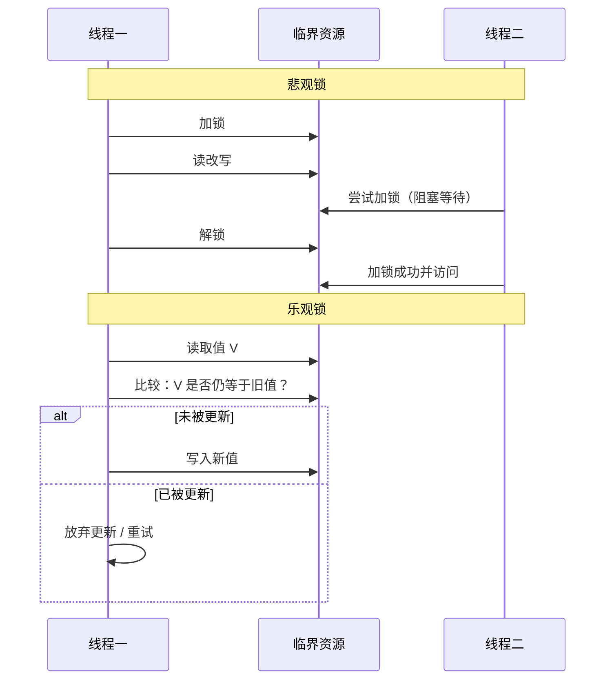
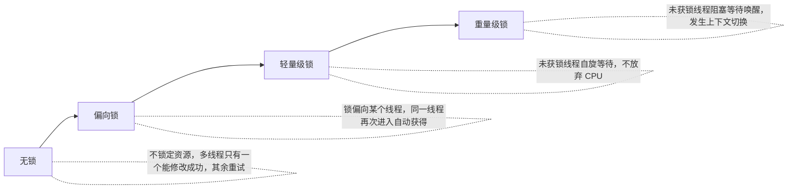
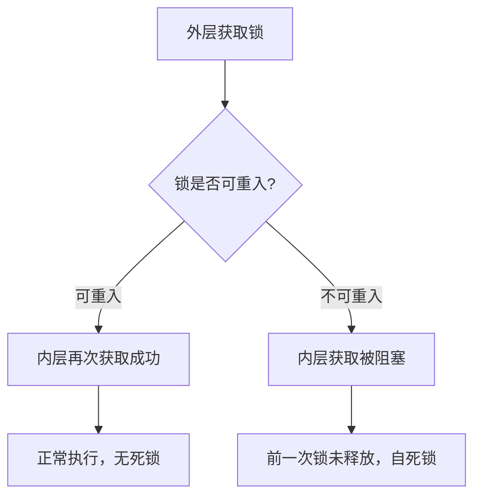

## 纲要

- 乐观锁与悲观锁：两种不同的线程同步视角、加锁流程差异、适用场景
- 锁的轻重梯度：无锁、偏向锁、轻量级锁（自旋）、重量级锁（阻塞唤醒）
- 公平锁与非公平锁：排队与插队、吞吐量与饥饿的取舍
- 可重入锁与非可重入锁：重入（递归锁）语义与自死锁
- 共享锁与排他锁：读写场景下的锁选择
- 面试高频追问与回答模板

## 乐观锁与悲观锁

乐观锁和悲观锁并不是某两个具体的锁实现，而是一组**广义概念**，体现的是看待线程同步的两种不同角度。

假设有两个线程都要读写同一份临界资源：

- **悲观锁**：线程一抢到临界资源后立刻加锁，线程二在锁释放前完全无法访问，只能等待；锁释放后线程二才拿到锁、访问资源。也就是说，**每一次操作都先加锁**。
- **乐观锁**：线程一拿到访问权限后直接操作数据，但在真正写入之前先判断"这份数据是否已被其他线程更新过"。没被更新就写入，被更新过就放弃本次更新（或重试）。也就是说，**默认不加锁，只在提交时做冲突检测**。

适用场景的取舍非常直接：

| 维度 | 悲观锁 | 乐观锁 |
| --- | --- | --- |
| 加锁时机 | 每次操作都加锁 | 默认不加锁，提交时校验 |
| 适合场景 | **写多读少**：写操作会改变值，必须串行化 | **读多写少**：读不改变值，不加锁可提升并发度 |
| 典型实现 | 互斥锁、数据库 `SELECT ... FOR UPDATE` | 版本号 / CAS |
| 代价 | 阻塞、上下文切换 | 冲突频繁时大量重试，反而更慢 |

一句话记忆：**悲观锁"先锁后干"，乐观锁"先干再说，冲突就重试"**。

## 锁的轻重梯度：无锁、偏向锁、轻量级锁、重量级锁

这四个概念描述的是**同一个竞争场景下锁的膨胀梯度**，从轻到重依次升级：

- **无锁**：不锁定资源，多个线程竞争修改，只有一个线程能修改成功，其他线程重试。核心依赖 CAS，后面有专门章节展开。
- **偏向锁**：锁对某个线程或进程具有**偏向性**。同一个线程再次执行临界区时会自动获取到资源，不需要再做同步操作。
- **轻量级锁**：多个线程竞争临界资源时，没有抢到资源的线程**自旋等待**锁释放。自旋的含义是等待过程**不放弃 CPU**，在 CPU 上以循环（`for` / `while`）的方式忙等。因此自旋锁就是轻量级锁。
- **重量级锁**：没有抢到资源的线程**阻塞等待唤醒**。相比轻量级锁，它会让出 CPU，必然伴随一次上下文切换。

轻量与重量的分水岭就是"**等待时是否放弃 CPU**"。临界区极短时自旋更划算（不等调度），临界区较长时阻塞更划算（不烧 CPU）。

## 公平锁与非公平锁

公平与非公平是相对于**等待锁的多个线程**而言的。

- **公平锁**：多个线程在队列中排队等待临界资源。此时新来的线程 D 想获取资源，也必须排到队尾；资源释放后，所有等待线程公平竞争。每个线程都不会长期拿不到锁，**不会出现饥饿**。
- **非公平锁**：新来的线程 D 可以**插队**。插队成功就直接拿到锁；插队失败才排到队尾等待。插队对其他已在等待的线程是不公平的。

| 维度 | 公平锁 | 非公平锁 |
| --- | --- | --- |
| 获取方式 | 严格排队 | 允许插队 |
| 优点 | 所有线程公平，等待线程不会饥饿 | 吞吐率高：部分线程可不阻塞直接拿锁 |
| 缺点 | 每次释放都要通知并唤醒所有等待线程去竞争，整体吞吐效率低 | 某些等待线程可能出现饥饿 |

非公平锁吞吐更高的关键原因：它**减少了线程的阻塞与唤醒次数**，从而减少了上下文切换，CPU 不必每次都唤醒所有等待线程。这也是多数语言默认使用非公平锁的原因。

## 可重入锁与非可重入锁

**重入**在这里的语境是：任意线程获取到锁之后，如果**再次**获取这把锁，不会发生阻塞。

假设一个函数里有两段获取锁的逻辑，外层一段、内层一段：

- **可重入锁**（又称**递归锁**）：同一个线程在外层方法获取到锁之后，进入该线程的内层方法时会自动获取锁，不会因为"之前已获取过且未释放"而阻塞。
- **非可重入锁**：当前线程再次获取自己已持有的锁时，由于该锁仍被自己持有且未释放，就会出现**自死锁**。

典型场景是递归调用、以及"锁方法 A 调用另一个同样加锁的方法 B"。

## 共享锁与排他锁

- **排他锁**：也就是互斥锁。该锁一次只能被**一个线程**持有。
- **共享锁**：该锁可以被**多个线程**同时持有。但获得共享锁的线程**只能读数据，不能写数据**。

读写例子：有一个临界资源，三个读线程、一个写线程。

- 三个读线程获取**共享锁**，可以同时读这份临界资源，但都不能写；
- 写线程会改变值，必须获取**互斥锁（排他锁）**，才能保证临界资源不被写坏。

| 锁类型 | 持有者数量 | 读 | 写 |
| --- | --- | --- | --- |
| 共享锁（读锁） | 多个线程 | 允许 | 禁止 |
| 排他锁（写锁 / 互斥锁） | 仅一个线程 | 允许 | 允许 |

## 面试回答模板

问：请简述乐观锁、悲观锁、可重入锁。

> 乐观锁和悲观锁是看待线程同步的两种角度，不是具体的锁实现。悲观锁认为并发冲突必然发生，所以每次操作都先加锁，适合写多读少的场景；乐观锁认为冲突不常发生，默认不加锁，只在提交时检测数据是否被其他线程更新过，没被更新就写入，被更新就放弃或重试，适合读多写少、追求并发度的场景。可重入锁也叫递归锁，指同一个线程在外层方法拿到锁之后，进入内层方法再次获取同一把锁时不会被自己阻塞；如果是非可重入锁，这种情况下就会因为自己持有锁未释放而产生自死锁。

问：轻量级锁和重量级锁的区别？

> 区别在于等待锁的线程是否放弃 CPU。轻量级锁下抢不到锁的线程自旋忙等，不放弃 CPU，适合临界区极短的场景；重量级锁下抢不到锁的线程直接阻塞等待唤醒，会让出 CPU 并产生上下文切换，适合临界区较长的场景。
