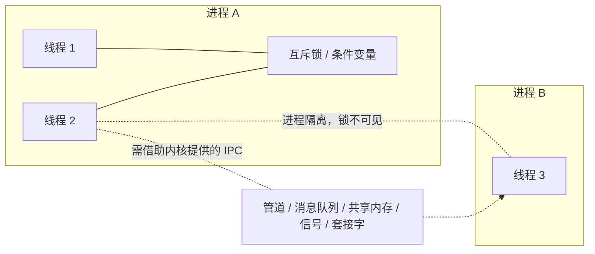
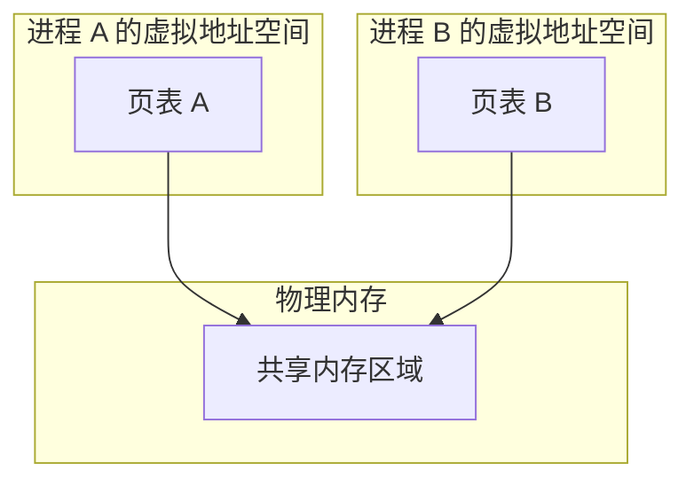

## 纲要

- 为什么进程间同步不能直接用线程的锁：资源独立 vs 资源共享
- 管道：匿名管道与命名管道（FIFO）
- 消息队列：支持序列化，可跨机器
- 共享内存：最快的通信方式，但不提供同步机制
- 信号：只做通知，不传数据
- 套接字：网络套接字与 Unix 域套接字的性能差异
- 五种方式的横向对比与面试回答模板

## 为什么进程间同步与线程间同步是两套东西

回顾进程与线程的区别：

- **线程**是系统进行运行调度的最小单位；
- **进程**是系统进行资源分配和调度的基本单位；
- 进程**拥有独立的资源**，线程则使用所属进程的资源，同一进程的多个线程**共享**进程资源。

因此前面学到的线程同步手段——互斥锁、读写锁、自旋锁、条件变量——对进程**全部不适用**。因为这些同步原语本身需要放在共享内存中才能被多个执行流看到，而进程之间的资源是相互隔离的。这就是进程间通信（IPC）需要单独立一章的原因。



## 管道

如果在 Linux 下用惯了命令行，管道其实天天都在用：

```bash
# 查看占用 8080 端口的进程
netstat -anp | grep 8080

# 在日志里找出与线程相关的错误
cat server.log | grep error | grep thread
```

竖杠 `|` 就是管道：**管道前面命令的输出，作为后面命令的输入**。多级管道把数据一级级往下过滤。

管道分两类：

| 分类 | 特点 | 示例 |
| --- | --- | --- |
| 匿名管道 | 没有名字，只能用于有亲缘关系的进程（如父子进程），随进程结束而销毁 | `cmd1 \| cmd2` |
| 命名管道（FIFO） | 有名字，以文件形式存在于文件系统中，无亲缘关系的进程也能通过名字打开 | `mkfifo testpipe` |

命名管道的典型用法：

```bash
mkfifo testpipe                   # 创建名为 testpipe 的管道
echo "this is a test pipe demo" > testpipe   # 写入
cat testpipe                      # 读出
```

管道的本质是内核里的一段缓冲区，只能承载**字节流（文本数据）**，无法直接传输结构化对象。

## 消息队列

消息队列可以看作生产者消费者问题中"缓冲区"的具体实现：生产者进程把数据写入消息队列，消费者进程从队列里取数据消费。生产者和消费者分属不同进程，消息队列本身就是一个进程间通信模块。

相比管道的进步在于：

- **支持序列化**：管道只能传文本，消息队列可以对数据做封装、序列化与反序列化，传输结构化对象；
- **可跨机器**：消息队列既支持单机进程间通信，也支持跨网络的进程间通信。跨机器场景下业界有大量成熟的消息中间件，例如 Kafka、RabbitMQ 等，它们本质上都属于消息队列这一 IPC 范畴的工程化实现。

## 共享内存

先回顾存储体系的背景：每个进程都有自己的**进程地址空间**，虚拟地址空间通过**页表**映射到物理内存，页表管理两者的映射关系。

共享内存的做法是：



1. 在物理内存上申请一块共享内存；
2. 通过系统调用把这块共享内存**挂接到多个进程的页表**上；
3. 之后这些进程都能像访问自己的内存一样读写这块区域。

关键结论：

- 共享内存允许**不相关的进程访问同一片物理内存**，是进程之间共享和传递数据**最快**的方式——数据不需要在内核与用户空间之间来回拷贝；
- 从某种意义上看，多进程本来就在共同使用物理内存，是进程管理机制把它们隔离开了，共享内存只是把这层隔离按需打开一个口子；
- **共享内存自身不提供同步机制**，必须另外借助信号量、互斥锁等手段管理访问，否则同样会出现数据错乱。

## 信号

信号是非常轻量的一类通信方式。日常用的 `Ctrl+C`、`Ctrl+Z`、`kill -9` 本质上都是给进程发信号。操作系统中不同信号用不同的值表示，可以通过 `kill -l` 查看完整列表。

常见信号：

| 信号值 | 名称 | 触发场景 |
| --- | --- | --- |
| 1 | SIGHUP | 用户终端连接结束时发出 |
| 2 | SIGINT | 中断信号，通知前台进程组终止进程，即 `Ctrl+C` |
| 3 | SIGQUIT | 类似 SIGINT，退出并生成 core 信息，`Ctrl+\` |
| 9 | SIGKILL | 强制终止进程，即 `kill -9 <pid>`，不可被捕获 |
| 15 | SIGTERM | 请求进程正常退出，`kill` 默认发送，可被捕获 |
| 16 | SIGSTKFLT | 栈溢出相关 |

使用信号通信时，接收信号的进程需要**注册对应的信号处理函数**，收到信号后执行该函数。

需要特别强调：**信号只起通知作用，不携带数据**。它只有一个信号取值，以及"收到之后该做什么"，进程之间无法通过信号交换业务数据。

## 套接字

套接字同样支持单机进程间通信与跨机器通信两种形态。

**网络套接字**：传输层的设计目标本来就是为主机上不同进程之间提供通信能力。主机用 IP 地址标识，主机上的进程用端口标识，IP + 端口构成套接字。网络套接字通信要经过完整的协议栈：


链路很长，每次通信都要逐层封装与解封装。

**Unix 域套接字（Unix Domain Socket）**："域套接字"是相对网络套接字而言的高级 IPC 方式，为同一台设备上的不同进程提供通信能力，功能与网络套接字类似，使用方式也几乎一致，但**通信过程无需经过完整的网络协议栈**。因此同机通信且要用套接字时，从性能角度应优先选择 Unix 域套接字。

套接字的使用流程分为两端：

- **服务端**：创建套接字 → 监听 → 接收连接与数据；
- **客户端**：创建连接 → 发送数据。

## 五种方式横向对比

| 方式 | 是否跨机器 | 是否传数据 | 数据形态 | 同步能力 | 性能 |
| --- | --- | --- | --- | --- | --- |
| 管道 | 否 | 是 | 字节流 / 文本 | 自带阻塞语义 | 中 |
| 消息队列 | 是 | 是 | 可序列化的结构化消息 | 自带队列语义 | 中 |
| 共享内存 | 否 | 是 | 任意内存数据 | **不提供，需额外机制** | **最高** |
| 信号 | 否 | 否（仅通知） | 信号值 | 异步通知 | 高 |
| 套接字 | 是 | 是 | 字节流 / 报文 | 自带连接语义 | 网络套接字较低，域套接字较高 |

一句话总结：**消息队列和套接字可以跨设备甚至跨网络通信；管道、共享内存和信号只能在单机上通信。**

## 面试回答模板

问：进程间有哪些同步（通信）方式？

> 主要有五种：管道、消息队列、共享内存、信号、套接字。管道分匿名管道和命名管道，本质是内核缓冲区，只能传字节流，常用于命令行和有亲缘关系的进程；消息队列在管道基础上支持结构化数据的序列化，并且可以跨机器，Kafka、RabbitMQ 都属于这一类；共享内存是最快的方式，它把同一块物理内存映射到多个进程的页表上，进程访问它和访问自己的内存没区别，但它本身不提供同步机制，需要额外用信号量或锁来保护；信号只用于通知，不携带数据，比如 Ctrl+C 发 SIGINT、kill -9 发 SIGKILL；套接字既能跨网络也能单机，同机场景优先用 Unix 域套接字，因为它不需要走完整的网络协议栈，性能更好。其中消息队列和套接字可以跨机器，管道、共享内存、信号只能单机使用。

问：共享内存为什么最快，又有什么坑？

> 快是因为数据直接在映射进进程地址空间的物理内存上读写，不需要在内核和用户空间之间来回拷贝；坑在于它只解决"共享"不解决"互斥"，多个进程同时写会造成数据错乱，必须额外配信号量或文件锁来做同步。
