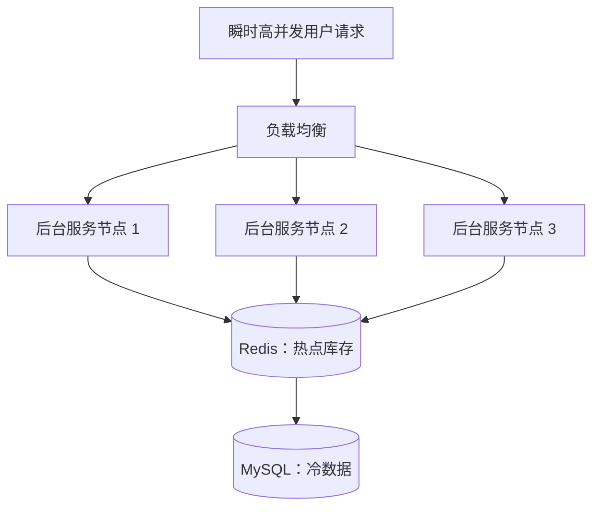
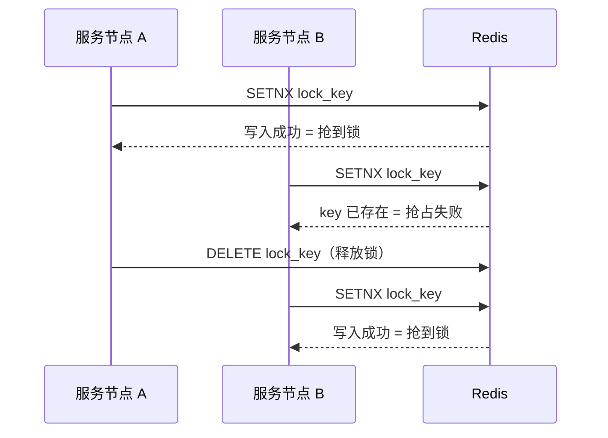

## 纲要

- 分布式锁的典型场景：秒杀系统中的库存临界资源
- 方案一：基于 Redis 的 `SETNX` 键值对，集群化规避单点
- 方案二：基于 ZooKeeper 的 znode 与临时节点
- 方案三：基于 MySQL 唯一键与行级锁
- 三种方案的逻辑共性与差异对比
- 业界成熟框架：Redlock、Curator、etcd 等
- 可运行的 Go + Redis 分布式锁 Demo

## 为什么需要分布式锁

以秒杀系统为例，它的典型架构是这样的：



- 后台系统为了应对瞬时大流量，都是**多节点、无状态**部署的；
- Redis 与 MySQL 通过冷热分离保存不同类型的数据，秒杀库存通常放在 Redis 里；
- 此时 **Redis 上的库存数据就是整个系统的临界资源**，多个服务节点就像多个线程/进程同时访问它，必须靠分布式锁保护。

锁机制不完善会直接导致超卖，引发用户投诉。除秒杀外，订单系统、积分系统、消费系统、消息中间件、数据发布订阅系统等，只要满足下面几个条件，都需要分布式锁：

- 分布式部署的集群或微服务；
- 服务节点之间需要通信协作；
- 数据有强一致性要求；
- 有性能与并发量的要求。

## 方案一：基于 Redis

Redis 是热门的 KV 数据库，用作分布式锁的底座有几个天然优势：数据常驻内存，读写性能优异；支持刷盘持久化；数据类型丰富；单线程处理命令；键值可设置自动过期；支持发布订阅。

核心命令是 `SETNX`（SET if Not eXists）：**当 key 不存在时写入成功，key 已存在时返回错误**。



- 多个节点同时对同一个 key 执行 `SETNX`，**有且只有一个客户端能写成功**，写成功的那个就抢到了分布式锁；
- 用完锁之后通过 `DEL` 删除这个 key 释放锁，其他客户端就可以继续抢占。

需要注意的坑：

- **单点问题**：单个 Redis 节点挂掉，整个分布式系统都失去协调能力，容易引发雪崩。生产上一般使用 Redis 集群，节点间的一致性由集群自身的主从复制与分布式协议保证，客户端无需关心。
- **死锁问题**：持有锁的进程崩溃而没有 `DEL`，锁将永久不释放。实践中必须给 key 设置过期时间，并保证"加锁 + 设过期"是原子操作。
- **误删问题**：锁过期后业务还没跑完，此时删除的可能已经是别人的锁。通常用唯一 value（如 UUID）配合 Lua 脚本做"校验再删除"。

## 方案二：基于 ZooKeeper

ZooKeeper 是开源的分布式应用程序协调服务，是 Google Chubby 的开源实现，也是 Hadoop、HBase 的重要组件，提供配置维护、域名服务、分布式同步、主节点选举等一致性服务。

它的数据节点称为 **znode**。基于 znode 实现互斥的逻辑与 Redis 的 KV 非常类似：

1. 服务一在 ZooKeeper 中创建一个 znode；
2. 服务二想创建同名 znode 时，由于节点已存在，创建失败，即抢锁失败；
3. 服务一释放 znode 后，服务二才能创建成功。

差异点在于**临时节点（Ephemeral Node）**：

- 临时节点由某个客户端创建，**当客户端与 ZooKeeper 断开连接时，该节点会被自动删除**；
- 因此服务一释放锁只需要断开连接即可，而 Redis 方案需要手动 `DEL`。

这一个特性天然解决了"持锁进程崩溃导致锁无法释放"的问题。配合顺序临时节点还能实现公平的排队锁：每个等待者监听前一个节点的删除事件，形成锁队列。

## 方案三：基于 MySQL

MySQL 提供事务、表级锁、行级锁，并且**唯一键在表级唯一、不能重复插入**。利用这些特性同样可以实现分布式锁：

- 加锁：多个节点向同一张锁表插入同一个 key 的记录，由于 key 是唯一键，**只有一个节点能插入成功**，其余节点插入失败；
- 释放锁：删除这条行记录，其他客户端就能继续插入。

逻辑本质与 Redis、ZooKeeper 完全一致，只是底座换成了传统数据库。需要特别注意两点：

- 这本质上是**把锁竞争的压力转嫁给了 MySQL**，并发高时数据库很容易成为瓶颈；
- MySQL 同样存在单点问题，挂掉之后整个集群无法协调，需要靠主从、集群方案解决。

## 三种方案对比

| 维度 | Redis | ZooKeeper | MySQL |
| --- | --- | --- | --- |
| 加锁方式 | `SETNX` 写 key | 创建 znode | 插入唯一键记录 |
| 释放方式 | 手动 `DEL`（或过期） | 断开连接自动删除 | 删除行记录 |
| 性能 | 最高，内存操作 | 中等，需与 ZK 集群交互 | 最低，落盘 |
| 崩溃容错 | 依赖过期时间 | 临时节点自动释放，最优 | 依赖连接断开后的清理 |
| 单点问题 | 需集群 | 天然集群 | 需主从/集群 |
| 公平性 | 需额外实现排队 | 顺序节点天然公平 | 需额外实现 |
| 适用场景 | 高并发、允许极端情况下的偶发失效 | 强一致、对可靠性要求极高 | 并发低、已有数据库依赖、实现最简单 |

## 业界成熟框架

- **Redlock**：Redis 官方提出的分布式锁算法，通过多个独立 Redis 节点投票降低单点风险；
- **Curator**：Netflix 开源的 ZooKeeper 客户端封装，内置 `InterProcessMutex` 等可重入、可公平的分布式锁实现；
- **etcd**：Go 生态中非常流行的分布式 KV，基于 Raft 协议，用 lease + txn 可以很自然地实现分布式锁；
- Java 微服务生态中也有基于 Spring Integration 的 Redis / JDBC 锁实现。

面试官问"了解哪些分布式锁框架"时，答出方案原理 + 一两个成熟框架的名字即可。

## API 速览

| API / 命令 | 签名与语义 | 返回值 |
| --- | --- | --- |
| `SETNX key value` | key 不存在时写入，存在则不写入 | 写入成功返回 1，失败返回 0 |
| `SET key value NX PX ms` | 原子地完成"不存在才写 + 设置毫秒过期" | 成功返回 OK，失败返回 nil |
| `DEL key` | 删除 key，用于释放锁 | 删除的个数 |
| `EVAL script` | 在 Redis 端原子执行 Lua 脚本，用于"校验 value 再删除" | 脚本返回值 |
| `go-redis SetNX(ctx, key, value, expiration)` | Go 客户端封装的 `SET NX PX` | `*BoolCmd`，`.Result()` 返回 `(bool, error)` |

## Demo 示例

下面是一份基于 Go + Redis 的分布式锁实现，覆盖"原子加锁、唯一 value、校验后释放、超时兜底"四个要点（根据讲稿逻辑补充）。

```go
package main

import (
	"context"
	"errors"
	"fmt"
	"log"
	"math/rand"
	"sync"
	"time"

	"github.com/redis/go-redis/v9"
)

// DistributedLock 基于 Redis SET NX PX 的分布式锁
type DistributedLock struct {
	client *redis.Client
	key    string
	value  string   // 唯一标识，防止误删他人的锁
	expire time.Duration
}

// NewLock 构造一把锁，value 使用 UUID / 随机数保证唯一
func NewLock(client *redis.Client, key string, expire time.Duration) *DistributedLock {
	return &DistributedLock{
		client: client,
		key:    key,
		value:  fmt.Sprintf("%d-%d", time.Now().UnixNano(), rand.Int63()),
		expire: expire,
	}
}

// TryLock 尝试加锁：key 不存在才写入，并同时设置过期时间（原子操作）
func (l *DistributedLock) TryLock(ctx context.Context) (bool, error) {
	return l.client.SetNX(ctx, l.key, l.value, l.expire).Result()
}

// unlockScript 只有 value 匹配时才删除，保证不会误删别人的锁（原子执行）
var unlockScript = redis.NewScript(`
if redis.call("get", KEYS[1]) == ARGV[1] then
    return redis.call("del", KEYS[1])
else
    return 0
end
`)

// Unlock 校验 value 后释放锁
func (l *DistributedLock) Unlock(ctx context.Context) error {
	n, err := unlockScript.Run(ctx, l.client, []string{l.key}, l.value).Int()
	if err != nil {
		return err
	}
	if n == 0 {
		return errors.New("lock not owned by this client")
	}
	return nil
}

// WithLock 业务模板：抢锁 -> 执行 -> 释放
func WithLock(ctx context.Context, client *redis.Client, fn func() error) error {
	lock := NewLock(client, "seckill:stock:lock", 3*time.Second)
	ok, err := lock.TryLock(ctx)
	if err != nil {
		return err
	}
	if !ok {
		return errors.New("acquire lock failed, another node holds it")
	}
	defer lock.Unlock(ctx)
	return fn()
}

func main() {
	ctx := context.Background()
	client := redis.NewClient(&redis.Options{Addr: "127.0.0.1:6379"})
	defer client.Close()

	var wg sync.WaitGroup
	var sold int64
	var mu sync.Mutex

	// 模拟 10 个服务节点并发抢锁扣减库存
	for i := 0; i < 10; i++ {
		wg.Add(1)
		go func() {
			defer wg.Done()
			err := WithLock(ctx, client, func() error {
				// 临界区：同一时刻只允许一个节点进入
				mu.Lock()
				sold++
				mu.Unlock()
				time.Sleep(50 * time.Millisecond)
				return nil
			})
			if err != nil {
				log.Println("skip:", err)
			}
		}()
	}
	wg.Wait()
	fmt.Println("critical section entered:", sold)
}
```

### 运行说明

```bash
# 启动一个 Redis 实例
docker run -d --name redis-lock -p 6379:6379 redis:7

# 初始化依赖并运行
go mod init lockdemo
go get github.com/redis/go-redis/v9
go run main.go
```

### 代码说明

- `SetNX` 把"判断 key 是否存在"和"设置过期时间"合并为一次原子操作，避免加锁后进程崩溃导致锁永不释放；
- `value` 使用时间戳 + 随机数保证全局唯一，是解锁时判断"这把锁是不是我的"的依据；
- 解锁用 Lua 脚本在 Redis 端原子地执行 `GET` 比较 + `DEL`，防止"判断过后锁恰好过期、被别人抢到，再把别人的锁删掉"；
- `expire` 要大于业务临界区的最大执行时间，否则业务没跑完锁就过期了；更严谨的做法是加一个续期协程（watch dog）。

### 技术点总结

- 分布式锁的本质是**在多个进程都能访问的地方，找一个"只能有一个成功"的写入操作**：Redis 的 `SETNX`、ZooKeeper 的同名 znode、MySQL 的唯一键，逻辑完全同构；
- 三个必须处理的细节：**原子加锁**（避免死锁）、**唯一标识 + 校验释放**（避免误删）、**过期兜底**（避免崩溃后锁残留）；
- Redis 性能最好但最需要处理容错，ZooKeeper 可靠性最高但性能居中，MySQL 最简单但压力最大。

## 面试回答模板

问：项目中的分布式锁是怎么实现的？

> 我们用的是 Redis 方案。加锁用 `SET key value NX PX expire` 这条命令，保证"不存在才写入"和"设置过期时间"是原子的；value 存一个全局唯一的随机串，解锁时用 Lua 脚本先比对 value 再删除，避免误删别人的锁；过期时间是防止持锁进程崩溃导致锁无法释放的兜底手段。之所以选 Redis，是因为秒杀场景并发高、要求性能好，Redis 是内存读写；缺点是它本身有单点风险，所以生产上用 Redis 集群，极端一致性要求下会考虑 ZooKeeper 的临时节点方案或者 etcd 的 lease 方案。
