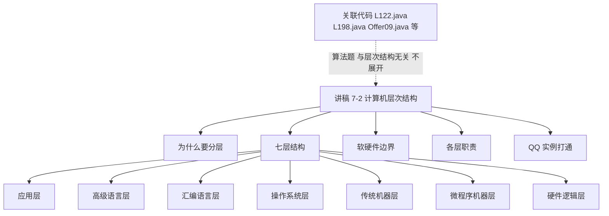
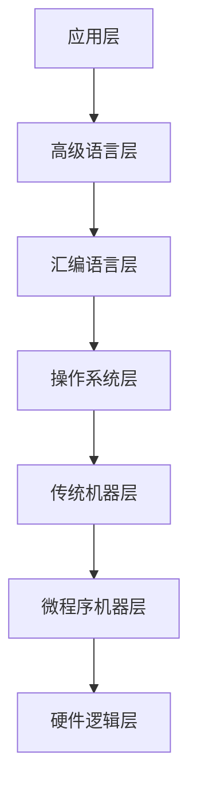

## 纲要

- 为什么要分层：不同层实现不同功能，层与层之间解耦（类比函数拆分）
- 七层结构：应用层、高级语言层、汇编语言层、操作系统层、传统机器层、微程序机器层、硬件逻辑层
- 软硬件边界：操作系统层及以上为软件，传统机器层及以下为硬件
- 各层职责：应用层面向场景、高级语言层面向程序员、汇编语言层面向底层工程师、操作系统层是软硬中介，再往下三层对应微程序、微指令与门电路
- 实例打通：以 QQ 为例，从应用层 App 逐层下沉到门电路执行

## 素材索引

- 讲稿：`work/source/8.mksz540-后端校招面试直通车，提前锁定大厂offer[完结]/{7}--第7章计算机系统之编程语言与运行原理/[7.1]--7-2计算机的层次结构划分详解`
- 关联代码：本篇为概念解析，不嵌入代码。

## 为什么要分层

一个良好的设计规范是：复杂系统的内部实现必须有清晰的分层。这与函数设计同理——函数体不应过长，过长就应拆成多个函数分别实现。分层的目的正是让不同层承担不同功能，且层与层之间的关联是解耦的。

这一点在之前的计算机网络部分已经铺垫过：网络也有自己的层次结构，分层的目标同样是"不同层做不同的事，层间解耦"。计算机系统沿用同样的思路进行划分。

## 计算机的七层结构

从上层到下层，计算机系统可以划分为七个层次：

| 层次 | 性质 | 说明 |
| --- | --- | --- |
| 应用层 | 软件 | 满足用户在各类场景下便捷使用计算机的需求 |
| 高级语言层 | 软件 | Java、C、C++、Python、Go、PHP、JavaScript 等，程序员直接面向 |
| 汇编语言层 | 软件 | 偏底层，可直接翻译为机器语言 |
| 操作系统层 | 分界 | 软件与硬件的中介，传统软件与硬件的分界线 |
| 传统机器层 | 硬件 | 由指令系统定义的机器层 |
| 微程序机器层 | 硬件 | 一条机器指令对应一条微程序 |
| 硬件逻辑层 | 硬件 | 由门电路执行微指令 |

## 软硬件边界

七层中有一条清晰的分界线：操作系统层及以上视为软件，传统机器层及以下视为硬件。作为编程人员，日常工作更多关注的是软件部分——通常集中在应用层、高级语言层与操作系统层，对汇编语言层及以下关注较少。

## 各层职责

### 应用层

应用层解决的是"让用户便捷使用计算机"的问题，呈现给用户的就是满足各类需求的应用软件：

- 办公场景：Office 套件中的 Word、Excel、PowerPoint 等
- 娱乐场景：各类游戏、视频软件等
- 学习场景：编程工具、PDF 阅读器等

### 高级语言层

这是程序员最熟悉、最常面向的层次。Java、C、C++、Python、PHP、JavaScript 等都属于这一层。该层的主要目的，是让程序员编写代码，实现供用户使用的应用层软件。

### 汇编语言层

汇编语言层是偏底层工程师（如嵌入式、二进制安全、工业控制场景）才会深入接触的层次。它可以直接翻译成可执行的机器语言。需要特别理解的是：汇编语言只是为了方便人类理解机器语言而设计的中间层，其指令助记符（如 `push`、`move`）在人类语言里都有明确含义。因此它既是人与底层之间的桥梁，也能直接翻译为机器语言被执行。

### 操作系统层

操作系统是软件与硬件之间的中介，也是传统软件与硬件的分界线：向上为用户提供简洁的操作接口，向下对接指令系统、管理硬件资源。它承上启下，是连接上层应用与底层硬件的关键一层。

### 传统机器层、微程序机器层与硬件逻辑层

这三层离程序员最远，但决定了计算机最终如何执行：

- 微程序：在微程序机器层，一条汇编指令对应一条微程序
- 微指令：一条微程序由多条微指令组成
- 门电路：微指令在最底层由门电路执行。数字逻辑中的与门、非门、或门等，正是实现这些微指令的具体硬件

## 以 QQ 为例打通层次

用大家熟悉的 QQ 把整条层次串起来：

- 在用户层面，QQ 是一个可以直接操作的 App（应用层）
- 它的底层由 C、Qt、MFC 等高级语言实现（高级语言层）
- 这些高级语言经编译器编译为汇编语言，交给操作系统
- 操作系统作为中介，将汇编翻译为机器语言
- 最终在门电路上真正执行

通过这一个例子，就能直观理解"应用层 → 高级语言层 → 汇编语言层 → 操作系统层 → 硬件逻辑层"的完整下沉路径。

## 本节要点

本节课的重点是理解计算机系统的层次结构：为什么需要分层（解耦、职责清晰），以及如何分层、每一层承担什么功能。需要掌握高级语言、汇编语言与指令集（传统机器层）的基本概念，并建立起"软硬件以操作系统为界"的整体认知。
