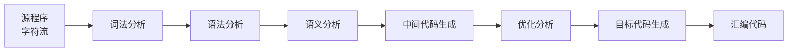
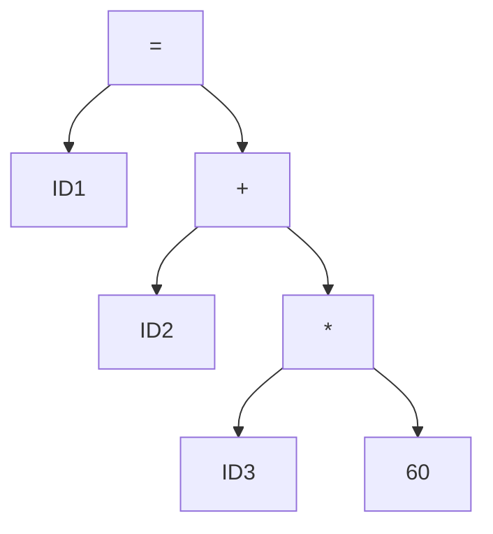

## 纲要

- 编译器的六个阶段：词法分析 → 语法分析 → 语义分析 → 中间代码生成 → 优化分析 → 目标代码生成
- 词法分析：把字符流拆成符号流，保留关键字、运算符，变量用符号（如 ID）表示
- 语法分析：把符号流构造成语法树，并校验语法合法性
- 语义分析：构建语义树，做类型检查（返回值、运算数类型是否匹配）
- 中间代码生成：产出偏底层的三地址代码
- 优化分析：合并冗余指令，减少指令条数
- 目标代码生成：把优化后的中间代码映射为汇编指令

## 📎 文本↔代码关联

- 讲稿：`work/source/8.mksz540-后端校招面试直通车，提前锁定大厂offer[完结]/{7}--第7章计算机系统之编程语言与运行原理/[7.3]--7-4编译器原理剖析`
- 关联代码：清单 `code_refs` 指向 `code/recruitment/...` 下的 `L122.java`、`L198.java`、`Offer09.java`、`L55.java`、`L142.java`、`L206.java`、`L860.java`、`L141.java`，均为配套算法题解，与"编译器原理"主题无直接关联，本篇为概念解析，不嵌入代码。

## 编译器的六个阶段

编译器从接收源程序到产出低级语言代码，自上而下经历六个阶段，前一步的输出是后一步的输入，环环相扣、缺一不可：



下面用一条语句贯穿全部阶段：

```text
result = initial + rate * 60
```

约定：`result` 记作 `ID1`，`initial` 记作 `ID2`，`rate` 记作 `ID3`。

## 词法分析

词法分析对程序中的每个"单词"做符号化处理：保留语言的关键字、保留运算符符号，同时把变量转换成符号。输入是字符流，输出是符号流。

对上面的语句，词法分析后得到的符号流为：

```text
ID1 = ID2 + ID3 * 60
```

其中 `ID1`、`ID2`、`ID3` 对应的名字与属性会记录在符号表里，供后续阶段查询。

## 语法分析

语法分析负责检查代码语法是否合法：把符号流构造成一棵**语法树**，并判断该树是否合法。语法树天然反映了运算优先级——越靠近叶子、越先结合。



从下往上看优先级：先算 `ID3 * 60`，结果与 `ID2` 相加，最后赋值给 `ID1`。

## 语义分析

语义分析在更高层面判断代码是否有意义，并引入**类型检查**：例如函数返回值类型是否正确、两个变量进行运算时类型是否允许。其产出常表现为一棵**语义树**，在语法树的基础上补上类型约束。

## 中间代码生成

中间代码生成产出偏底层、容易理解的中间表示。上面的例子会生成一组**三地址代码**（每条指令最多涉及两个操作数地址，结果存入第三个地址）：

```text
t1 = 60
t2 = ID3 * t1
t3 = ID2 + t2
ID1 = t3
```

每一行都是单步运算。除了三地址代码，也存在二地址代码；但更通用、更常见的就是上述三地址形式（首尾两行只是没用到第三个地址）。

## 优化分析

优化分析对前面的三地址代码做合并，以减少指令条数。上面四条指令可以压缩为两条：

```text
t1 = ID3 * 60
ID1 = ID2 + t1
```

这里把 `t1 = 60` 与 `t2 = ID3 * t1` 合并为 `t1 = ID3 * 60`，再把 `t3 = ID2 + t2` 与 `ID1 = t3` 合并为 `ID1 = ID2 + t1`。PPT 展示的是极简优化，真实编译器中还会有嵌套优化、无用分支消除等更复杂的手段。

## 目标代码生成

经过优化得到两条三地址代码，最后一步把它们**映射**为汇编指令。以上面两条为例，可翻译成五条汇编：

```asm
LOAD  R2, [ID3]      ; 把 ID3 的数据加载到寄存器 R2
MUL   R2, 60         ; R2 = R2 * 60
LOAD  R1, [ID2]      ; 把 ID2 的数据加载到寄存器 R1
ADD   R1, R2         ; R1 = R1 + R2
STORE [ID1], R1      ; 把 R1 的结果保存到 ID1 的地址
```

最终代码的生成，是从高级语言逐步下沉到人类可读、机器也容易理解的汇编语言（即更底层的汇编语言层）的过程。经过这一系列编译操作，代码最终从高级语言转变成了低级语言。

## 小结

编译器的工作是一个由"字符流 → 符号流 → 语法树 → 语义树 → 中间代码 → 优化代码 → 目标代码"逐级变换的流水线。每个阶段都为下一阶段提供输入，前一步的产物是后一步的原料，六步共同把高级语言翻译成可在机器上执行的低级语言。
