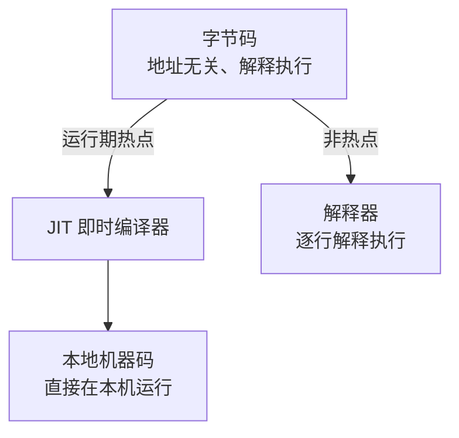

## 纲要

- 程序从源码到运行经历六个步骤：预编译、编译、汇编、链接、装载、运行
- 不同平台的可执行文件格式不同：macOS 的 Mach-O、Linux 的 ELF、Windows 的 PE，跨平台二进制不可直接运行
- 链接分两类：源码之间的链接，以及动态链接库（如系统库）的链接，后者依赖地址无关代码（GOT）做运行时重定位
- 装载：把可执行文件装入内存，建立进程空间并确定入口地址（如 `main`）
- JIT 的背景：字节码这类中间代码靠解释执行，效率低于本地二进制
- JIT 的原理：在运行期把热点字节码**动态编译**成本地机器码，跳过解释直接执行以加速
- JIT 的前提：并非"编译免费"，动态编译本身有开销，需收益大于消耗才划算

## 📎 文本↔代码关联

- 讲稿：`work/source/8.mksz540-后端校招面试直通车，提前锁定大厂offer[完结]/{7}--第7章计算机系统之编程语言与运行原理/[7.4]--7-5请简述什么是JIT技术`
- 关联代码：清单 `code_refs` 指向 `code/recruitment/...` 下的 `L122.java`、`L198.java`、`Offer09.java`、`L55.java`、`L142.java`、`L206.java`、`L860.java`、`L141.java`，均为配套算法题解，与"程序运行原理/JIT"主题无直接关联，本篇为概念解析，不嵌入代码。

## 程序从源码到运行的六个步骤

一个程序从编写到最终执行，主要经历以下六个阶段：

1. **预编译**：主要做文本替换，处理宏定义（`#define`）、头文件包含（`#include`）、条件编译，并去掉代码注释。Java 中的 `import` 也在这一阶段把依赖代码引入同一文件并去注释。
2. **编译**：把预处理后的代码翻译成汇编/中间代码，产出**目标文件**（`*.o`）。目标文件尚不可执行。
3. **汇编**：把编译产出的代码转成机器码。早期有独立的汇编器，现在通常已集成进编译器。
4. **链接**：至关重要。单个源文件编译出的目标文件并不能直接执行，必须把多个目标文件以及所依赖的系统库、第三方库（动态/静态链接库）链接起来，形成最终的可执行文件。
5. **装载**：把可执行文件加载进内存，由操作系统分配 PCB、建立进程空间。
6. **运行**：在不同平台还会做更细化的地址解析后真正执行。

以示例程序为例：`test.cpp` 依赖 `a.cpp`、`b.cpp`，三者需各自编译成目标文件，再链接成最终的二进制。而输出到屏幕、系统 `sleep`、新建线程等功能都来自操作系统，源码中并没有这些代码，必须依赖系统库，在链接阶段接入。

## 不同平台的可执行文件格式

不同系统的可执行文件格式不同，一个平台的二进制无法在另一平台直接运行：

| 平台 | 可执行文件格式 |
| --- | --- |
| macOS | Mach-O |
| Linux | ELF |
| Windows | PE |

程序运行原理，本质上就是理解这些二进制文件的格式，以及它们是怎么来的。

## 链接的两种情形与动态重定位

链接有两种情形：一是源码之间的相互链接；二是链接动态链接库（如系统库）。链接动态库时有两点要注意：

- 地址无关的代码会有特殊标记（如 **GOT，Global Offset Table**），用于运行时的动态地址重定位
- 执行到相关指令时，按 offset 动态装载地址，并跳转到系统库对应位置执行函数

链接完成后得到可执行文件，运行时才需要装载进内存。装载的本质是把可执行文件按格式解释，由操作系统分配进程空间（含内核空间、栈、动态库地址空间、堆、数据段、代码段、保留区等），并确定进程入口地址（找到 `main` 函数的地址）。

## 为什么需要 JIT

Java 这类语言编译加解释：JVM 层面是**地址无关**的字节码，解释执行。但正因为是解释执行，其性能不如本地二进制代码快。这就引出了优化空间——**JIT（Just-In-Time，即时编译）技术**。

JIT 出现在"存在中间代码"的运行系统中（如 Java）：

JIT 会在程序运行过程中，把部分频繁执行的中间字节码**动态编译成机器码**，从而跳过字节码解释阶段，直接以本地机器码运行，加快程序速度。也就是说，部分代码会绕过字节码阶段，直接以最终编译出的机器码执行。

## JIT 的前提与权衡

JIT 并非"免费午餐"。动态编译本身有性能消耗，因此必须考虑**收益是否大于消耗**：

- JIT 只在运行期针对热点代码做编译，若代码执行频次不足以摊薄编译开销，反而得不偿失
- 适合 JIT 的前提是：系统存在中间代码、有解释执行过程、且解释效率低于本地代码执行效率

## 面试题速答

- **程序从源码到二进制经历了哪些步骤？** 预编译、编译、汇编、链接、装载、运行六个步骤；面试常重点考察编译与链接两步。
- **什么是 JIT 技术？** 针对存在中间代码的运行系统，在解释执行效率低于本地代码的前提下，由虚拟机在运行期把热点字节码动态编译成本地机器码，以加快运行速度；但动态编译有开销，需收益大于消耗才划算。
