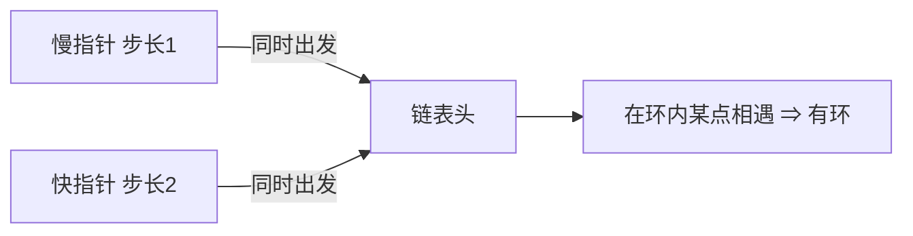
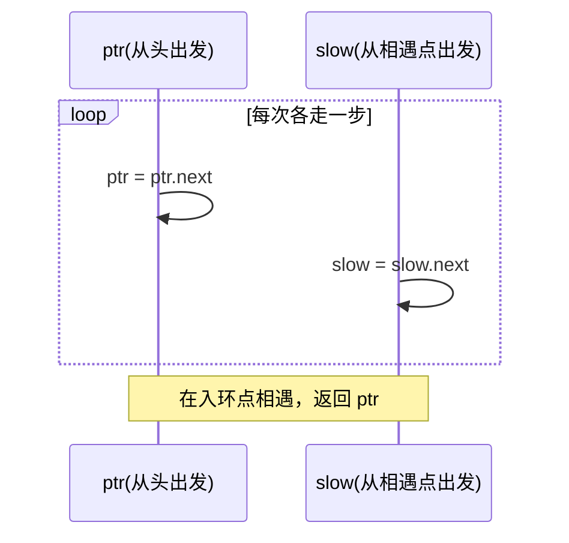

## 纲要

- LeetCode 141：判断链表是否有环，两种解法——哈希表法、快慢指针法
- LeetCode 142：在判断有环的基础上，返回入环的第一个节点
- 哈希表法：用集合记录访问过的节点，空间 O(n)、时间 O(n)
- 快慢指针法：两指针速度比为 2:1，相遇即证明有环，空间 O(1)、时间 O(n)
- 142 的快慢指针数学推导：a = c + (n-1)(b+c)，可在入环点相遇
- 时间与空间的权衡：同一问题，哈希表拿空间换时间，快慢指针以少量时间换 O(1) 空间

## 📎 文本↔代码关联

- 讲稿：`work/source/8.mksz540-后端校招面试直通车，提前锁定大厂offer[完结]/{8}--第8章数据结构与算法之链表、栈、队列与二叉树iclass=new/[8.4]--8-5链表算法题实战详解`
- 关联代码：清单 `code_refs` 为空，本节按算法思路讲解（哈希表与快慢指针），不嵌入代码。

## 题目说明

**LeetCode 141（环形链表）**：给定一个链表，判断其中是否有环。有环返回 `true`，无环返回 `false`。

直观理解：若链表有环，迭代遍历将永远不会结束，会一直在环里循环；若没有环，会在有限时间内走到尾节点并返回。

**LeetCode 142（环形链表 II）**：给定一个链表，返回链表开始入环的第一个节点；若无环，返回 `null`。相比 141，它在"判断有没有环"之外，还多了一个"定位入环点"的任务。

## 解法一：哈希表法

核心思路朴素而有效：用一个哈希表（集合）记录已经被访问过的节点。每遍历到一个节点，先检查它是否已在表中——若已存在，说明这个节点被重复访问了，链表一定有环；否则就把当前节点加入集合，继续前进。

对于 141，只要发现重复节点即可判定有环；对于 142，由于入环的第一个节点必定是"第一个在集合中重复出现"的节点，直接返回它即可。

| 维度 | 141（判环） | 142（定位入环点） |
| --- | --- | --- |
| 时间复杂度 | O(n) | O(n) |
| 空间复杂度 | O(n) | O(n) |
| 核心 | 发现重复即返 `true` | 第一个重复节点即入环点 |

哈希表法实现简单、易于理解，代价是需要 O(n) 的额外空间来保存节点。

## 解法二：快慢指针法

使用两个指针从链表头部出发：慢指针每次走一步，快指针每次走两步，两者以不同速度遍历。如果链表有环，快指针终将在环内追上慢指针（二者相遇）；如果没有环，快指针会先走到尾节点（`null`）而结束。判断依据就是"两个指针是否相遇"。



### 141 的快慢指针

先做特判：若头节点为空或头节点的 `next` 为空，必然无环，直接返回 `false`。随后初始化慢、快指针指向头节点，进入循环：只要快指针及其下一步不为空，就推进慢指针一步、快指针两步；若某刻快慢指针相等，说明相遇、有环，返回 `true`；若快指针走到 `null`，说明遍历到尾部、无环，返回 `false`。

时间复杂度仍为 O(n)（相遇前一定走过不超过 n 的某个常数倍距离），但空间复杂度降为 O(1)——只需定义两个指针。相比哈希表法，快指针多走的那段常数距离使得单次操作略多，但整体量级仍是 O(n)。

### 142 的快慢指针与数学推导

哈希表法定位入环点很直接，但快慢指针法在相遇后并不能直接知道入环点在哪里——因为指针本身没有记录位置。需要通过量化推导找到"用慢指针定位入环点"的方法。

把环抽象为三部分：

- `a`：入环前的距离（从头节点到入环点）
- `b`：入环点到快慢指针相遇点的距离（顺时针）
- `c`：相遇点绕回入环点剩余的环上距离


环的周长 = `b + c`。当快慢指针相遇时：

- 慢指针走过的距离 = `a + b`
- 快指针走过的距离 = `a + n(b + c) + b`（其中 `n` 为快指针在环内可能绕过的圈数）

又因为快指针速度是慢指针的两倍，故快指针路程是慢指针的两倍：

```text
a + n(b + c) + b = 2(a + b)
```

移项整理可得：

```text
a = (n - 1)(b + c) + c
```

由于 `b + c` 正好是一个环的周长，`(n-1)(b+c)` 就是 `n-1` 个整圈。也就是说：

> 从链表头走 `a` 的距离，与从相遇点每次走一步、先绕 `n-1` 圈再走 `c` 的距离，最终会在**入环点**相遇。

因此，在快慢指针相遇后，额外用一个指针 `ptr` 指向链表头，让 `ptr` 与慢指针每次各走一步，二者最终必然在入环点碰头，此时返回 `ptr`（或 `slow`）即可。



## 时间与空间的权衡

同一组环形链表问题，两种解法体现了典型的时空权衡：

| 解法 | 时间复杂度 | 空间复杂度 | 特点 |
| --- | --- | --- | --- |
| 哈希表法 | O(n) | O(n) | 思路简单，直接记录位置，但占空间 |
| 快慢指针法 | O(n) | O(1) | 多消耗少量时间，换取常数级空间，面试加分项 |

面试中若能在哈希表法之外给出快慢指针法，尤其是把 142 的入环点推导讲清楚（快指针路程 = 2 × 慢指针路程，推出 `a = c + (n-1)(b+c)`），是明显的加分点。

## 小结

链表算法题本质上考察的是遍历方法以及对链表特性的熟练度。面对环形链表问题，哈希表法以 O(n) 空间换来了最直观的解法；快慢指针法则用"速度比 2:1 必相遇"的特性把空间压到 O(1)，并通过距离量化推导（141 判环、142 定位入环点）解决更深层的问题。掌握这两种思路及其时空权衡，是应对链表面试题的关键。
