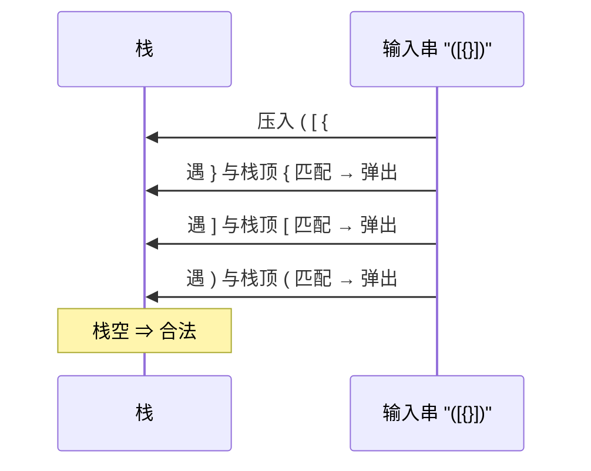

## 纲要

- LeetCode 20（有效的括号）：判断仅含 `()[]{}` 的字符串是否合法闭合
- 合法定义：左括号须用**同类型**右括号闭合，且以**正确顺序**闭合
- 栈天然契合本题：相邻配对的括号才能消除，消除后栈回到上一状态
- 解法：遇左括号入栈；遇右括号则与栈顶比较，不匹配或栈空则非法；遍历完栈空即合法
- 给出完整可运行 Go 代码、逐步推演与复杂度

## 📎 文本↔代码关联

- 讲稿：`work/source/8.mksz540-后端校招面试直通车，提前锁定大厂offer[完结]/{8}--第8章数据结构与算法之链表、栈、队列与二叉树iclass=new/[8.9]--8-10数组、栈、队列实战详解（三）`
- 关联代码：`code_refs` 为空，本卡片按讲稿逻辑用 **Go** 补充完整可运行实现（讲稿原示例为 Java vector/栈）。

## 为什么用栈

括号的核心约束是"**相邻且同类型**的左右括号才能配对消除"——这恰好是栈的语义。以 `"([{}])"` 为例：

1. 依次把 `(`、`[`、`{` 压入栈，栈变为 `[ (, [, { ]`。
2. 遇到 `}`：与栈顶 `{` 同类型，弹出 `{`，栈回到 `[ (, [ ]`。
3. 遇到 `]`：与栈顶 `[` 同类型，弹出，栈回到 `[ ( ]`。
4. 遇到 `)`：与栈顶 `(` 同类型，弹出，栈变为空。

遍历结束且栈为空，说明全部配对成功，字符串合法。任何一步若出现"栈顶与当前右括号类型不同"或"遇右括号但栈已空"，都直接判定非法。



## Demo 示例

### 运行说明

将 `valid.go` 与 `main.go` 放在同一目录，执行 `go run valid.go main.go`。

### 代码说明

```go
package main

func isValid(s string) bool {
	stack := []rune{}
	// 右括号 → 期望的左括号
	pairs := map[rune]rune{')': '(', ']': '[', '}': '{'}

	for _, ch := range s {
		switch ch {
		case '(', '[', '{':
			// 左括号：入栈
			stack = append(stack, ch)
		default:
			// 右括号：栈空或栈顶不匹配则非法
			if len(stack) == 0 || stack[len(stack)-1] != pairs[ch] {
				return false
			}
			stack = stack[:len(stack)-1] // 配对成功，弹出
		}
	}
	return len(stack) == 0
}
```

`main.go`：

```go
package main

import "fmt"

func main() {
	fmt.Println(isValid("()[]{}")) // true
	fmt.Println(isValid("([{}])")) // true
	fmt.Println(isValid("(]"))     // false
	fmt.Println(isValid("([)]"))   // false
	fmt.Println(isValid("{[]}"))   // true
}
```

预期输出：

```text
true
true
false
false
true
```

### 技术点总结

- 栈的"后进先出"完美对应括号的"最内层先闭合"，是本题的标准解法。
- 关键判据两条：遇右括号时（1）栈不能为空；（2）栈顶必须是与之配对的左括号。任一不满足即为非法。
- 遍历结束后必须检查栈是否为空：形如 `"((` 的输入虽全程不报错，但栈非空，仍属非法。
- 复杂度：遍历一次，**时间 O(n)、空间 O(n)**（最坏全为左括号）。

## API 速览

| 操作 | 说明 | 复杂度 |
| --- | --- | --- |
| 入栈 | `stack = append(stack, ch)` | O(1) 均摊 |
| 取栈顶 | `stack[len(stack)-1]` | O(1) |
| 出栈 | `stack = stack[:len(stack)-1]` | O(1) |
| 查表配对 | `pairs[ch]` 右→左映射 | O(1) |
| 整体 | 单次遍历 | 时间 O(n)、空间 O(n) |
