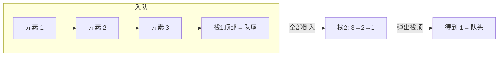

## 纲要

- 剑指 Offer 09：用两个栈实现队列，支持 `appendTail`（队尾入）与 `deleteHead`（队头出）
- 关键洞察：栈是后进先出、队列是先进先出，**两个 LIFO 串联可得到 FIFO**
- `appendTail`：直接压入栈 1
- `deleteHead`：若栈 2 为空，把栈 1 全部倒入栈 2（顺序反转），再弹出栈 2 栈顶；两栈皆空返回 -1
- 给出完整可运行 Go 代码、状态推演与复杂度

## 📎 文本↔代码关联

- 讲稿：`work/source/8.mksz540-后端校招面试直通车，提前锁定大厂offer[完结]/{8}--第8章数据结构与算法之链表、栈、队列与二叉树iclass=new/[8.10]--8-11数组、栈、队列实战详解（四）`
- 关联代码：`code_refs` 为空，本卡片按讲稿逻辑用 **Go** 补充完整可运行实现（讲稿原示例为 Java vector/栈）。

## 为什么两个栈能变队列

栈 1 与栈 2 特性相反：栈 1 的"底部"是队列的头部，但栈底无法直接读取。解决思路是借助栈 2 做"倒带"：

- 入队 `appendTail`：直接把元素压入栈 1，栈 1 的最上方天然视作队列的**尾部**。
- 出队 `deleteHead`：队列头部在栈 1 底部、读不到。于是把栈 1 全部弹出并依次压入栈 2，原本在栈 1 底部的元素就跑到了栈 2 顶部，此时弹出栈 2 栈顶即得到最早的入队元素。



只有栈 2 为空时才需要"倒栈"，倒一次即可服务多次出队，因此均摊成本很低。

## Demo 示例

### 运行说明

将 `cqueue.go` 与 `main.go` 放在同一目录，执行 `go run cqueue.go main.go`。

### 代码说明

```go
package main

type CQueue struct {
	in  []int // 入队栈
	out []int // 出队辅助栈
}

func Constructor() CQueue {
	return CQueue{}
}

// 队尾插入
func (q *CQueue) AppendTail(value int) {
	q.in = append(q.in, value)
}

// 队头删除，空队列返回 -1
func (q *CQueue) DeleteHead() int {
	if len(q.in) == 0 && len(q.out) == 0 {
		return -1
	}
	// 出队栈为空时，把入队栈全部倒入，顺序反转
	if len(q.out) == 0 {
		for len(q.in) > 0 {
			q.out = append(q.out, q.in[len(q.in)-1])
			q.in = q.in[:len(q.in)-1]
		}
	}
	val := q.out[len(q.out)-1]
	q.out = q.out[:len(q.out)-1]
	return val
}
```

`main.go`：

```go
package main

import "fmt"

func main() {
	q := Constructor()
	fmt.Println(q.DeleteHead()) // 空队列: -1
	q.AppendTail(5)
	q.AppendTail(2)
	fmt.Println(q.DeleteHead()) // 5
	fmt.Println(q.DeleteHead()) // 2
	fmt.Println(q.DeleteHead()) // 空队列: -1
}
```

预期输出：

```text
-1
5
2
-1
```

### 技术点总结

- 两个栈串联得到 FIFO：入队走栈 1，出队前把栈 1 整体倒入栈 2 实现顺序反转。
- 倒栈只在栈 2 为空时发生，一次倒入可支撑多次出队，均摊效率高。
- 空队列（两栈皆空）时 `deleteHead` 返回 -1，是题目规定的边界行为。
- 复杂度：每个元素最多"入栈 1 一次 + 入栈 2 一次 + 出栈 2 一次"，均摊 **O(1)**。

## API 速览

| 操作 | 说明 | 复杂度 |
| --- | --- | --- |
| `AppendTail` | `in = append(in, value)` | O(1) 均摊 |
| 倒栈 | 栈 1 全部倒入栈 2（仅栈 2 空时） | 单次 O(n)，均摊 O(1) |
| `DeleteHead` | 弹出栈 2 栈顶 | O(1) 均摊 |
| 空判定 | `len(in)==0 && len(out)==0` | O(1) |
