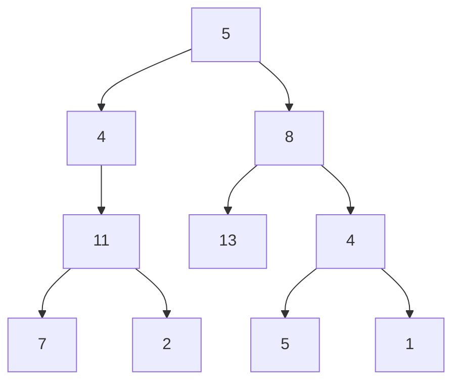
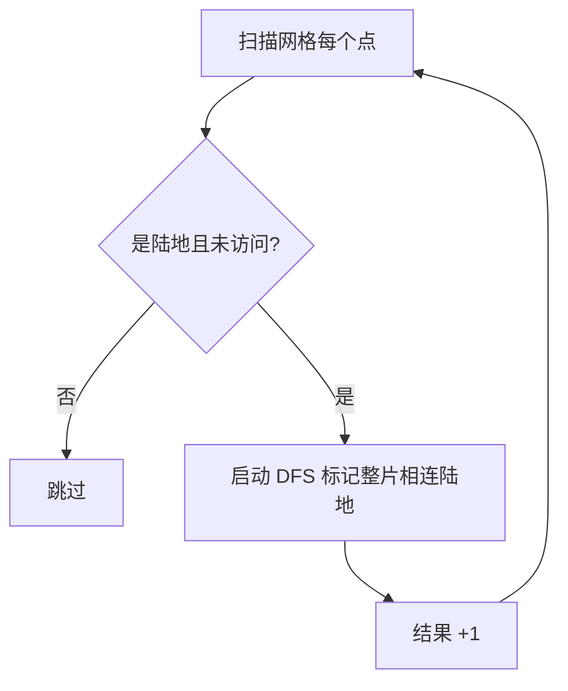

## 纲要

- 深度优先遍历与广度优先遍历的区别：先触达叶子节点 vs 按层触达
- 二叉树前序遍历本质上就是 DFS：枚举所有路径后过滤
- LeetCode 200 岛屿数量：用 DFS 把一片相连陆地全部标记为同一座岛屿
- DFS 的核心：递归 + 辅助 visited 数组避免重复访问
- 递归终止条件必须写全：越界、是水、已访问都要直接返回，否则会无限递归
- 每完成一次完整的 DFS 探索，就得到一座岛屿，结果加一
- 完整可运行的 Go 示例：前序遍历、路径总和、岛屿数量

## 深度优先与广度优先的区别

以一棵二叉树为例，根节点为 5，第二层为 4 和 8，第三层为 11、13、4，第四层为 7、2、5、1。

- **深度优先遍历（DFS）**：站在节点 5 时先选 4，再沿 4 一路向下到 11，再到 7、2，把这条分支的叶子全部搜索完，才回到 8 继续向下。特点是"先到达某个叶子节点"。
- **广度优先遍历（BFS）**：站在节点 5 时先罗列这一层的所有可能（4 和 8），再进入下一层（11、13、4），最后第四层一起访问。特点是"按层扩散"。

前序、中序、后序三种遍历，差别仅在于中间节点的访问顺序（前、中、后），但本质都是"先到达一个叶子，再到达另一个叶子"，因此都属于深度优先遍历。



前面用前序遍历求解路径总和时，实际上是把从根到叶子的所有路径都枚举出来（5-4-11-7、5-4-11-2、5-8-13、5-8-4-5、5-8-4-1），再过滤出路径和等于目标的那些。这个过程本质上就是一次深度优先搜索。

## 实战：岛屿数量（LeetCode 200）

题目：给定一个由 `0`（水）和 `1`（陆地）组成的二维网格，计算岛屿的数量。岛屿由水平或竖直方向相连的陆地组成，且总被水包围。

用 DFS 求解的思路：

- 遍历网格中的每一个点，只有当该点是陆地（值为 `1`）且尚未被访问时，才启动一次 DFS；
- 在这次 DFS 中，把当前点上下左右相连的所有陆地全部标记为"已访问"，它们共同构成同一座岛屿；
- 一旦一次完整的 DFS 结束，说明一座岛屿被完整找出，结果计数加一。



这里"深度"体现在：每当搜索到一个陆地点时，都会把它相连的所有陆地一次性找全，形成一座岛屿。而为了避免重复搜索，必须借助一个 **visited 辅助数组** 记录已经处理过的点。

## DFS 递归的终止条件（易错点）

DFS 通常用递归实现，而递归最重要的是把**终止（返回）条件写全**，否则会无限递归导致栈溢出。针对岛屿问题，进入递归后需要先判断：

1. 行下标越界（`i < 0` 或 `i >= 行数`）→ 返回；
2. 列下标越界（`j < 0` 或 `j >= 列数`）→ 返回；
3. 当前格子是水（`grid[i][j] == '0'`）→ 返回；
4. 当前格子已被访问（`visited[i][j] == true`）→ 返回。

只有以上都不满足，当前点才是"与起点相连的、未被访问的陆地"，将其标记为已访问，再向上下左右四个方向继续递归。

> 现场写代码时常见的两个坑：一是边界判断写成 `>` 而非 `>=`（数组从 0 开始，等于长度时已经越界）；二是漏掉"已访问"判断，导致上下左右来回访问同一点、陷入死循环。

## 完整可运行示例（Go）

以下示例根据讲稿中描述的 DFS 逻辑补充实现，包含前序遍历、路径总和与岛屿数量三部分。

### 运行说明

```bash
mkdir dfs-demo && cd dfs-demo
go mod init dfs-demo
# 将下方代码保存为 main.go
go run main.go
```

Go 1.18+ 即可运行，无第三方依赖。

### 完整代码

```go
package main

import "fmt"

// ============ 一、二叉树 DFS（前序遍历 + 路径总和） ============

type TreeNode struct {
	Val   int
	Left  *TreeNode
	Right *TreeNode
}

// PreorderDFS 前序遍历：根 -> 左 -> 右，本身就是一次深度优先搜索
func PreorderDFS(root *TreeNode) []int {
	var res []int
	var dfs func(*TreeNode)
	dfs = func(n *TreeNode) {
		if n == nil {
			return
		}
		res = append(res, n.Val) // 访问根
		dfs(n.Left)
		dfs(n.Right)
	}
	dfs(root)
	return res
}

// PathSumDFS 找出所有根到叶子、路径和等于 target 的路径
func PathSumDFS(root *TreeNode, target int) [][]int {
	var res [][]int
	var path []int
	var dfs func(*TreeNode)
	dfs = func(n *TreeNode) {
		if n == nil {
			return
		}
		path = append(path, n.Val)
		if n.Left == nil && n.Right == nil { // 到达叶子
			sum := 0
			for _, v := range path {
				sum += v
			}
			if sum == target {
				tmp := make([]int, len(path))
				copy(tmp, path)
				res = append(res, tmp)
			}
		} else {
			dfs(n.Left)
			dfs(n.Right)
		}
		path = path[:len(path)-1] // 回溯
	}
	dfs(root)
	return res
}

// buildTree 构造讲稿中的示例树
//        5
//       / \
//      4   8
//     /   / \
//    11  13  4
//   / \      / \
//  7   2    5   1
func buildTree() *TreeNode {
	n := func(v int) *TreeNode { return &TreeNode{Val: v} }
	root := n(5)
	root.Left = n(4)
	root.Right = n(8)
	root.Left.Left = n(11)
	root.Right.Left = n(13)
	root.Right.Right = n(4)
	root.Left.Left.Left = n(7)
	root.Left.Left.Right = n(2)
	root.Right.Right.Left = n(5)
	root.Right.Right.Right = n(1)
	return root
}

// ============ 二、岛屿数量（LeetCode 200） ============

// NumIslands 用 DFS 统计二维网格中的岛屿数量
func NumIslands(grid [][]byte) int {
	if len(grid) == 0 {
		return 0
	}
	m, cols := len(grid), len(grid[0])
	visited := make([][]bool, m)
	for i := range visited {
		visited[i] = make([]bool, cols)
	}
	// 上下左右四个方向
	dirs := [][2]int{{-1, 0}, {1, 0}, {0, -1}, {0, 1}}
	var dfs func(int, int)
	dfs = func(r, c int) {
		// 终止条件：越界、是水、已访问，均直接返回
		if r < 0 || r >= m || c < 0 || c >= cols || grid[r][c] == '0' || visited[r][c] {
			return
		}
		visited[r][c] = true
		for _, d := range dirs {
			dfs(r+d[0], c+d[1])
		}
	}
	res := 0
	for i := 0; i < m; i++ {
		for j := 0; j < cols; j++ {
			if grid[i][j] == '1' && !visited[i][j] {
				dfs(i, j) // 完整探索一座岛屿
				res++      // 每次完整 DFS 得到一座岛屿
			}
		}
	}
	return res
}

// ============ 三、演示 ============

func main() {
	root := buildTree()
	fmt.Println("前序遍历:", PreorderDFS(root))
	// target = 22，期望路径: 5-4-11-2 与 5-8-4-5
	fmt.Println("路径和为22:", PathSumDFS(root, 22))

	grid := [][]byte{
		{'1', '1', '0', '0', '0'},
		{'1', '1', '0', '0', '0'},
		{'0', '0', '1', '0', '1'},
		{'0', '0', '0', '1', '1'},
	}
	fmt.Println("岛屿数量:", NumIslands(grid)) // 期望 3
}
```

预期输出：

```
前序遍历: [5 4 11 7 2 8 13 4 5 1]
路径和为22: [[5 4 11 2] [5 8 4 5]]
岛屿数量: 3
```

### 代码说明

- 前序遍历的 `dfs` 先访问根再递归左右子树，遍历顺序即为深度优先；它枚举了所有根到叶子的路径，与路径总和复用同一棵树形结构。
- 路径总和在叶子节点处才计算路径和，命中目标就拷贝当前 `path` 保存；递归返回前执行 `path = path[:len(path)-1]` 完成回溯，保证进入新分支时路径干净。
- 岛屿数量的 `dfs` 把"越界 / 是水 / 已访问"三种情况合并为同一个终止判断，先标记当前点为已访问，再向四邻域扩散；外层两重循环每遇到一个未访问的陆地就启动一次 DFS，计数加一。

### 技术点总结

| 题目 | 核心数据结构 | DFS 作用 | 关键细节 |
| --- | --- | --- | --- |
| 前序遍历 | 二叉树 + 递归栈 | 枚举所有路径 | 访问顺序根→左→右 |
| 路径总和 | 二叉树 + 回溯 | 找目标和路径 | 叶子处判和，回溯恢复路径 |
| 岛屿数量 | 二维网格 + visited | 标记整片相连陆地 | 终止条件写全，避免无限递归 |

## 面试答题要点

- 讲清 DFS 与 BFS 的形态差异：DFS 先触达叶子、BFS 按层扩散；二叉树前序遍历就是 DFS。
- 岛屿数量题：强调 visited 数组的作用，以及递归终止条件必须覆盖"越界、是水、已访问"三种情况。
- 强调回溯：路径类问题在递归返回前要恢复现场（如 `path` 出栈），否则会影响其他分支。
- 一句话总结：DFS 适合"一条路走到黑"式的探索，配合递归与回溯可以优雅地穷举解空间。
