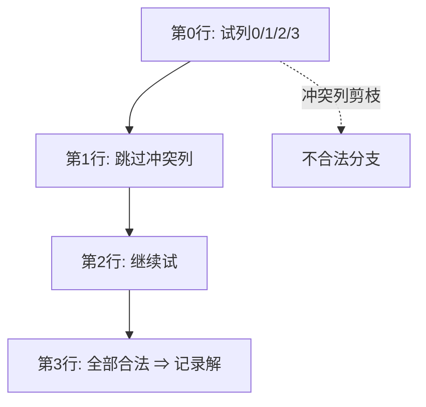
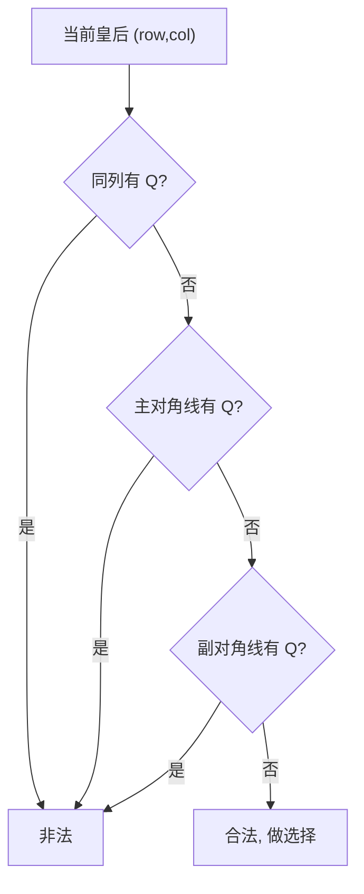

## 纲要

- LeetCode 51（N 皇后）：在 `n × n` 棋盘放置 n 个皇后，使彼此不在同一行、列、45°/135° 斜线
- 同样套用回溯模板：按行深搜，每行尝试每一列，合法则做选择、递归下一行、撤销
- 合法判定 `isValid`：列冲突 + 主对角线（左上→右下）+ 副对角线（右上→左下）三方检查
- 棋盘用 `byte` 二维数组表示（`Q` 皇后、`.` 空），终止时转成题目要求的字符串列表
- 易错点：行号作为递归参数，终止判断应是 `row == n`；斜线检查方向与循环边界要写对
- 给出完整可运行 Go 代码、解空间示意与复杂度

## 📎 文本↔代码关联

- 讲稿：`work/source/8.mksz540-后端校招面试直通车，提前锁定大厂offer[完结]/{9}--第9章数据结构与算法之排序、回溯、贪心、搜索与动态规划iclas/[9.5]--9-5回溯算法题模板与实战详解（二）`
- 关联代码：`code_refs` 为空，本卡片按讲稿逻辑用 **Go** 补充完整可运行实现（讲稿原示例为 Java/LeetCode 在线判题）。

## 为什么仍是回溯

N 皇后与上一节的排列同属"在解空间树上深搜 + 剪枝"。区别在于**选择列表与合法性约束**：每一行皇后有 n 个可放位置（列 0~n-1），但放之前要判断该位置会不会与已放皇后互相攻击。把"不合法"的分支剪掉，就只在合法子树里继续递归。



以三皇后为例：第一行放列 0 后，第二行列 0（同列）、列 1（45°斜线）都冲突被剪，只有列 2 合法；但第三行已无合法列，说明该分支无解——这正是剪枝在缩小搜索空间。

## 合法性判定

放置 `(row, col)` 时检查三类冲突（行冲突天然不存在，因为每行只放一个）：

- **列**：上方同列是否已存在皇后。
- **主对角线（左上→右下）**：`(row-1, col-1)`、`(row-2, col-2)` … 方向向上向左。
- **副对角线（右上→左下）**：`(row-1, col+1)`、`(row-2, col+2)` … 方向向上向右。



## Demo 示例

### 运行说明

将 `nqueens.go` 与 `main.go` 放在同一目录，执行 `go run nqueens.go main.go`。

### 代码说明

```go
package main

func solveNQueens(n int) [][]string {
	board := make([][]byte, n)
	for i := range board {
		board[i] = make([]byte, n)
		for j := range board[i] {
			board[i][j] = '.'
		}
	}
	var result [][]string

	var backtrack func(row int)
	backtrack = func(row int) {
		if row == n { // 已放下 n 个皇后，记录解
			tmp := make([]string, n)
			for i := 0; i < n; i++ {
				tmp[i] = string(board[i])
			}
			result = append(result, tmp)
			return
		}
		for col := 0; col < n; col++ {
			if !isValid(board, row, col, n) {
				continue
			}
			board[row][col] = 'Q' // 做选择
			backtrack(row + 1)
			board[row][col] = '.' // 撤销选择
		}
	}

	backtrack(0)
	return result
}

func isValid(board [][]byte, row, col, n int) bool {
	// 列冲突
	for i := 0; i < row; i++ {
		if board[i][col] == 'Q' {
			return false
		}
	}
	// 主对角线（向左上）
	for i, j := row-1, col-1; i >= 0 && j >= 0; i, j = i-1, j-1 {
		if board[i][j] == 'Q' {
			return false
		}
	}
	// 副对角线（向右上）
	for i, j := row-1, col+1; i >= 0 && j < n; i, j = i-1, j+1 {
		if board[i][j] == 'Q' {
			return false
		}
	}
	return true
}
```

`main.go`：

```go
package main

import "fmt"

func main() {
	sols := solveNQueens(4)
	fmt.Println("解的个数:", len(sols))
	for _, s := range sols {
		fmt.Println(s)
	}
}
```

预期输出：

```text
解的个数: 2
[.Q.. ...Q Q... ..Q.]
[..Q. Q... ...Q .Q..]
```

### 技术点总结

- 递归以 `row` 为参数：每行只放一个皇后，天然消除了行冲突，也决定了终止条件 `row == n`。
- `isValid` 只需查"列 + 两条对角线"：从当前位置沿已放置区域（上方）回溯检查即可，不必扫描全盘。
- 斜线检查的方向与边界极易写反：主对角线是 `i--, j--`，副对角线是 `i--, j++`，循环条件要与之一致。
- 记录解时必须把 `byte` 棋盘逐行转成 `string` 副本，避免后续撤销操作改掉已存入的结果。
- 复杂度：解空间上界 n!（每行 n 选 1），剪枝后实际远小于此；每次合法性检查 O(n)，整体最坏 **O(n!)**。

## API 速览

| 操作 | 说明 | 复杂度 |
| --- | --- | --- |
| 棋盘初始化 | `make([][]byte, n)` 填充 `.` | O(n²) |
| 终止判定 | `row == n` | O(1) |
| `isValid` | 查列 + 主/副对角线 | O(n) |
| 做/撤选择 | `board[row][col] = 'Q' / '.'` | O(1) |
| 整体 | 解空间 n! 上界，剪枝后更小 | 时间 O(n!)，空间 O(n²) |
