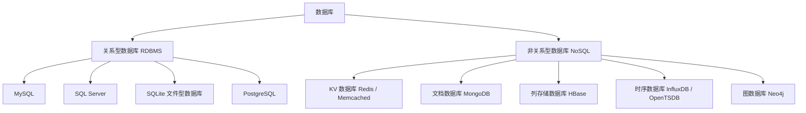

## 纲要

- 数据库的两大阵营：关系型数据库（RDBMS）与非关系型数据库（NoSQL）
- 关系型数据库的本质：把复杂数据结构归约为二维表，通过表间关联/合并/连接完成数据管理
- 典型关系型数据库：MySQL、SQL Server、SQLite、PostgreSQL
- NoSQL 的四个常见子类：KV 数据库、文档数据库、列存储数据库、图数据库
- 各类型数据库的数据组织方式、读写特征与适用场景对比
- 面试高频问法："你了解哪些数据库？它们分别适合什么场景？"

## 数据库全景与分类

后端开发接触的数据库远不止 MySQL 一种。按数据组织方式划分，可以先把它们分成两大阵营：

理解这张图的关键不在于背下产品名字，而在于回答一个问题：**数据是"按行"还是"按别的维度"组织和检索的**。

## 关系型数据库

关系型数据库的核心特征是：把复杂的数据结构归约为简单的**二维表格**来组织与存储。对数据的操作几乎都建立在一张或多张关系表上，通过表之间的关联、合并、连接、筛选来完成数据管理。

以一套课程系统为例，数据被拆分到三张表中：

| 科目 | 老师 | 学分 | 课时 | 人数 |
| --- | --- | --- | --- | --- |
| 语文 | 黄老师 | 4 | 60 | 80 |
| 英语 | 陈老师 | 3 | 60 | 75 |
| 数学 | 刘老师 | 5 | 80 | 60 |

| 老师 | 性别 | 毕业院校 | 职称 |
| --- | --- | --- | --- |
| 黄老师 | 女 | A 大学 | 高级教师 |
| 陈老师 | 男 | B 大学 | 一级教师 |

第三张表保存学生信息。三张表各自独立成行完整记录，行与行之间天然无关联，只有通过外键（如科目表的"老师"列指向教师表）才建立起关系。

常见产品的定位差异：

| 产品 | 定位 |
| --- | --- |
| MySQL | 开源、互联网场景最常用，本课程的主角 |
| SQL Server | 微软生态，通常运行在 Windows 服务器上 |
| SQLite | 轻量文件型数据库，数据落在本地单个文件里，在此之上提供 SQL 查询能力，常见于嵌入式与移动端 |
| PostgreSQL | 近年热度很高，对复杂查询与 OLAP 场景支持更好 |

关系型数据库的强项是**事务、一致性约束与多表关联查询**，这也是业务系统主库几乎都选它的原因。

## 非关系型数据库

NoSQL 并不是"不用 SQL"的字面含义，更准确的理解是 **Not Only SQL**——它是一大类数据库的统称，共同点是**去掉了关系模型**，数据之间的关系不再紧密，因此更易水平扩展，架构上更偏向大数据量与高性能设计。

### KV 数据库

KV 数据库通过特定的 key 指向特定的 value，value 通常支持多种数据格式。检索时只要算出 key 交给数据库，就能直接取回对应的数据，本质是一张分布式哈希表。

- 典型产品：Redis、Memcached
- 典型用途：内存缓存、文件缓存、对象存储、会话与排行榜

因为数据之间没有关系约束，KV 库的使用极其简单：设计好唯一的 key，写入 value，读取时按 key 取回即可。代价是不支持按 value 的复杂条件查询。

### 文档数据库

文档数据库可以理解为 KV 数据库的升级版，value 不再是任意二进制，而是**结构化文档**（如 JSON/BSON 一类的半结构化格式）。

- 典型产品：MongoDB
- 典型用途：商品详情、文章内容、配置项这类结构经常变化的数据
- 额外能力：多数文档数据库支持文档版本回溯，可以保存历史版本并按版本恢复

### 列存储数据库

列存储数据库与关系型数据库最大的差异在**物理分区方式**：关系库按行分区，列存库按列分区、按列分组存储。

假设有四台设备在 10 月 1 日到 10 月 4 日的采样数据：

| 时间 | 设备一 | 设备二 | 设备三 | 设备四 |
| --- | --- | --- | --- | --- |
| 10-01 | v11 | v21 | v31 | v41 |
| 10-02 | v12 | v22 | v32 | v42 |
| 10-03 | v13 | v23 | v33 | v43 |
| 10-04 | v14 | v24 | v34 | v44 |

关系库按行切分，取"设备一"的时间序列需要扫描所有行；列存库把"设备一"这一列连续存放，一次顺序 IO 就能取完整列。多数查询只检索表中的一列或几列，因此列存在聚合分析场景效率极高。

- 典型产品：HBase，以及时序场景下的 InfluxDB、OpenTSDB
- 适用场景：监控指标、日志、离线分析
- 不适用：更新与删除频繁的场景，因为列式存储对原地修改不友好

### 图数据库

图数据库用图论来存储实体之间的关系信息，是典型的 NoSQL 数据库。

- 每个实体是一个**节点**，每条关系是一条**边**
- 典型产品：Neo4j
- 典型场景：社交网络、智能推荐、风控关系链挖掘

在推荐场景中，"猜你认识的人"就是从某个人的节点出发，沿着与他相连的边去检索相邻节点。这类多跳关系查询用关系型数据库需要反复 JOIN，图数据库则是沿着边直接遍历。

## 五类数据库的横向对比

| 类型 | 数据单位 | 读写特征 | 典型场景 | 不擅长 |
| --- | --- | --- | --- | --- |
| 关系型 | 行 | 事务强一致，支持多表 JOIN | 交易、账务、业务主库 | 海量写入与动态 schema |
| KV | key-value | O(1) 点查，延迟极低 | 缓存、会话、计数器 | 条件查询、范围查询 |
| 文档 | JSON 文档 | schema 灵活，按文档读写 | 内容、商品、配置 | 跨文档事务与复杂关联 |
| 列存储 | 列 | 批量扫描、聚合极快 | 监控、日志、OLAP | 高频更新删除 |
| 图 | 节点与边 | 多跳关系遍历 | 社交、推荐、风控 | 大批量简单点查 |

## 面试作答思路

被问到"数据库有哪些分类、各自适合什么场景"时，建议按下面这条线回答：

- 先给出划分依据：按数据组织方式分为关系型与非关系型
- 关系型讲清楚二维表 + 事务 + JOIN，并点名 MySQL、PostgreSQL、SQL Server、SQLite
- 非关系型按 KV、文档、列存储、图四类分别给出产品与场景
- 最后落到选型原则：业务主数据用关系型，缓存用 KV，结构多变用文档，分析型用列存，关系挖掘用图
