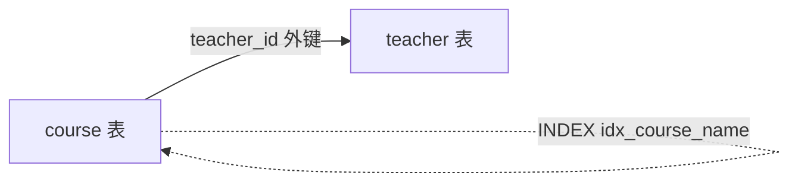

## 纲要

- `CREATE TABLE` 官方模板：`CREATE [TEMPORARY] TABLE [IF NOT EXISTS] tbl_name (create_definition, ...) [table_options] [partition_options]`
- `create_definition` 是建表核心：定义列名、数据类型、是否空、默认值等
- 列属性：`NOT NULL`、`DEFAULT`、自增 `AUTO_INCREMENT`
- 表级约束：主键 `PRIMARY KEY`、外键 `FOREIGN KEY ... REFERENCES`、普通索引 `INDEX`
- 表选项 `table_options`：存储引擎 `ENGINE=InnoDB`、默认字符集
- 分区选项 `partition_options`：RANGE / LIST / KEY / HASH 分区，用于优化大表 IO

## 创建数据表的语法

MySQL 官方建表模板（中括号为可选项）：

```sql
CREATE [TEMPORARY] TABLE [IF NOT EXISTS] tbl_name
    (create_definition, ...)
    [table_options]
    [partition_options];
```

- `TEMPORARY`：创建临时表，会话结束自动销毁；
- `IF NOT EXISTS`：表不存在才创建，避免重复执行报错；
- `create_definition`：最重要的部分，定义列与表级约束；
- `table_options`：表级属性（引擎、字符集等）；
- `partition_options`：分区规则。

## create_definition：列与约束

`create_definition` 负责定义每一列的**名字、数据类型、是否允许为空、默认值**等属性，还可定义主键、外键和索引。

以一张课程表为例，包含课程 ID、课程名、老师 ID、学分、课时、创建时间、最后修改时间：

```sql
CREATE TABLE IF NOT EXISTS course (
    course_id   INT            NOT NULL AUTO_INCREMENT,   -- 课程ID，自增主键
    course_name VARCHAR(64)    NOT NULL DEFAULT '',        -- 课程名，不允许空，默认空串
    teacher_id  INT            NOT NULL,                   -- 授课老师ID
    credit      INT            NOT NULL,                   -- 学分
    duration    INT            NOT NULL,                   -- 课时
    create_time DATETIME       NOT NULL DEFAULT CURRENT_TIMESTAMP, -- 创建时间
    modify_time DATETIME       NOT NULL DEFAULT CURRENT_TIMESTAMP
                              ON UPDATE CURRENT_TIMESTAMP, -- 修改时自动刷新
    PRIMARY KEY (course_id),                     -- 主键
    FOREIGN KEY (teacher_id) REFERENCES teacher(teacher_id), -- 外键
    INDEX idx_course_name (course_name)          -- 普通索引，加速按名检索
) ENGINE = InnoDB DEFAULT CHARSET = utf8mb4;
```

### 关键列属性

- `NOT NULL`：该列不允许为空；
- `DEFAULT ''`：未显式赋值时使用默认空串（如 `course_name`）；
- `AUTO_INCREMENT`：自增字段，常用于主键，由数据库自动生成递增的唯一值；
- `DEFAULT CURRENT_TIMESTAMP`：插入时若未指定，取当前时间戳；
- `ON UPDATE CURRENT_TIMESTAMP`：该行被更新时，时间戳自动刷新为当前时间。

## 主键与外键

- **主键 `PRIMARY KEY`**：关系型表中强烈建议显式指定。若未指定，InnoDB 也会隐式生成一个内部主键。主键保证行唯一性，如 `PRIMARY KEY (course_id)`。
- **外键 `FOREIGN KEY ... REFERENCES`**：表达"这张表的某列指向另一张表的主键/唯一键"。例如 `course.teacher_id` 指向 `teacher.teacher_id`，查询某门课的老师信息时，可凭 `teacher_id` 去 `teacher` 表检索。外键用于维护引用完整性。



## 普通索引

`INDEX idx_course_name (course_name)` 既不属于主键也不属于外键，仅为 `course_name` 建立索引。当按课程名检索时，可借助该索引加速，避免全表扫描。

## 表选项与分区

### table_options

定义表级属性，最常用的是存储引擎与字符集：

- `ENGINE = InnoDB`：InnoDB 支持事务、行级锁、外键，是绝大多数业务的首选；
- `DEFAULT CHARSET = utf8mb4`：表级默认字符集，未指定列字符集时继承。

### partition_options（运维向）

指定表数据的分区规则，目的是优化 IO 与查询性能，业务开发中较少手写：

- `RANGE`：按列值落入的连续区间分区；
- `LIST`：按离散的枚举值分区；
- `KEY` / `HASH`：按哈希结果分区，哈希相同的数据落入同一分区。

## Demo 示例

### 运行说明

在 MySQL 5.7 / 8.0 客户端执行；外键要求被引用的 `teacher` 表已存在，可先建 `teacher` 表：

```sql
CREATE TABLE IF NOT EXISTS teacher (
    teacher_id   INT         NOT NULL AUTO_INCREMENT,
    teacher_name VARCHAR(64) NOT NULL DEFAULT '',
    PRIMARY KEY (teacher_id)
) ENGINE = InnoDB DEFAULT CHARSET = utf8mb4;

CREATE TABLE IF NOT EXISTS course (
    course_id   INT         NOT NULL AUTO_INCREMENT,
    course_name VARCHAR(64) NOT NULL DEFAULT '',
    teacher_id  INT         NOT NULL,
    credit      INT         NOT NULL,
    duration    INT         NOT NULL,
    create_time DATETIME    NOT NULL DEFAULT CURRENT_TIMESTAMP,
    modify_time DATETIME    NOT NULL DEFAULT CURRENT_TIMESTAMP
                              ON UPDATE CURRENT_TIMESTAMP,
    PRIMARY KEY (course_id),
    FOREIGN KEY (teacher_id) REFERENCES teacher(teacher_id),
    INDEX idx_course_name (course_name)
) ENGINE = InnoDB DEFAULT CHARSET = utf8mb4;

-- 验证结构
DESCRIBE course;
SHOW CREATE TABLE course;
```

### 代码说明

- `course_id` 同时具备 `NOT NULL` 与 `AUTO_INCREMENT`，并作为 `PRIMARY KEY`，是典型自增主键设计；
- `FOREIGN KEY (teacher_id) REFERENCES teacher(teacher_id)` 建立课程到老师的引用关系，删除被引用的老师前需先处理关联课程；
- `modify_time` 上的 `ON UPDATE CURRENT_TIMESTAMP` 让"最后修改时间"自动维护，无需业务代码显式赋值；
- `ENGINE = InnoDB` 保证外键约束与事务能力生效。

### 技术点总结

| 概念 | 关键字 | 作用 |
| --- | --- | --- |
| 自增主键 | `AUTO_INCREMENT` + `PRIMARY KEY` | 唯一标识每行 |
| 非空约束 | `NOT NULL` | 禁止空值 |
| 默认值 | `DEFAULT` | 缺省赋值 |
| 外键 | `FOREIGN KEY ... REFERENCES` | 维护跨表引用完整性 |
| 普通索引 | `INDEX` | 加速特定列检索 |
| 存储引擎 | `ENGINE = InnoDB` | 事务/外键/行锁支持 |

## 阅读官方文档的建议

建表模板字段繁多，实际业务还会因需求衍生更多约束。建议以官方 `CREATE TABLE` 文档为准，遇到不确定的列定义或分区语法时直接查文档，补全知识全景。
