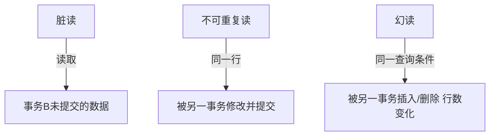

## 纲要

- 隔离性是事务四大特性之一，用于防止并发事务交叉执行导致的数据不一致
- 三种并发异常：脏读、不可重复读、幻读
- 四个隔离级别：未提交读、提交读、可重复读、串行化
- 各级别能解决的问题对照表
- 不可重复读 vs 幻读的核心区别：前者是"数据被修改"，后者是"数据被插入/删除（行数变化）"

## 三个核心概念

理解隔离级别前，必须先厘清三种并发读异常。

### 脏读（Dirty Read）

事务 A 读取了事务 B**尚未提交**的数据。由于 B 可能回滚，A 读到的就是"脏"的、可能根本不会存在的数据。

### 不可重复读（Non-Repeatable Read）

事务 A 需要多次读取同一份数据；在 A 的多次读取之间，事务 B 对该数据做了**更新并提交**。于是 A 两次读到的结果不一致。重点是：同一行数据的内容被改写了。

### 幻读（Phantom Read）

事务 A 按某个条件查询，准备对结果进行操作；但在它操作前，事务 B **插入或删除了**符合该条件的数据，导致 A 再次查询时发现"凭空多出来"或"消失了"的行。重点是：满足条件的**行数**发生了变化。

## 四个隔离级别

SQL 标准定义了四级隔离，严谨程度递增：

| 隔离级别 | 英文 | 解决脏读 | 解决不可重复读 | 解决幻读 |
| --- | --- | --- | --- | --- |
| 未提交读 | READ UNCOMMITTED | 否 | 否 | 否 |
| 提交读 | READ COMMITTED | 是 | 否 | 否 |
| 可重复读 | REPEATABLE READ | 是 | 是 | 否（标准定义） |
| 串行化 | SERIALIZABLE | 是 | 是 | 是 |

### 未提交读（READ UNCOMMITTED）

级别最低。事务可以读取其他事务未提交的数据，因此**脏读、不可重复读、幻读三种问题都无法避免**。

以金融账户为例：事务 A 执行"金额 +500"（尚未提交），事务 B 在此时读到了 A 未提交的 1500。一旦 A 回滚，B 读到的 1500 就是虚假数据——这就是脏读。

### 提交读（READ COMMITTED）

解决了脏读：事务只能读取**已提交**的数据。但无法解决不可重复读。

仍用账户例子：事务 B 需要两次读取同一账户余额。第一次读到 1000（A 尚未提交）；之后 A 提交"+500"，B 第二次读到 1500。B 在同一次事务内两次读取结果不一致，这就是不可重复读。

### 可重复读（REPEATABLE READ）

解决了不可重复读：事务 B 在整个事务期间多次读取同一数据，结果都保持一致（仿佛数据在事务开始时就被"定格"）。这是 MySQL InnoDB 的默认隔离级别。但它**仍不能解决幻读**——因为幻读关注的是行数的增减，而非单行内容的修改。

### 串行化（SERIALIZABLE）

最严谨。多个事务之间不能并发执行，必须一个接一个地串行运行，彻底杜绝脏读、不可重复读、幻读。本质上等同于对涉及的数据加锁。代价是牺牲并发性能，吞吐量明显下降。

## 不可重复读与幻读的区别（面试高频）

两者最容易被混淆，记住一句话即可：

- **不可重复读**：强调的是**同一行数据被修改**（update），两次读取内容不同；
- **幻读**：强调的是**数据被插入或删除**（insert / delete），满足条件的行数变多或变少。

换句话说，不可重复读是"老数据的值变了"，幻读是"数据凭空出现或消失"。串行化通过加锁同时压制二者，而可重复读（标准定义）只压制前者。

## 面试答题模板

问：请简述数据库的隔离级别，以及脏读、不可重复读、幻读的区别。

> 隔离性保证多个事务并发读写时互不干扰。并发下会出现三种异常：脏读（读到别的事务未提交的数据）、不可重复读（同一事务内多次读同一行，被别的事务修改提交导致不一致）、幻读（同一查询条件，被别的事务插入/删除导致行数变化）。SQL 有四级隔离：未提交读三种都不防；提交读防脏读；可重复读防脏读和不可重复读；串行化全防但性能最差。关键区别是——不可重复读是"行被改"，幻读是"行被增删"。
