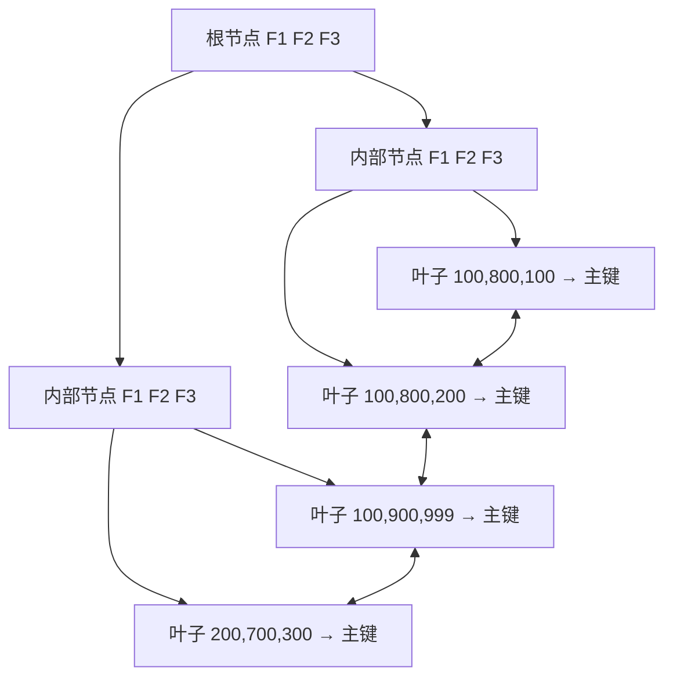

## 纲要

- 联合索引（复合索引）：由多个字段共同组成的索引，每个索引节点包含多个字段的值
- 与单列索引的区别：单列索引依赖一个字段，联合索引依赖两个及以上字段
- 索引体积随字段行数呈乘积关系增长，字段不宜过多
- 五个典型 case 逐条分析联合索引是否生效
- 核心结论：最左匹配原则、首字段必须出现、与 `where` 条件书写顺序无关

## 什么是联合索引

前面接触的主键、外键、普通索引都建立在单个列上：主键是课程 ID，外键是老师 ID，普通索引是课程名。这些都属于单列索引。

**联合索引**（也称复合索引）则是由多个字段共同组成的索引。假设表中有 F1、F2、F3 三个字段：

- 由 F1、F2 组成的 `idx_xy` 是联合索引
- 由 F1、F2、F3 组成的 `idx_xyz` 也是联合索引

它最大的特点是：**索引的每个节点都包含多个字段的值**，关键字按建索引时声明的字段顺序依次比较排序。



### 字段数量与索引体积

假设 F1、F2、F3 各有 100 行不同取值，那么联合索引的叶子节点规模是 100 × 100 × 100 = 100 万，呈**乘积（指数）关系**增长。

这带来一条硬性建议：**不要用太多字段建联合索引**。字段越多，B+ 树越庞大，占用的内存与磁盘越多，维护成本也越高，只有在确实需要覆盖特定查询组合时才建。

## 五个 case 分析

以下分析基于表 `t` 上的联合索引 `idx_xyz(F1, F2, F3)`，用 `EXPLAIN` 观察 `possible_keys` 与 `key`。

| case | where 条件 | 是否使用 idx_xyz | 说明 |
| --- | --- | --- | --- |
| 1 | `F1=100 and F2=800 and F3=100` | 完整使用 | 依次匹配 F1、F2、F3 |
| 2 | `F1=100 and F2=800` | 使用 F1、F2 | 从左连续匹配到 F2 |
| 3 | `F1=100 and F3=999` | 仅 F1 生效 | F1 与 F3 不连续，F3 只能在结果集上过滤 |
| 4 | `F2=100 and F3=999` | 不生效 | 缺少最左字段 F1，possible_keys 为 NULL |
| 5 | `F3=100 and F2=999 and F1=60` | 生效 | 优化器会重排条件顺序 |

逐条展开：

- **case 1**：三个字段全部命中。检索时先在 B+ 树中按 F1 定位，再在 F1 相同的区间内确定 F2，最后确定 F3，充分利用了整棵联合索引树。
- **case 2**：只给了 F1 和 F2。由于 F1 已经限定了范围，在 F1 相同的子树里 F2 依然是有序的，所以联合索引同样生效。
- **case 3**：F1 与 F3 之间隔了 F2。索引只在 `F1=100` 这个子条件上生效，`F3=999` 只能在已经取出的结果集上逐行过滤（MySQL 5.6 之后表现为索引条件下推 `Using index condition`，但仍不是完整的索引定位）。
- **case 4**：没有最左字段 F1，索引的第一列无法确定起点，整棵树无法定位，`possible_keys` 与 `key` 都为 NULL，直接全表扫描。
- **case 5**：条件顺序被打乱成 F3、F2、F1，但联合索引依然生效。因为 SQL 在引擎层会经过编译与优化，**条件的书写顺序与索引使用无关**，只与字段是否出现、是否连续有关。

## 三条核心结论

- **最左匹配原则**：联合索引从建索引时最左边的字段开始匹配，依次向右。只有连续匹配的前缀才能真正用于定位。case 1、2、3、4 共同印证了这一点。
- **必须使用第一个字段**：`where` 条件里不出现联合索引的第一个字段，索引整体失效（case 4）。
- **与条件顺序无关**：`where` 中字段的书写顺序不影响索引使用，优化器会重排（case 5）。

## Demo 示例

### 运行说明

在 MySQL 5.7/8.0 客户端直接执行即可，观察 `EXPLAIN` 输出中的 `key` 与 `Extra`。

```sql
DROP TABLE IF EXISTS t_course;
CREATE TABLE t_course (
    id        BIGINT      NOT NULL AUTO_INCREMENT,
    f1        INT         NOT NULL,
    f2        INT         NOT NULL,
    f3        INT         NOT NULL,
    remark    VARCHAR(64) NOT NULL,
    PRIMARY KEY (id),
    KEY idx_xyz (f1, f2, f3)
) ENGINE = InnoDB DEFAULT CHARSET = utf8mb4;

INSERT INTO t_course (f1, f2, f3, remark)
VALUES (100, 800, 100, 'case1'),
       (100, 800, 200, 'case2'),
       (100, 900, 999, 'case3'),
       (200, 700, 300, 'case4'),
       (60,  999, 100, 'case5');

-- case 1：三列全命中
EXPLAIN SELECT * FROM t_course WHERE f1 = 100 AND f2 = 800 AND f3 = 100;

-- case 2：命中 f1、f2
EXPLAIN SELECT * FROM t_course WHERE f1 = 100 AND f2 = 800;

-- case 3：只有 f1 用于定位，f3 走索引条件下推
EXPLAIN SELECT * FROM t_course WHERE f1 = 100 AND f3 = 999;

-- case 4：缺少最左列 f1，索引失效
EXPLAIN SELECT * FROM t_course WHERE f2 = 100 AND f3 = 999;

-- case 5：条件顺序打乱，优化器重排后仍然走索引
EXPLAIN SELECT * FROM t_course WHERE f3 = 100 AND f2 = 999 AND f1 = 60;

-- 覆盖索引：只取索引列与主键，无需回表
EXPLAIN SELECT f1, f2, f3 FROM t_course WHERE f1 = 100 AND f2 = 800;
```

### 代码说明

- `KEY idx_xyz (f1, f2, f3)` 建立三列联合索引，索引内按 `(f1, f2, f3)` 的字典序排序
- case 3 的 `Extra` 常见为 `Using index condition`，说明 `f3` 被下推到索引层过滤，但没有参与定位
- case 4 的 `key` 为 `NULL`，对应全表扫描
- 最后一条查询的列全部落在索引与主键中，形成覆盖索引，`Extra` 出现 `Using index`

### 技术点总结

- 联合索引是有序的多列关键字，匹配必须从最左列开始且尽量连续
- 缺失最左列即整体失效，中断之后只能靠过滤或条件下推
- 条件顺序无关，建索引时的字段顺序才决定一切
- 字段越多索引体积增长越快，按需建、避免冗余前缀索引

## API 速览

| 语法 | 作用 |
| --- | --- |
| `KEY idx_xyz (f1, f2, f3)` | 建立三列联合索引 |
| `ALTER TABLE t ADD INDEX idx_xy (f1, f2)` | 已有表上追加联合索引 |
| `EXPLAIN SELECT ...` | 查看 `possible_keys`、`key`、`key_len`、`Extra` |
| `key_len` | 实际用到的索引字节数，可判断匹配到了联合索引的第几列 |
| `Using index condition` | 索引条件下推，部分条件在索引层过滤 |
| `Using index` | 覆盖索引，无需回表 |
