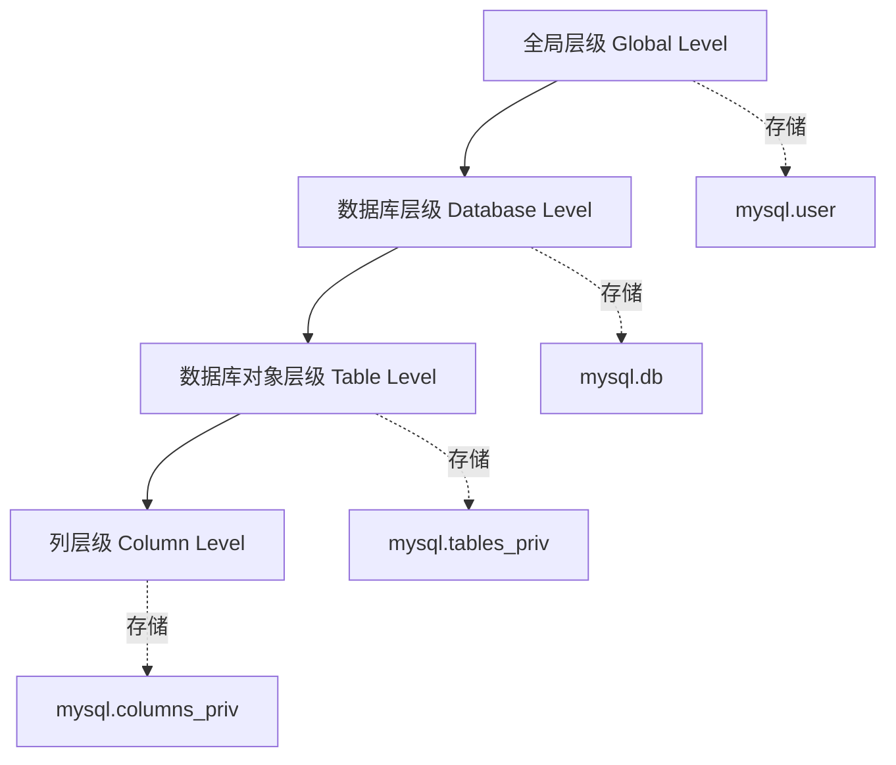

## 纲要

- MySQL 权限的四个层级：全局层级、数据库层级、数据库对象层级、列层级
- 各层级权限的存放位置：`mysql.user`、`mysql.db`、`mysql.tables_priv`、`mysql.columns_priv`
- 常见静态权限与所属层级对照
- 用户创建、授权、回收、改名、改密的标准语法
- `FLUSH PRIVILEGES` 的必要性：内存中的权限缓存与磁盘表不一致
- 最小权限原则下的授权实践

## 四个权限层级



| 层级 | 作用范围 | 典型对象 | 权限存放表 | 使用频率 |
| --- | --- | --- | --- | --- |
| 全局层级 | 整个 MySQL 实例 | 建库、改配置、用户管理、主从配置 | `mysql.user` | 仅管理员，不建议普通用户持有 |
| 数据库层级 | 指定数据库 | 库内的表、视图、触发器、索引 | `mysql.db` | 高，一个库一个专用账号 |
| 数据库对象层级 | 指定库的指定表 | 表结构与表数据 | `mysql.tables_priv` | 高，敏感表单独控制 |
| 列层级 | 指定库的指定表的指定列 | 特定列的增删改查 | `mysql.columns_priv` | 低，粒度太细很少使用 |

实践中最常用的是**数据库层级**与**数据库对象层级**。常见的做法是：创建一个数据库时，为它创建一个专用账号并授予该库的全部权限；库里如果存在敏感表（如支付流水），再单独限制该表的删除与查询权限。

## 常见权限与层级对照

| 权限 | 层级 | 说明 |
| --- | --- | --- |
| `ALL` / `ALL PRIVILEGES` | 全局 | 除 `GRANT OPTION` 外的全部权限 |
| `CREATE` | 库级、表级 | 创建 database、table、index |
| `CREATE USER` | 全局 | 创建用户，一般由 root 执行 |
| `ALTER` | 表级 | 修改表结构 |
| `DROP` | 库级、表级 | 删除库、表、视图 |
| `DELETE` | 表级 | 删除行数据 |
| `INDEX` | 表级 | 创建与删除索引 |
| `SELECT` | 表级 | 查询数据 |
| `UPDATE` | 表级 | 更新数据 |
| `SHOW DATABASES` | 全局 | 列出全部数据库 |
| `SHOW VIEW` | 表级 | 查看视图定义 |
| `REPLICATION CLIENT` / `REPLICATION SLAVE` | 全局 | 主从复制相关，只有全局层级可配置 |
| `RELOAD` / `SUPER` / `SHUTDOWN` | 全局 | 实例级运维操作 |

权限清单以官方文档为准，实际授权前建议查阅对应版本的权限说明，避免凭记忆下判断。除静态权限外，MySQL 8.0 还有一批以角色形式给出的动态权限。

## 用户的创建与授权

### 创建用户

```sql
CREATE USER 'username'@'hostname' IDENTIFIED BY 'password';
```

- `username`：用户名
- `hostname`：允许登录的主机。`localhost` 表示本机，`%` 表示任意主机，填写具体 IP 则只允许从该 IP 登录，其他来源会被拒绝
- `password`：登录密码

创建用户属于全局层级操作，通常由 root 执行。

### 授权

```sql
GRANT privileges ON database.table TO 'username'@'hostname' IDENTIFIED BY 'password';
```

- `*.*` 表示任意数据库的任意表，第一个 `*` 是库，第二个 `*` 是表
- 授予 `ALL PRIVILEGES ON *.*` 等于给出几乎全部权限，生产环境应避免

遵循最小权限原则的授权示例：

```sql
-- 授予 test 库下所有表的查询与插入权限
GRANT SELECT, INSERT ON test.* TO 'username'@'hostname';

-- 只允许操作 test.student 这一张表
GRANT SELECT, INSERT ON test.student TO 'username'@'hostname';
```

敏感库通常只给 `SELECT`、`INSERT`、`UPDATE`，不给 `DELETE`。

### 刷新权限

```sql
FLUSH PRIVILEGES;
```

`CREATE USER`、`GRANT` 这些操作都是在权限表里改记录，而 MySQL 启动时已经把权限信息加载到了内存。磁盘表改了、内存没改，二者不一致，因此需要手动触发一次刷新，让 MySQL 重新读取权限表更新内存中的授权缓存。

## 权限回收与用户变更

回收权限使用 `REVOKE`，语法结构与 `GRANT` 对应：

```sql
REVOKE ALL PRIVILEGES ON *.* FROM 'username'@'hostname';
REVOKE SELECT, INSERT ON test.* FROM 'username'@'hostname';
REVOKE SELECT, INSERT ON test.student FROM 'username'@'hostname';
```

用户不再使用时必须回收权限，保证访问约束始终有效。

用户信息的变更：

```sql
-- 删除用户
DROP USER 'username'@'hostname';

-- 修改用户名
RENAME USER 'username'@'hostname' TO 'newusername'@'hostname';
```

修改密码有三种方式：

```sql
-- 方式一：直接操作权限表记录，新密码经 PASSWORD() 加密后写入
SET PASSWORD FOR 'username'@'hostname' = PASSWORD('newpassword');

-- 方式二：使用 MySQL 内置机制，推荐
ALTER USER 'username'@'hostname' IDENTIFIED BY 'newpassword';
```

```bash
# 方式三：在操作系统命令行执行，需要有服务器的管理员权限
mysqladmin -u username -p oldpassword password newpassword
```

方式一直接改记录，方式二走 MySQL 内部的账户管理机制，更稳妥；方式三不在 MySQL 终端内执行，依赖服务器上的管理权限与登录方式。

## Demo 示例

### 运行说明

使用 root 或有 `CREATE USER` 权限的账号登录 MySQL，按序执行下面的脚本，可完整走一遍"建库 → 建账号 → 授权 → 验证 → 回收 → 删除"的流程。

```sql
-- 创建业务库与业务表
CREATE DATABASE IF NOT EXISTS shop DEFAULT CHARSET utf8mb4;
USE shop;
CREATE TABLE IF NOT EXISTS orders (
    id      BIGINT NOT NULL AUTO_INCREMENT,
    amount  INT    NOT NULL,
    PRIMARY KEY (id)
) ENGINE = InnoDB;

-- 创建只允许本机连接的只读账号
CREATE USER 'shop_reader'@'localhost' IDENTIFIED BY 'Reader@2024';
GRANT SELECT ON shop.* TO 'shop_reader'@'localhost';

-- 创建允许内网段连接、可写入但不可删除的账号
CREATE USER 'shop_writer'@'10.0.%' IDENTIFIED BY 'Writer@2024';
GRANT SELECT, INSERT, UPDATE ON shop.* TO 'shop_writer'@'localhost';

-- 敏感表单独收紧：禁止对 orders 的删除
REVOKE DELETE ON shop.orders FROM 'shop_writer'@'localhost';

-- 使授权生效
FLUSH PRIVILEGES;

-- 核对授权结果
SHOW GRANTS FOR 'shop_reader'@'localhost';
SHOW GRANTS FOR 'shop_writer'@'localhost';

-- 回收并删除账号
REVOKE SELECT ON shop.* FROM 'shop_reader'@'localhost';
DROP USER 'shop_reader'@'localhost';
DROP USER 'shop_writer'@'localhost';
FLUSH PRIVILEGES;
```

### 代码说明

- `shop_reader` 只拿到 `SELECT`，且限定 `localhost`，连来源都做了约束
- `shop_writer` 具备 `SELECT, INSERT, UPDATE`，但没有 `DROP` 与 `DELETE`，即使程序被注入也很难删库删表
- `REVOKE DELETE` 演示了对单表的收紧动作；实际场景中若未授予过 `DELETE`，该语句会报错，仅作演示
- 每次授权变更之后执行 `FLUSH PRIVILEGES`，让内存中的权限缓存与权限表同步
- `SHOW GRANTS` 用于核对最终生效的权限，是上线前的必查项

### 技术点总结

- 权限分四层，库级与表级最常用，全局权限只留给管理员
- 授权遵循最小权限原则：按库建账号、按表收紧、敏感库不给 `DELETE`
- `GRANT`/`REVOKE` 改的是权限表，必须 `FLUSH PRIVILEGES` 才能同步到内存
- 账号要绑定来源主机，避免 `%` 全开

## API 速览

| 语法 | 作用 |
| --- | --- |
| `CREATE USER 'u'@'h' IDENTIFIED BY 'p'` | 创建用户并指定允许登录的主机 |
| `GRANT priv ON db.tbl TO 'u'@'h'` | 授予权限，`*.*` 表示所有库所有表 |
| `REVOKE priv ON db.tbl FROM 'u'@'h'` | 回收权限 |
| `FLUSH PRIVILEGES` | 重新加载权限表到内存 |
| `SHOW GRANTS FOR 'u'@'h'` | 查看某用户的权限清单 |
| `DROP USER 'u'@'h'` | 删除用户 |
| `RENAME USER 'u'@'h' TO 'n'@'h'` | 修改用户名 |
| `ALTER USER 'u'@'h' IDENTIFIED BY 'p'` | 修改密码（推荐方式） |
| `SET PASSWORD FOR 'u'@'h' = PASSWORD('p')` | 改密（直接操作记录） |
| `mysqladmin -u u -p 旧密码 password 新密码` | 命令行改密 |
