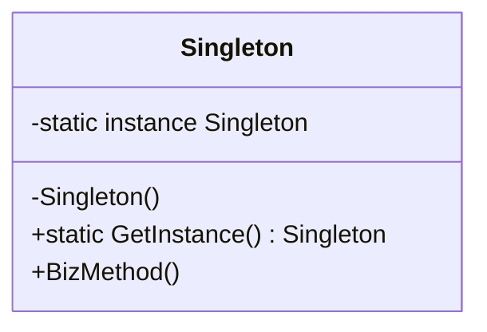

## 纲要

- 为什么需要单例：系统只需要一个实例、初始化开销大、需要统一访问点
- 单例的三要素：私有静态实例变量、公有的全局获取方法、私有的构造函数
- 朴素实现在多线程下会重复初始化，甚至产生空指针
- 两种线程安全实现：饿汉式与懒汉式
- Go 语言下的落地方式：包级变量与 `sync.Once`
- 使用建议与代价

## 为什么需要单例模式

有三类典型场景会自然导向单例：

- **系统层面只需要一个实例**。最形象的例子是 Windows 任务管理器：重复打开不会生效。如果允许同时存在多个任务管理器，多个窗口的内容必须完全一致，一旦不一致就说明至少有一个是错的，使用者无从判断该信哪个。
- **类的初始化资源消耗过大**。例如游戏里的地图对象，初始化时要加载贴图、完成渲染准备，开销极高；而地图在游戏进程中通常也只有一份。
- **只允许通过一个公共访问点访问该实例**，不允许通过其他途径创建。

因此单例要解决的就是两件事：**保证全局唯一**，**提供统一的获取入口**。

## 单例的三要素

无论用哪种语言实现，单例都由三个要素构成：

- 一个私有的静态变量，用于保存唯一的实例
- 一个公有的静态方法（通常叫 `GetInstance`），返回那个唯一的实例
- 一个私有的构造函数，使外部无法通过 `new` 直接实例化



私有的构造函数是核心：它把实例化入口收拢到 `GetInstance` 内部，外部只能走这一条路。

## 朴素实现的问题

最直观的写法是"为空才创建"：

```go
if instance == nil {
    instance = new(Singleton)
}
return instance
```

在单线程场景下完全没问题，但放到多线程环境就会出问题：多个线程同时调用 `GetInstance`，可能同时看到 `instance == nil`，于是各自初始化一次，不仅重复消耗资源，极端情况下还会让调用方拿到一个尚未初始化完成的半成品对象，触发空指针错误。

要解决这个问题，就需要区分两种加载策略：**懒汉式**与**饿汉式**。

## 饿汉式

定义：在类（或包）初始化的阶段就把单例对象创建好，使用时直接返回。

- 优点：实现最简单，天然线程安全，不需要任何同步保护
- 缺点：不管用不用都会占用资源，启动阶段就付出初始化成本

在 Go 里，包级变量的初始化由运行时保证只执行一次，天然就是饿汉式。

## 懒汉式

定义：**等到真正需要该对象时才初始化**。

- 优点：资源按需分配，避免无谓的启动开销
- 缺点：必须自己保证并发安全，通常要引入同步原语（加锁、双重检查或语言提供的 once 机制）

工程实践中建议优先采用饿汉式：实现简单、不容易出错。只有当初始化确实很重、且可能根本用不到时，才考虑懒汉式。

## Demo 示例

> 以下代码根据讲稿逻辑用 Go 语言补充，单文件可直接运行。

### 运行说明

```bash
mkdir singleton-demo && cd singleton-demo
go mod init singleton-demo
# 将下方代码保存为 main.go
go run main.go
```

```go
package main

import (
	"fmt"
	"sync"
)

// EagerSingleton 饿汉式：包初始化阶段即完成实例化
type EagerSingleton struct {
	name string
}

// eagerInstance 包级变量，由运行时保证只初始化一次
var eagerInstance = &EagerSingleton{name: "eager"}

// GetEagerInstance 直接返回已就绪的实例
func GetEagerInstance() *EagerSingleton {
	return eagerInstance
}

// LazySingleton 懒汉式：首次使用时才实例化
type LazySingleton struct {
	name string
}

var (
	lazyInstance *LazySingleton
	once         sync.Once
)

// GetLazyInstance 通过 sync.Once 保证初始化只执行一次
func GetLazyInstance() *LazySingleton {
	once.Do(func() {
		lazyInstance = &LazySingleton{name: "lazy"}
	})
	return lazyInstance
}

func main() {
	// 饿汉式：多次获取得到同一实例
	e1 := GetEagerInstance()
	e2 := GetEagerInstance()
	fmt.Println("eager same instance:", e1 == e2)

	// 懒汉式：并发获取仍然只初始化一次
	const n = 1000
	var wg sync.WaitGroup
	instances := make([]*LazySingleton, n)
	for i := 0; i < n; i++ {
		wg.Add(1)
		go func(idx int) {
			defer wg.Done()
			instances[idx] = GetLazyInstance()
		}(i)
	}
	wg.Wait()

	same := true
	for i := 1; i < n; i++ {
		if instances[i] != instances[0] {
			same = false
			break
		}
	}
	fmt.Println("lazy same instance under concurrency:", same)
	fmt.Println("lazy instance name:", instances[0].name)
}
```

预期输出：

```text
eager same instance: true
lazy same instance under concurrency: true
lazy instance name: lazy
```

### 代码说明

- `eagerInstance` 是包级变量，Go 运行时保证包初始化只执行一次，天然线程安全，不需要额外的同步原语
- `GetLazyInstance` 用 `sync.Once` 包裹初始化逻辑，它保证 `Do` 里的函数在整个进程生命周期内只被执行一次，且并发调用方会正确等待初始化完成
- 并发示例中启动 1000 个 goroutine 同时取实例，最终比对指针全部相同，验证了懒汉式在并发下的正确性
- 这也反衬出朴素 `if instance == nil` 写法的危险：缺少同步时，多个 goroutine 会各自创建出不同实例

### 技术点总结

- 单例三要素：私有实例变量、公有获取方法、私有构造函数
- 饿汉式在包/类加载期创建，实现简单且天然并发安全，推荐优先使用
- 懒汉式按需创建，但必须借助 `sync.Once`（Java 中是 `volatile` + 同步块）保护
- Go 语言没有私有构造函数的语法约束，通常通过**小写类型名 + 导出获取函数**来限制包外实例化，达到同样效果

## API 速览

| API | 签名 | 说明 |
| --- | --- | --- |
| `sync.Once.Do` | `func (o *Once) Do(f func())` | 保证 `f` 在进程内只执行一次，并发调用会阻塞等待首次执行完成 |
| `sync.WaitGroup.Add` | `func (wg *WaitGroup) Add(delta int)` | 增加等待的 goroutine 计数 |
| `sync.WaitGroup.Done` | `func (wg *WaitGroup) Done()` | 计数减一，通常配合 `defer` 使用 |
| `sync.WaitGroup.Wait` | `func (wg *WaitGroup) Wait()` | 阻塞直到计数归零 |
