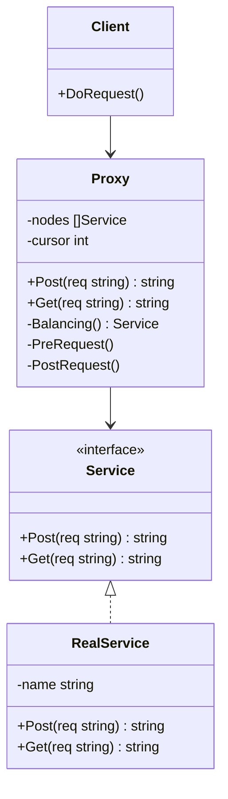

## 纲要

- 代理模式的定义：为目标对象提供代理，以控制对它的访问
- 生活类比：房屋中介、火车票代售点
- 工程类比：后台多节点部署，前端统一代理层做转发与负载均衡
- 实现要点：代理持有目标对象（或多个节点），在调用前后插入准备与收尾逻辑，并做请求分发
- 优点：保护目标对象、扩展功能、降低耦合、支持动态扩容
- 缺点：类数量增加、链路变长、代理层过重会拉低处理效率

## 为什么需要代理模式

定义：**由于某些原因需要给某个对象提供一个代理，以控制对该对象的访问**。当访问对象不适合或不能直接引用目标对象时，代理对象就充当访问对象与目标对象之间的中介。

生活中的例子最容易理解：

- 房屋买卖：买家与卖家通常不直接接触，双方利益都难以保障，于是引入房屋中介协调交易、准备材料
- 买火车票：不必去火车站，通过代售点或网站即可购票，本质也是代理

放到后台架构里，最常见的代理形态是：**后台部署了三个服务节点，前端需要一个统一的代理层，把请求统一处理并转发到后面的节点**。

## 结构



代理内部的关键要素：

- 构造函数接收 `parallel` 参数，指定后台服务节点的数量，并用列表保存这些节点
- 一个负载均衡过程，把请求均衡地分发到不同节点
- `PreRequest` 与 `PostRequest` 两个钩子，分别做调用前的准备与调用后的收尾

以 `Post` 为例，代理的执行流程是：`PreRequest` → 负载均衡选节点 → 调用真实服务的 `Post` → `PostRequest` → 返回结果给客户端。`Get` 同理。

在 `PreRequest` 里可以记录开始时间与请求参数，`PostRequest` 里记录返回时间、统计接口耗时——这些都是**原目标对象做不到的事情**，由代理层扩展出来。

## 优缺点

| 维度 | 说明 |
| --- | --- |
| 优点 | 在客户端与目标对象之间起中介作用，并保护目标对象 |
| 优点 | 可以扩展目标对象的功能：前置记录、后置统计、负载均衡 |
| 优点 | 降低系统耦合度，后台节点可动态扩展后接入代理即可，提升可扩展性 |
| 缺点 | 类的数量增加，系统复杂度上升 |
| 缺点 | 代理层逻辑过重会拖慢请求处理速度，降低效率 |
| 缺点 | 链路变长，排障路径更长 |

是否引入代理需要权衡：并不是所有场景都该加一层代理，要看它带来的收益是否抵得上增加的复杂度和延迟。

## Demo 示例

> 以下代码根据讲稿逻辑用 Go 语言补充，单文件可直接运行。

### 运行说明

```bash
mkdir proxy-demo && cd proxy-demo
go mod init proxy-demo
# 将下方代码保存为 main.go
go run main.go
```

```go
package main

import (
	"fmt"
	"sync/atomic"
	"time"
)

// Service 服务接口：代理与真实服务实现同一接口
type Service interface {
	Post(req string) string
	Get(req string) string
}

// RealService 真实服务节点
type RealService struct {
	name string
}

func (s *RealService) Post(req string) string {
	return fmt.Sprintf("%s handled POST(%s)", s.name, req)
}

func (s *RealService) Get(req string) string {
	return fmt.Sprintf("%s handled GET(%s)", s.name, req)
}

// Proxy 服务代理：持有多个节点，负责分发与前置/后置处理
type Proxy struct {
	nodes  []Service
	cursor uint64
}

// NewProxy parallel 指定后台服务节点数量
func NewProxy(parallel int) *Proxy {
	nodes := make([]Service, 0, parallel)
	for i := 1; i <= parallel; i++ {
		nodes = append(nodes, &RealService{name: fmt.Sprintf("node-%d", i)})
	}
	return &Proxy{nodes: nodes}
}

// Balancing 轮询负载均衡
func (p *Proxy) Balancing() Service {
	idx := atomic.AddUint64(&p.cursor, 1)
	return p.nodes[(idx-1)%uint64(len(p.nodes))]
}

// PreRequest 调用前准备
func (p *Proxy) PreRequest(method, req string) time.Time {
	fmt.Printf("[pre ] method=%s req=%s\n", method, req)
	return time.Now()
}

// PostRequest 调用后收尾，统计耗时
func (p *Proxy) PostRequest(start time.Time) {
	fmt.Printf("[post] cost=%s\n", time.Since(start))
}

// Post 代理的 POST 入口
func (p *Proxy) Post(req string) string {
	start := p.PreRequest("POST", req)
	defer p.PostRequest(start)
	return p.Balancing().Post(req)
}

// Get 代理的 GET 入口
func (p *Proxy) Get(req string) string {
	start := p.PreRequest("GET", req)
	defer p.PostRequest(start)
	return p.Balancing().Get(req)
}

func main() {
	// 后台部署三个节点，客户端只面对代理
	proxy := NewProxy(3)

	for i := 1; i <= 4; i++ {
		fmt.Println(proxy.Post(fmt.Sprintf("order-%d", i)))
	}
	fmt.Println(proxy.Get("user-1"))
}
```

预期输出（耗时为示例值）：

```text
[pre ] method=POST req=order-1
[post] cost=1.2µs
node-1 handled POST(order-1)
[pre ] method=POST req=order-2
[post] cost=900ns
node-2 handled POST(order-2)
[pre ] method=POST req=order-3
[post] cost=800ns
node-3 handled POST(order-3)
[pre ] method=POST req=order-4
[post] cost=750ns
node-1 handled POST(order-4)
[pre ] method=GET req=user-1
[post] cost=700ns
node-2 handled GET(user-1)
```

### 代码说明

- `NewProxy(3)` 模拟后台三个服务节点，客户端完全不感知节点数量与地址
- `Balancing` 用原子自增的游标做轮询分发，保证并发安全，输出可以看到请求被均匀打到 node-1/2/3
- `PreRequest` 打印方法与入参，`PostRequest` 统计耗时，这两个钩子是代理相对真实服务的**功能扩展**
- 真实服务节点可以随时增加，只要加入代理的节点列表即可，体现了代理带来的可扩展性
- `defer` 保证无论中间是否出错，收尾逻辑都会执行

### 技术点总结

- 代理与目标对象实现同一接口，客户端无感知地被引流
- 代理的价值在于"控制访问 + 能力扩展"：限流、鉴权、日志、负载均衡、熔断都可以在这一层实现
- 与装饰器模式的区别：装饰器侧重**增强功能**且通常由调用方显式包装；代理侧重**控制访问**，往往对客户端隐藏目标对象
- 与适配器模式的区别：适配器改变接口，代理不改变接口
- 代价是多一跳延迟与更高的复杂度，需要按场景权衡

## API 速览

| API | 签名 | 说明 |
| --- | --- | --- |
| `NewProxy` | `func NewProxy(parallel int) *Proxy` | 按节点数量创建代理并初始化服务列表 |
| `(*Proxy).Post` | `func (p *Proxy) Post(req string) string` | 代理的 POST 入口，含前后置处理 |
| `(*Proxy).Get` | `func (p *Proxy) Get(req string) string` | 代理的 GET 入口 |
| `(*Proxy).Balancing` | `func (p *Proxy) Balancing() Service` | 轮询选出一个后端节点 |
| `atomic.AddUint64` | `func AddUint64(addr *uint64, delta uint64) uint64` | 原子自增，保证并发下的游标安全 |
| `time.Since` | `func Since(t Time) Duration` | 计算从 `t` 到现在的时间间隔，用于统计耗时 |
