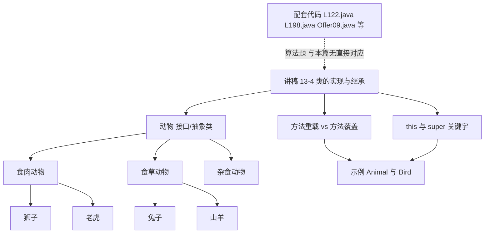

## 纲要

- 继承树：从抽象到具体的分层结构，最上层是动物，中间层是食性分类，最底层是具体动物
- 方法重载：同一个类中同名不同参数，解决"同一函数多种实现"的命名问题
- 方法覆盖：子类中名称、返回类型、参数签名与父类完全一致，用于替换父类实现
- 重载与覆盖的四个关键差异：签名、返回类型、适用范围、次数
- `this` 与 `super`：修改 Java 默认作用域，让被屏蔽的变量与方法重新可见
- 三个典型场景：局部变量同名、子类覆盖父类方法、子类定义同名成员变量

## 素材索引



- 讲稿：`work/source/8.mksz540-后端校招面试直通车，提前锁定大厂offer[完结]/第13章 程序设计之设计模式详解/13-4 面向对象编程——类的实现与继承`
- 关联代码：本篇示例根据讲稿逻辑补充（原课程算法题代码未随本课程体系分发）。

## 继承树

先看一棵典型的继承树。顶层是"动物"这一抽象（接口或抽象类），中间层按食性分为食肉动物、食草动物、杂食动物，最底层是具体动物：狮子和老虎属于食肉动物，兔子和山羊属于食草动物。

```text
        动物（抽象层）
     /     |      \
  食肉   食草    杂食
  /  \    /  \     |
狮子 老虎 兔子 山羊
```

这棵树体现的是"包含"关系：动物包含食肉动物、食草动物、杂食动物；食肉动物包含狮子和老虎。包含关系成立，继承设计才是合理的。

## 方法重载

通常情况下，类的同一个函数可能有多种实现方式，到底用哪一种取决于给定的参数。给每种实现都起一个新名字显然不现实，于是就有了方法重载。

重载必须满足的条件：

- 方法名必须相同
- 参数的类型、个数、顺序至少有一项不同
- 返回类型可以不同
- 修饰符可以不同

```java
class Bird {
    public void eat() {
        System.out.println("this is eat 1");
    }

    // 只有参数不同，才构成重载；两个签名完全相同的方法无法通过编译
    public void eat(String food) {
        System.out.println("this is eat 2: " + food);
    }
}
```

如果两个 `eat` 方法的参数完全一致，编译直接失败——那不是重载，是重复定义。

## 方法覆盖

在继承场景里，子类需要实现一个函数，且这个函数的名称、返回类型、参数签名与父类函数完全一致，这就是方法覆盖。它通常发生在父类的实现无法满足子类需求的时候。

```java
class Animal {
    public void eat(String food, String type) {
        System.out.println("animal eat " + food + " with " + type);
    }
}

class Bird extends Animal {
    @Override
    public void eat(String food, String type) {
        System.out.println("bird 用喙啄食 " + food);
    }
}
```

Java 中用 `@Override` 注解标注覆盖，它不是语法必需，但能让编译器帮你检查签名是否真的与父类一致，建议始终写上。

## 重载与覆盖的对比

| 对比项 | 方法重载（Overload） | 方法覆盖（Override） |
| --- | --- | --- |
| 方法名 | 必须相同 | 必须相同 |
| 参数签名 | 必须不同（类型/个数/顺序至少一项） | 必须完全一致 |
| 返回类型 | 可以不同 | 必须一致 |
| 适用范围 | 一个类的所有方法，包括继承自父类的方法 | 只能用于子类覆盖父类的方法 |
| 次数 | 一个方法可以在一个类中被重载多次 | 父类的一个方法在子类中只能被覆盖一次 |
| 目的 | 用同一语义处理不同入参 | 替换父类已有的实现 |

## this 与 super

`this` 和 `super` 都用于覆盖 Java 默认的作用域规则，让在当前环境下被屏蔽的方法和变量重新变得可用。三个典型场景：

- 方法内局部变量与类的成员变量（或父类成员变量）同名时，按作用域规则只有局部变量可见，需要用 `this`（本类成员）或 `super`（父类成员）访问被屏蔽的变量
- 子类的某个方法覆盖了父类方法后，父类方法在子类范围内不可见，需要用 `super.method()` 调用
- 子类定义了与父类同名的成员变量时，父类成员变量在子类范围内不可见，需要用 `super.field` 访问

一句话总结：需要当前类的信息用 `this`，需要父类的信息用 `super`。

## Demo 示例

### 运行说明

```bash
mkdir -p inherit-demo && cd inherit-demo
# 将代码保存为 Main.java
javac Main.java && java Main
```

### 代码

```java
class Animal {
    protected String type = "animal";

    // 方法重载：同名方法，参数个数不同
    public void eat(String food) {
        System.out.println("animal eat " + food);
    }

    public void eat(String food, String type) {
        System.out.println("animal eat " + food + " with " + type);
    }
}

class Bird extends Animal {
    // 与父类同名的成员变量：父类变量在子类范围内被隐藏
    private String type = "bird";

    // 方法覆盖：名称、返回类型、参数签名与父类完全一致
    @Override
    public void eat(String food, String type) {
        System.out.println("局部参数 type = " + type);      // 局部变量（形参）可见
        System.out.println("本类成员 type = " + this.type); // this 访问被屏蔽的本类成员
        System.out.println("父类成员 type = " + super.type);// super 访问被隐藏的父类成员

        super.eat(food, type);                              // 调用被覆盖的父类方法
        System.out.println("bird 用喙啄食 " + food);
    }
}

public class Main {
    public static void main(String[] args) {
        Animal animal = new Animal();
        animal.eat("虫子");              // 重载：单参数版本
        animal.eat("虫子", "爪子");      // 重载：双参数版本

        System.out.println("-----");

        Animal bird = new Bird();        // 向上转型
        bird.eat("虫子", "喙");          // 运行期绑定到 Bird 的覆盖实现
    }
}
```

预期输出：

```text
animal eat 虫子
animal eat 虫子 with 爪子
-----
局部参数 type = 喙
本类成员 type = bird
父类成员 type = animal
animal eat 虫子 with 喙
bird 用喙啄食 虫子
```

### 代码说明

- `Animal` 中两个 `eat` 参数个数不同，构成重载；编译期根据实参决定调用哪个版本。
- `Bird.eat(String, String)` 与父类签名完全一致，构成覆盖；`@Override` 让编译器校验签名，写错参数会直接报错。
- 形参 `type` 屏蔽了成员变量，方法内直接写 `type` 拿到的是形参；`this.type` 拿到 `Bird` 的成员，`super.type` 拿到 `Animal` 的成员。
- `super.eat(food, type)` 在覆盖后仍然可以复用父类实现，这是"扩展而非替换"的常用写法。
- `Animal bird = new Bird()` 的调用在运行期绑定到子类实现，体现了多态。

### 技术点总结

- 重载看参数（编译期决定），覆盖看继承（运行期决定）
- 覆盖要求签名与返回类型完全一致，且不能缩小访问权限
- `this` 指向当前对象，`super` 指向父类视角，二者都是对默认作用域的显式修正
- 继承树的设计应遵循"包含"关系，越往上越抽象

## 面试要点速记

| 问题 | 答题要点 |
| --- | --- |
| 重载和覆盖的区别 | 重载同签名不同参数、可多次、编译期决定；覆盖签名返回类型一致、只能在子类覆盖父类一次、运行期决定 |
| 覆盖对返回类型的要求 | 必须与父类一致（Java 5 起可以是协变返回类型） |
| `super` 能用在哪些地方 | 调用被覆盖的父类方法、访问被隐藏的父类成员变量、`super()` 调用父类构造方法（必须在首行） |
| 继承树怎么设计才合理 | 上下层之间要满足"包含"关系，上层抽象、下层具体 |
