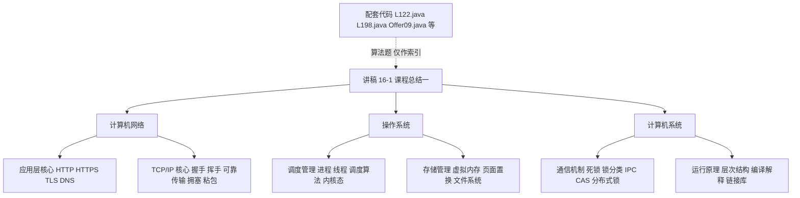

## 纲要

- 计算机网络专题：应用层核心与 TCP/IP 核心两大块，覆盖 HTTP、HTTPS/TLS、DNS、加密基础、TCP/UDP、三次握手与四次挥手、可靠传输、拥塞避免、粘包、VPN
- 操作系统专题：调度管理与存储管理，覆盖进程线程、调度算法、用户态与内核态、虚拟内存、页面置换、文件系统与 RAID
- 计算机系统专题：通信机制与运行原理，覆盖死锁、锁的分类、进程间通信、CAS 无锁结构、分布式锁、编译与解释、链接库
- 每一块都给出对应的高频面试题，用于自查

## 素材索引

- 讲稿：`work/source/8.mksz540-后端校招面试直通车，提前锁定大厂offer[完结]/第16章 面试复盘-预祝大家斩获offer拿高薪/16-1 课程总结（一）`
- 关联代码：本篇为知识体系回顾，不展开代码实现。

## 计算机网络

计算机网络专题分成应用层核心与 TCP/IP 核心两条线索。

### 应用层核心

| 知识点 | 关键内容 | 对应面试题 |
| --- | --- | --- |
| OSI 七层模型 | 各层职责与典型协议，TCP/IP 四层与之的映射 | 请简述 OSI 七层模型及 TCP/IP 模型的区别 |
| HTTP 协议 | 报文结构、请求方法、状态码、幂等、长连接、HTTP/1.0 与 1.1 与 2.0 的差异 | 常见 HTTP 状态码及含义；GET 与 POST 的区别 |
| HTTPS 与 TLS | 对称加密与非对称加密配合、TLS 握手细节、数字证书与 CA 链 | 请简述 HTTPS 加密认证的过程 |
| DNS | 域名分级、根/顶级/权威域名服务器、递归查询与迭代查询、DNS 攻击 | 请简述域名系统的工作流程；DNS 攻击原理 |
| 安全传输基础 | 对称加密（DES、3DES、AES）、非对称加密（RSA、ECC、DH）、哈希与加盐 | 对称加密与非对称加密的异同；MD5 是加密算法吗；什么是加盐 |
| 应用层安全 | 中间人攻击、证书校验、注入与越权等应用层风险 | 如何防止传输内容被篡改 |

### TCP/IP 核心

| 知识点 | 关键内容 | 对应面试题 |
| --- | --- | --- |
| TCP 与 UDP | 面向连接与无连接、可靠性、头部开销、适用场景、所属层次 | TCP、UDP 分别属于什么层；两者区别 |
| 三次握手 | 序列号同步、为什么不是两次、握手过程中的状态迁移 | TCP 为什么需要三次握手 |
| 四次挥手 | 半关闭、TIME_WAIT 的存在意义与 2MSL | 请简述什么是 TIME_WAIT 状态 |
| 可靠传输 | 序列号、确认应答、超时重传、滑动窗口 | 请简述滑动窗口的工作过程 |
| 拥塞控制 | 慢启动、拥塞避免、快重传、快恢复 | 请介绍常见的 TCP 拥塞避免算法 |
| 粘包 | 粘包成因与三种解决思路：定长、分隔符、长度字段 | 什么是粘包，如何解决 |
| SYN Flood | 半连接队列被打满的原理与 SYN Cookie 防御 | 请简述什么是 SYN Flood 攻击 |
| VPN | 隧道、加密与认证，在传输层之上构建安全通道 | 什么是 VPN，原理是什么 |

## 操作系统

操作系统专题分为调度管理与存储管理。

### 调度管理

| 知识点 | 关键内容 | 对应面试题 |
| --- | --- | --- |
| 进程 | 进程的定义、PCB、进程状态模型与切换 | 请简述对进程的理解 |
| 线程 | 线程与进程的资源边界、切换成本、通信方式 | 进程和线程的区别 |
| 调度算法 | Linux 的调度策略与时间片、优先级、抢占 | Linux 常见调度算法 |
| 用户态与内核态 | 特权级、系统调用的陷入过程、切换开销 | 请简述什么是内核态与用户态 |
| IO 密集型与计算密集型 | 线程池规模与并发度配置思路、阻塞 IO 与非阻塞 IO | IO 密集型任务部署需要注意什么 |
| 同步与异步 | 调用返回时机、阻塞与非阻塞的组合关系 | 同步与异步的区别 |
| 协程 | 用户态调度、栈切换、为什么需要协程 | 协程是什么，为什么需要协程 |

### 存储管理

| 知识点 | 关键内容 | 对应面试题 |
| --- | --- | --- |
| 存储器层次结构 | 寄存器、Cache、内存、磁盘的速度与容量梯度 | 为什么需要多级存储 |
| 虚拟内存 | 地址空间隔离、页表、地址翻译、按需分页 | 请简述操作系统的虚拟内存 |
| 缺页中断 | 触发条件、处理流程、与一般中断的区别 | 请简述什么是缺页中断 |
| 内存管理 | 段式、页式、段页式管理 | 段式与页式管理的区别 |
| 页面置换算法 | FIFO、LRU、LFU、Clock，以及 LRU 的实现方式 | 请编程实现 LRU 算法 |
| 文件系统 | inode、目录项、软链接与硬链接 | 软链接与硬链接有什么区别 |
| 服务器存储 | RAID 0/1/5/10 的容量、性能与冗余对比 | 请简述服务器部署的 RAID |
| 缓存的作用 | 局部性原理、命中率、缓存一致性 | 系统设计中缓存的作用 |

## 计算机系统

计算机系统专题分为通信机制与运行原理。

### 通信机制

| 知识点 | 关键内容 | 对应面试题 |
| --- | --- | --- |
| 死锁 | 四个必要条件、预防、避免、检测与解除 | 请谈谈对死锁必要条件的理解 |
| 经典同步问题 | 读者写者、生产者消费者、哲学家进餐 | 线程/进程同步三大经典案例 |
| 锁的分类 | 乐观锁、悲观锁、可重入锁、不可重入锁、互斥锁、自旋锁的适用场景 | 互斥锁与自旋锁的区别；乐观锁与悲观锁 |
| 进程间通信 | 管道、消息队列、共享内存、信号、信号量、Socket | 进程间有哪些同步方式 |
| 无锁结构 | CAS 的原理、ABA 问题、原子操作与内存序 | 请简述无锁数据结构的原理 |
| 分布式锁 | 基于数据库、Redis、ZooKeeper/etcd 的实现方式与取舍 | 项目中分布式锁的实现方式 |

### 运行原理

| 知识点 | 关键内容 | 对应面试题 |
| --- | --- | --- |
| 计算机层次结构 | 硬件、指令集、操作系统、编译器、应用层的分层 | 计算机的层次结构划分 |
| 编译与解释 | 编译型与解释型的差异、字节码的角色 | 什么是字节码，编译和解释有什么区别 |
| 编译原理 | 词法分析、语法分析、语义分析、中间代码、优化、目标代码生成 | 编译器原理剖析 |
| JIT | 热点探测、运行时编译、解释与编译混合执行 | 请简述什么是 JIT 技术 |
| 链接库 | 静态链接与动态链接的差异、符号重定位、运行期加载 | 动态链接和静态链接的区别 |

## 复盘建议

- 按块自查：给每个知识点准备一个"一句话定义 + 一个原理要点 + 一个工程例子"
- 用面试题反向索引：答不上来的题目回到对应知识点补齐，而不是重新看一遍视频
- 重点块优先：TCP 握手/挥手、进程线程、死锁与锁、虚拟内存是最高频的四块
- 对原理类问题画出流程图（握手、缺页中断、DNS 查询），表达会清晰很多
