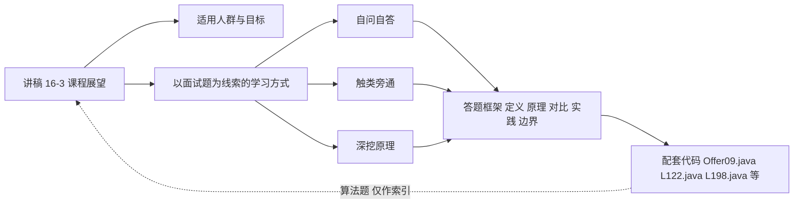
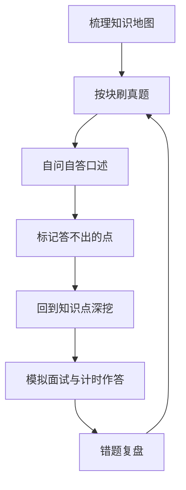

## 纲要

- 定位：面向秋招与春招的准毕业生，科班与非科班都适用
- 特点：以面试题为线索组织知识，功利性强，需要在题目之上深挖原理
- 三个核心方法：自问自答、触类旁通、专业精神
- 一套可复用的答题框架：定义、原理、对比、工程实践、边界
- 复习节奏：知识地图、真题演练、模拟面试、错题复盘
- 长期目标：把八股文沉淀成工程能力

## 素材索引

- 讲稿：`work/source/8.mksz540-后端校招面试直通车，提前锁定大厂offer[完结]/第16章 面试复盘-预祝大家斩获offer拿高薪/16-3 课程展望`
- 关联代码：本篇讨论复习方法，不涉及代码实现。

## 谁需要这套知识体系

这套内容面向几类人：

- 即将参加秋招或春招的准毕业生，科班与非科班都需要，非科班更需要补齐计算机基础
- 高校在读、未来要参加校招的同学，可以把它当成系统入口，按图索骥地补内容
- 希望系统梳理计算机体系知识、把零散知识点串成体系的工程师

大厂面试对基础知识的考察一直占有很大比重，竞争又同时来自海外留学生与国内毕业生、科班与非科班、本科与研究生多个维度，因此基础扎实与否往往是决定性差异。

## 以面试题为线索的学习方式

这套内容是以面试题的角度组织的，天然带有功利性：题目考什么就先讲什么。这种方式效率高，但也有明显的边界——

- 题目只暴露了知识点的入口，背后的原理需要自己往下挖
- 面试官换个问法，如果只背了标准答案，很容易答不到点上
- 只记结论的人在追问环节最容易失分，因为追问问的正是原理

所以正确的用法是：把面试题当成索引，而不是当成终点。

## 三个核心方法

### 自问自答

看到一道题，先不看答案，自己组织语言完整回答一遍，再对照补充。这个过程会暴露出"以为自己懂了、其实说不出来"的部分。自问自答的产物应该是可以直接口述的一段话，而不是脑中的一个模糊印象。

### 触类旁通

面试官变换问法时，要能识别出他在问什么。例如：

| 表面问法 | 实际考点 |
| --- | --- |
| 请简述域名系统的工作流程 | DNS 分级、递归查询与迭代查询 |
| MD5 是加密算法吗 | 哈希的单向性与加盐 |
| 服务器响应很慢怎么排查 | 状态码分层定位：4xx 看客户端，5xx 看服务端与网关 |
| 进程间怎么同步 | 通信方式与锁的分类 |

把题目映射到知识点，再从知识点展开，就不会被问法变化打乱。

### 深挖原理

专业精神体现在不满足于标准答案。每道题至少往下挖一层：三次握手为什么不是两次、TIME_WAIT 为什么要等 2MSL、B+ 树为什么比 B 树更适合做索引。每往下挖一层，追问环节的容错空间就大一分。

## 一套可复用的答题框架

回答基础题时按五步展开，既完整又不容易漏点：

| 步骤 | 内容 | 示例（以 TCP 三次握手为例） |
| --- | --- | --- |
| 定义 | 一句话说明它是什么 | 建立 TCP 连接前双方同步初始序列号的过程 |
| 原理 | 展开关键过程与状态 | SYN、SYN+ACK、ACK 三次交互与状态迁移 |
| 对比 | 与相近概念做区分 | 为什么两次不够、四次不必要 |
| 工程实践 | 结合真实场景 | 握手超时、SYN Flood 与 SYN Cookie |
| 边界 | 说明代价与适用条件 | 握手延迟、长连接复用与连接建立的开销 |

这个框架的好处是：即使某个细节记不清，结构本身也能体现思考的完整性。

## 复习节奏

- 先建地图：按网络、操作系统、计算机系统、算法、数据库、编程能力六块列出自己的掌握程度
- 再做真题：每块挑高频题，先口述再对照
- 然后模拟：找人做面试官，限时作答，训练表达而不是背诵
- 最后复盘：把答崩的题归到具体知识点，回到地图里标记

简历准备、表达技巧、校招信息与平台选择属于软实力部分，同样需要提前准备，但它们的上限取决于前面的硬实力。

## 从八股到工程能力

面试题的价值在于它压缩了工业界的常见考点：面试官有工业背景，考察点天然贴近生产环境。把八股沉淀成工程能力的方式很直接——

- 把每个知识点落到自己项目的一个场景：缓存一致性、连接池与 TIME_WAIT、索引设计与慢查询
- 把原理变成可观测的东西：用抓包看握手、用执行计划看索引、用压测看并发瓶颈
- 把结论变成取舍能力：任何技术选型都能说出适用条件与代价

做到这三点之后，八股就不再是背诵材料，而是设计系统时可以随手调用的工具箱。
