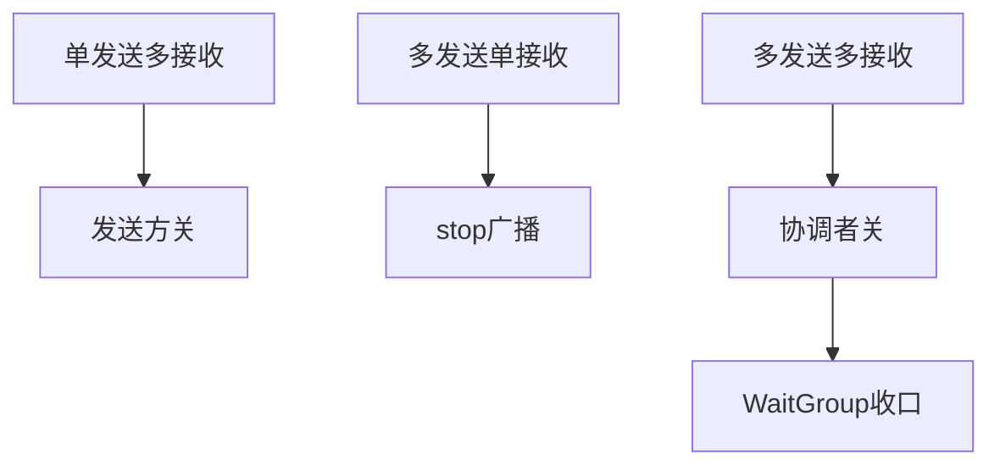

> 分类：并发模型 | 难度：L4 | 题型：工程题 | 频率：高
> 原文锚点：第 38~112 段「Once/锁封装 + 1:N / N:1 / N:N 三种关闭责任分配」

## 思路与架构
把"关闭"拆成两个正交问题再决策：① 关闭后是否还有人写（写了就 panic）；② 关闭是否只发生一次。按"发送者数量 × 接收者数量"落矩阵，唯一发送者才让其自关，否则引入 stop 广播。

- 单发送多接收：发送方发完即 close，最自然。
- 多发送单接收：接收方 close(stop) 广播停发，等发送者退后再关数据。
- 多发送多接收：stop 通知 + 独立 goroutine/main 在 WaitGroup 收口后关数据 channel。

## 方案取舍
| 方案 | 适用 | 关闭责任 | 风险点 | 复杂度 |
|---|---|---|---|---|
| 发送方自关 | 唯一发送者 | 发送方 | 多发送会写已关 | 低 |
| stop channel | 多发送 | 协调者 | 忘等发送者退 | 中 |
| sync.Once 封装 | 责任难收敛 | 任意调用 | 掩盖设计问题 | 低 |
| context 取消 | 需超时/级联 | cancel 调用方 | 与 close 混用易漏 | 中 |

选型结论：优先让唯一发送者关；多发送者用 stop 广播 + WaitGroup 收口；Once/锁封装只作兜底，context 用于需要超时或级联取消时，与 close 二选一不要叠加。

不适用边界：stop 方案要求发送循环能响应 select；纯阻塞发送（无 default）需改造成可中断。

## 性能量级与实测数据
关闭本身接近零开销，无分配 `[经验]`；差异在"是否引入锁/Once"——Once 多一次原子与锁竞争，但仅关闭时触发一次，可忽略。stop 广播为一次 close + N 次零值读取，开销极低。

## 答题技巧

## 细节与核心 API
- `close(ch)`：仅发送方/协调者调用，且全局唯一一次 `[源码]`。
- `v, ok := <-ch`：ok 为 false 表已关闭且无值，用于 for-select 退出 `[源码]`。
- `sync.Once.Do`：闭包至多执行一次，封装安全关闭 `[源码]`。
- `stop := make(chan struct{})`：零内存广播信号，关闭即通知所有接收者 `[经验]`。
- `wg.Wait()`：在全部发送者退出后由协调者收口再关数据 channel `[源码]`。

- 30 秒版：关闭责任唯一；唯一发送者自关，多发送者用 stop 广播 + 协调者收口。
- 3 分钟版：讲清"先停发后关数据"顺序，避免向已关写 panic 与重复 close panic。
- 白板版：画 1:N / N:1 / N:N 三矩阵，标注各自关闭方。
- 不会怎么接：承认"多发送者不能任一方关"，迁移到 stop channel 思路再补细节。

## 广度与深度延伸
- 横向：context.Context 取消与 close 语义对比——cancel 偏"请求撤销"，close 偏"数据流结束"，可 coexist 但不应重复表达同一信号。
- 纵向：runtime 中 hchan 关闭态字段、recv 返回 false 的实现路径 `[源码]` runtime/chan.go。

## 反问环节
可反问面试官：团队里数据 channel 的生命周期由谁管理？是否有统一封装（如 fan-out helper）？借此展示工程化意识。
