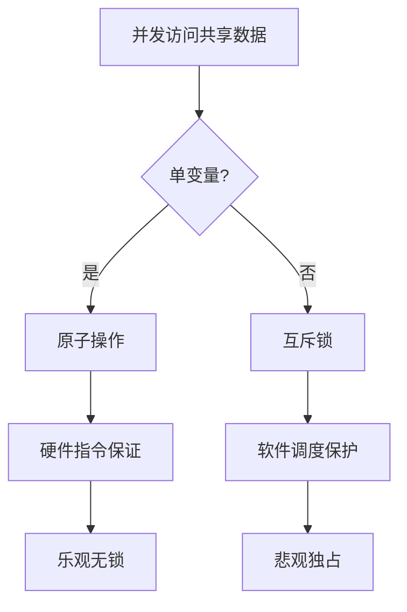

> 关联主卡：105-atomic-vs-mutex-core / 105-atomic-implementation / 105-atomic-types-scope / 105-atomic-vs-lock-when / 105-cond-semaphore
> 深挖门槛命中：L3（实现原理 + 乐观/悲观权衡）+ 版本翻转（Go1.19 类型化原子）+ 多方案对比

## 思路与架构
原子操作与锁解决的是同一个问题——并发数据安全，但走了两条路：原子走硬件指令（乐观、无锁、单变量），锁走软件调度（悲观、护临界区、可多变量）。切入点是"保护范围 + 冲突假设 + 失败代价"三连问，再决定用哪条路。

文字版：① 先问保护范围是不是单个变量；② 是则走原子（硬件指令、乐观）；③ 否（多变量/复合逻辑）则走互斥锁（软件、悲观）；④ 二者不是替代关系，而是按场景分层使用。

## 方案取舍
| 维度 | 原子操作 | 互斥锁 | 读写锁 |
|---|---|---|---|
| 实现 | CPU 原子指令 | 原子+调度 | 原子+读者计数 |
| 保护范围 | 单个变量 | 任意临界区 | 读共享/写独占 |
| 冲突假设 | 乐观（重试） | 悲观（独占） | 读多写少友好 |
| 高竞争 | 反复重试可能变慢 | 一次独占 | 读者并发 |
| 适用 | 计数/状态/标志 | 复合临界区 | 读多写少配置 |

选型结论：单变量无复合条件用原子；多变量一致或读-判-写用 mutex；读远多于写用 RWMutex。不适用边界：原子无法表达跨变量事务语义，强行 CAS 多变量会出竞态。

## 性能量级与实测数据
无竞争时原子操作约几个时钟周期，远快于锁的调度开销；但高竞争下 CAS 自旋重试会空耗 CPU，此时一把锁的"先独占"反而更稳 `[源码]`。具体量级需 `go test -bench` 在目标竞争强度下实测，go1.26.5。验证：`go test -bench=. -benchtime=...` 对比 atomic 与 mutex 的 ns/op。

## 答题技巧

## 细节与核心 API
- `atomic.AddInt64/LoadInt64/StoreInt64`：对 int64 的原子增减/读/写。
- `atomic.CompareAndSwapInt64(ptr, old, new)`：CAS 核心原语，失败返回 false 需重试。
- `atomic.Value`：存任意类型，要求存入类型一致，否则 panic。
- `atomic.Int64`（Go1.19+）：类型化原子变量，`Store/Add/Load` 更不易用错。
- `sync.Mutex.Lock/Unlock`：临界区保护，不可复制、须配对。
- `sync.RWMutex.RLock/RUnlock`：读锁可并发，写锁独占。
- `golang.org/x/sync/semaphore.NewWeighted/Acquire/Release/TryAcquire`：并发额度控制。

- 30 秒版：原子靠 CPU 指令护单变量、乐观无锁；锁护临界区、悲观独占；多变量用锁。
- 3 分钟版：补 LOCK 前缀/MESI、CAS 重试、Go1.19 类型化原子、RWMutex 读多写少。
- 白板版：画"单变量→原子 / 多变量→锁"分支，标注乐观 vs 悲观。
- 话术模板："单变量计数用 atomic.Int64；读判写或多变量一致一律上锁，高竞争再压测选型。"
- 不会怎么接：诚实说"CAS 的 ABA 我了解概念但没实战踩过，具体退回细节我查官方文档"，不编。

## 广度与深度延伸
- 横向：Java `AtomicInteger`/`synchronized`、C++ `std::atomic`、Rust `AtomicU64` 的 memory ordering。
- 纵向：CPU 缓存一致性协议(MESI)、LOCK 前缀的 bus lock vs cache lock、Go 运行时 mutex 的饥饿模式（正常/饥饿，Go1.9 引入）。

## 反问环节
可反问："咱们热点路径用的是 atomic 还是锁？有没有因为高竞争把原子换成 mutex 的先例？RWMutex 在你们读多写少的场景收益如何？"——体现性能与选型意识。
