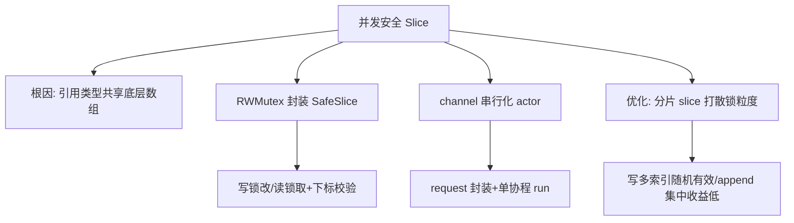

> 覆盖源 10-9 全文：slice 非并发安全本质、RWMutex 封装、channel 串行化、分片优化。主卡已拆成非并发本质、RWMutex 封装、channel 串行化三张，本附录做横向对比与取舍。

## 思路与架构



## 方案取舍
- **RWMutex vs channel**：读多写少选 RWMutex（读锁不互斥）；channel 串行化逻辑简单但单消费者瓶颈、读频繁更慢。
- **分片 slice**：写多且索引随机时按 key 分片打散锁粒度；但 append 索引连续易集中某分片、锁仍集中，收益有限。
- **sync 原语 vs 自建**：map 有 `sync.Map`、slice 无官方并发版，需按访问模式自封装（锁或 channel）。

## 答题技巧
- 被问「slice 并发安全吗」先答「否 + 静默覆盖（对比 map panic）+ 共享底层数组」，再给锁/channel 两方案 [经验]。
- 主动边界到 `914`(map 并发)/`925`(RWMutex)/`609`(channel 锁)/`1018`(race detector)，构成并发安全全栈 [边界]。

## 细节与核心 API

**根因**：slice 是引用类型、共享底层数组；并发 append/写会**静默覆盖**（不像 map panic），且 `append` 可能触发底层数组扩容换地址。

**RWMutex 封装 SafeSlice（写锁改、读锁取 + 下标校验）**：

```go
type SafeSlice[T any] struct {
    mu   sync.RWMutex
    data []T
}
func (s *SafeSlice[T]) Get(i int) (T, bool) {
    s.mu.RLock(); defer s.mu.RUnlock()
    if i < 0 || i >= len(s.data) { var z T; return z, false }
    return s.data[i], true
}
func (s *SafeSlice[T]) Append(v T) {
    s.mu.Lock(); defer s.mu.Unlock()
    s.data = append(s.data, v) // 写锁内 append，避免并发扩容踩踏
}
func (s *SafeSlice[T]) Range(f func(T) bool) {
    s.mu.RLock(); defer s.mu.RUnlock()
    for _, v := range s.data { if !f(v) { return } }
}
```

**channel 串行化 actor（单 goroutine 操作，并发度恒为 1）**：

```go
type sreq[T any] struct{ op string; v T; resp chan []T }
func runSlice[T any](in <-chan sreq[T]) {
    var data []T
    for r := range in {
        switch r.op {
        case "append": data = append(data, r.v)
        case "get":    r.resp <- data
        }
    }
}
```

**分片 slice**：写多且索引随机时按 key 分片打散锁粒度；但 `append` 索引连续易集中某分片、锁仍集中，收益有限。

> 边界：map 并发见 914；RWMutex 见 925；channel 锁见 609；race detector 验证见 1018。
