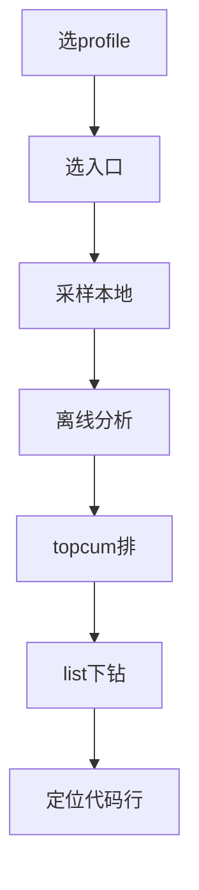

## 思路与架构
从"先建基准、再定位热点"切入：选 profile 类型 → 选采集入口 → 采出文件 → `go tool pprof` 分析 → 下钻到代码行。

文字版：① 按症状选 profile（CPU 高→cpu，内存涨→heap/allocs，协程卡→block/mutex）；② 按场景选入口（测试用 flag、程序内用 runtime/pprof、HTTP 服务用 net/http/pprof）；③ `go tool pprof file.prof` 进入；④ `top -cum` 按累积锁定最重调用链；⑤ `list 函数` 下钻到具体代码行。每一步都围绕"把可疑范围收敛到行"。

## 方案取舍
| 采集入口 | 适用 | 优点 | 缺点 |
|---|---|---|---|
| 基准测试 flag | 写 benchmark | 不影响业务 | 只测 bench |
| runtime/pprof | 自定义程序 | 精细控制 | 需改代码 |
| net/http/pprof | 线上 HTTP | 零改动接入 | 需收口安全 |

不适用边界：短时脚本/无 HTTP 的服务更适合 runtime/pprof；生产用 http/pprof 务必鉴权或定位完关闭。

## 性能量级与实测数据
- CPU profile 默认 100Hz，每 10ms 一次 SIGPROF 中断，`小于 10ms` 热点会漏采 `[源码]`。
- heap 默认按 `runtime.MemProfileRate`(512*1024 字节≈512KB) 字节率采样，不是按次数 `[源码]`。
- 采样本身有开销：CPU profile 约 5% 量级、heap 采样影响分配路径，生产按需开启 `[经验]`。

## 答题技巧

## 细节与核心 API
- `runtime/pprof.StartCPUProfile(f)` / `StopCPUProfile()`：CPU 采样开关，100Hz `[源码]`。
- `pprof.WriteHeapProfile(f)`：写堆快照；等价于 `Lookup("heap").WriteTo` `[源码]`。
- `runtime.SetMutexProfileFraction(n)`：mutex 竞争采样比例，1=全采、0=关，与内存无关 `[源码]`。
- `pprof.Lookup("block").WriteTo(f,0)`：阻塞 profile 落盘 `[源码]`。
- `net/http/pprof`：空导入后 `init` 在 `http.DefaultServeMux` 注册 `/debug/pprof/` `[源码]`。
- `go tool pprof -http=:8080 file.prof`：启动 Web UI(含火焰图)，需 graphviz `[源码]`。

- 30 秒版：pprof 采 CPU/heap/mutex/block；三种入口；`top -cum`+`list` 定位到行。
- 3 分钟版：补各 profile 默认开关、allocs 含已释放/heap 仅存活、采样率事实。
- 白板版：画上图，标清"选类型→选入口→top -cum→list"。
- 不会怎么接：承认不记得具体 flag 拼写，但能说清"CPU 是统计抽样、heap 字节率采样"即为 P6。

## 广度与深度延伸
- 横向：Java 用 async-profiler、Python 用 cProfile/py-spy，思想都是抽样+火焰图。
- 纵向：读 `runtime/pprof/pprof.go` 看 CPU 采样注册；`runtime` 的 `profile` 与 `trace` 包。

## 反问环节
可反问面试官：线上 pprof 端点如何收口？是否有常态化火焰图采集平台？
