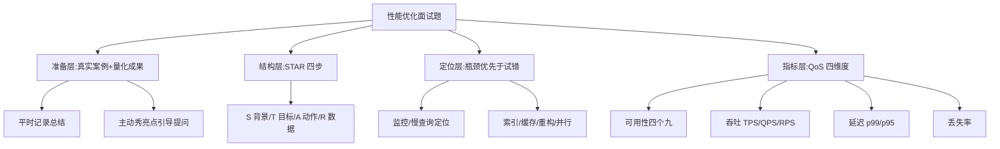

> 覆盖源 11-2 全文：从「准备案例」到「STAR 叙述」到「瓶颈优先」到「QoS 量化」的完整方法论。主卡已拆成真实案例+STAR、瓶颈优先、QoS 四指标三张，本附录做横向串联与取舍。

## 思路与架构

## 方案取舍
- **案例 vs 套路**：没有真实案例只背 STAR 是空架子；有案例不用 STAR 易讲散。二者必须绑定。
- **定位 vs 手段**：先定位再优化（慢但准）优于先加缓存/索引（快但盲）。面试中「方向正确」本身就是得分点。
- **均值 vs 分位数**：结果量化优先用 p99 等分位数，均值掩盖长尾，易被认为不专业。

## 答题技巧
- 主动在简历/项目介绍抛「有挑战的性能案例 + 量化数字」作钩子，把追问引向自己准备充分的方向。
- 被问「你具体改了哪段」时，用瓶颈优先的框架展开（监控定位→DB 改写/缓存/重构），瞬间显出工程素养。
- 收尾一定要给**可对比的量化指标**（建 baseline + p99 前后对比），这是和普通候选拉开差距的关键 [经验]。
