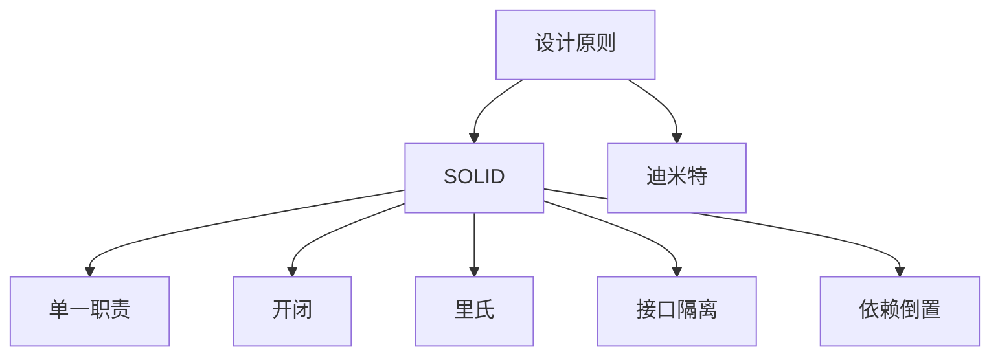
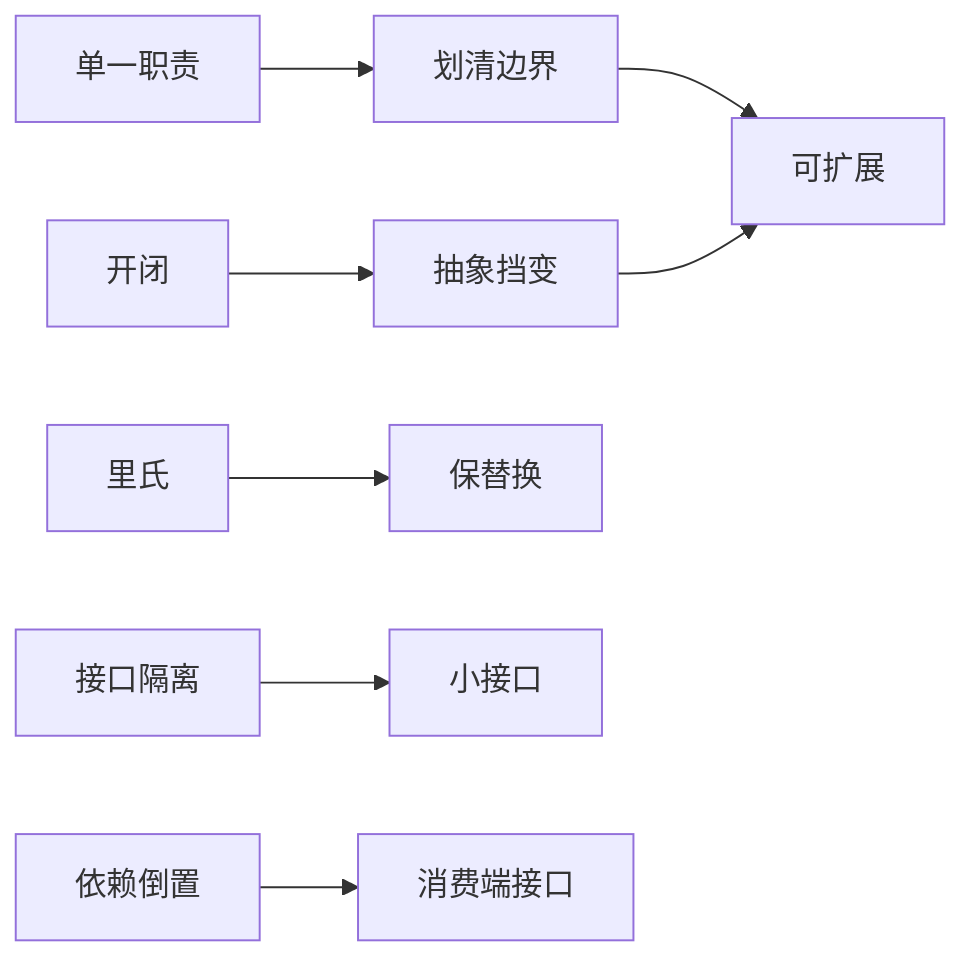

## 思路与架构
六大原则围绕一个内核：把「会变的部分」与「不变的部分」分离，用抽象和多态承接变化。SOLID 是五个（取首字母 S O L I D），再加迪米特法则（LOD）共六个。

文字版：SOLID 由单一职责、开闭、里氏、接口隔离、依赖倒置五原则组成；迪米特法则是第六条，强调模块间最小知识。

文字版：SRP 划清职责边界、ISP 产出小接口，二者给 OCP 提供稳定的抽象面；LSP 保证该抽象可被多态替换；DIP 让调用方定义接口，共同撑起「可扩展、低耦合」。

## 方案取舍
| 维度 | 遵循原则 | 忽视原则 |
|---|---|---|
| 修改成本 | 改动局部、回归面小 | 牵一发动全身 |
| 复用性 | 职责/接口单一易复用 | 大杂烩难抽取 |
| 理解成本 | 结构清晰但需读多层 | 初看简单实则耦合 |
| 过度风险 | 抽象泛滥成胶水层 | — |

选型结论：在易变、长期维护的核心域遵循原则；一次性脚本或稳定简单依赖不必强求，按「人力/时间/质量」平衡，不刻意完美。

## 性能量级与实测数据
设计原则是编译期结构，无运行时开销 `[经验]`。真正代价在「过度抽象」引入的间接层与可读性下降，而非性能；仅在极端热路径需警惕接口调用与反射，但远不及原则收益。

## 答题技巧

## 细节与核心 API
- `SRP`：一个模块只有一个变化原因，按需求方划界。
- `OCP`：对扩展开放、对修改关闭，靠稳定抽象承接变化。
- `LSP`：子类可替换父类且契约不变，否则改用组合。
- `ISP`：客户端只依赖最小接口，拒绝胖接口。
- `DIP`：高层低层同依赖抽象，接口由消费端定义。
- `LOD`：模块间最小知识，只与直接朋友通信，门面模式体现。

30 秒版：SOLID 五原则 + 迪米特；核心是「变与不变分离、面向接口」。
3 分钟版：SRP 划界、OCP 抽象挡变、LSP 保替换、ISP 小接口、DIP 消费端接口，LOD 最小知识；各配一个 Go 反例。
白板版：画出「抽象隔离变化」图，把六原则挂到「边界/抽象/替换/接口/耦合」五类收益上。
不会怎么接：诚实说「某原则在实战中的边界我拿不准」，转向最熟的 SRP/OCP 展开，避免编造反例。

## 广度与深度延伸
横向：其他语言同样适用（Java Spring、Python ABC）。纵向：原则源自 GoF 23 模式的内核，多数模式（策略、装饰、观察者）都是原则落地。规范：原则服务于「松耦合、高内聚」，脱离业务场景套用会事倍功半。

## 反问环节
可反问面试官：团队在哪些模块强制走接口/DI，哪些地方允许直接依赖具体实现？借此展示你对「原则权衡」而非「教条」的理解。
