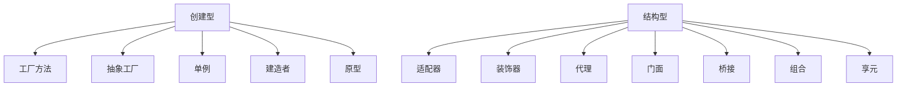

> 覆盖源 16-2 全文：创建型 5（工厂方法/抽象工厂/单例/建造者/原型）+ 结构型 7（适配器/装饰器/代理/门面/桥接/组合/享元）。
> 主卡已详述单例/工厂/建造者/适配器/装饰器，本附录补齐其余模式并做横向对比。

## 思路与架构

- 三类模式分工：创建型管"对象怎么生"，结构型管"对象怎么拼"，行为型管"对象怎么协作"（见 163 深挖）。
- 创建型 5 种都围绕"把 new 的时机与细节藏起来"；结构型 7 种都围绕"用组合/接口把对象粘成大结构"。
- 面试常考点不是背定义，而是"这个场景用哪个、Go 怎么写、坑在哪"——下面逐条给 Go 落地。

## 方案取舍

| 模式 | Go 落地要点 | 何时用 | 坑 |
|---|---|---|---|
| 抽象工厂 | 一组 `func() X` 产相关对象族 | 多套风格/平台对象需成套一致 | 单维度变化上它=过度设计 |
| 原型 | `Clone() T` 深拷贝，规避初始化开销 | 构造成本高且需大量相似对象 | Go 无自动深拷贝，手写易漏字段 |
| 代理 | 同接口包裹，控制访问（懒加载/鉴权/远程） | 不想/不能直接引用目标 | 与装饰器混淆：代理重"控"、装饰重"增" |
| 门面 | 一个 struct 封装多个子系统调用 | 给复杂子系统提供精简入口 | 门面变万能类=反模式 |
| 桥接 | 抽象与实现各自接口，组合而非继承 | 一个类有多个独立变化维度 | 维度识别错=白桥接 |
| 组合 | 叶子与容器实现同一接口，树形递归 | 整体-部分呈树状、客户端不区分 | 业务非树形硬套=累赘 |
| 享元 | 对象池缓存内部状态，外部状态外传 | 海量相似对象、内存吃紧 | 内部/外部状态划错=共享污染 |

- **选型结论**：单对象创建用单例/工厂/建造者；多对象拼装用适配器/装饰器/代理/组合；跨维度变化用桥接；海量对象用享元；统一入口用门面。
- **不适用边界**：只有 1~2 个具体类型且无扩展预期时，任何创建型/结构型都是过度设计，直接构造最清晰。

## 性能量级与实测数据

- `sync.Once.Do` 首次加锁、后续仅一次原子读判定，稳态开销接近一次 atomic load，远小于重复初始化重对象 `[源码]`。
- 函数式 Options：构造时遍历 N 个闭包，每个闭包一次堆分配；超高频（百万 QPS）构造路径若在意分配可改 plain struct `[经验]`。
- `sync.Pool` 收益来自降分配与 GC 压力，仅在"高频短生命周期对象"场景显著，用错反而更慢 `[经验]`。
- 抽象工厂/桥接等纯结构性模式不引入运行时开销，代价是类型数量与可读性的权衡，无性能数字可量化 `[经验]`。

## 答题技巧

## 细节与核心 API

- `sync.Once.Do(f)`：并发恰好执行一次 f，内部原子标志+mutex，是 Go 单例基石 `[源码]`。
- `func(...Option)` 函数式选项：Option 即 `func(*T)`，构造先填默认再逐个应用，扩展不破签名 `[源码]`。
- 接口匿名嵌入：`struct{ Inner }` 直接获得 Inner 方法集，是 Go 实现"装饰/适配/组合"的通用手段 `[源码]`。
- `sync.Pool`：享元思想的标准库落地，缓存临时对象减 GC 压力；`New` 字段造兜底对象 `[源码]`。
- `context.Context`：常作跨层（中介者/责任链/代理）传递的取消与超时信号 `[源码]`。

- 30 秒版：背出三类模式总数（创建5/结构7/行为11=23），各举 1 个 Go 例子（单例=Once、装饰器=中间件、享元=Pool）。
- 3 分钟版：按"场景→Go 写法→坑"三层讲一个你真用过的模式，比罗列 12 个定义更有分。
- 白板版：画一张"创建/结构/行为"三分支树，标出你熟悉的 3~4 个叶子，现场写 Options 或中间件代码。
- 话术模板：先说"这是 X 型模式，解决的是…"，再补"Go 里我通常用…实现，要注意…"。
- 不会怎么接：被问到冷门模式（如桥接/组合）时，承认未实战用过，但能说清定义与适用面，并反问团队是否用到，比硬编强。

## 广度与深度延伸

- 横向：Java 用继承实现模板/适配器，Go 用组合/函数字段替代——面试官常考"Go 为什么少谈继承"。
- 纵向：GoF 的 23 种在 Go 里大多被"接口+组合+一等函数"简化；Go 自己的惯用法（Options、middleware、error wrapping）可视为现代变体。
- 经典书单：《设计模式：可复用面向对象软件的基础》（GoF）仍是母本，Go 适配见《Go 语言设计模式》。

## 反问环节

- "贵团队在实际业务里最常用哪几种模式？是偏创建型还是结构型？"——把单向考核变双向交流。
- "你们对函数式 Options 和 config struct 两种配置方式怎么取舍？"——展示你思考过代价。
