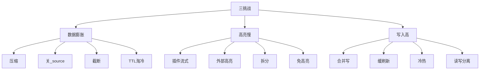

> 覆盖源 19-9 全文：大文本索引的三大挑战（数据膨胀 / 高亮性能 / 写入负载）与对应治理策略。
> 主卡已详述单点手段（压缩/_source、四种高亮、合并写/refresh/分集群），本附录做横向串联与取舍。

## 思路与架构



- 三挑战同源：单文档大 → 存储涨、高亮算得慢、写得多。治理顺序建议先"压存储 + 限尺寸"（代价最低），再"减写 + 缓刷新"，最后才上"分集群"架构（成本最高）。
- 架构侧三件套（冷热/读写/TTL）都以"用户维度"切分，可组合：冷热分高频、读写分新用户、TTL 淘僵尸，互不冲突。

## 方案取舍

| 手段 | 收益 | 代价 | 何时用 |
|---|---|---|---|
| best_compression | 省 posting 存储 | 写放大（压缩 CPU） | 大文本索引必开 |
| 关 _source | 省原文存储 | 无法取原文字段 | 只搜不取原文 |
| 字数截断 | 控单文档上限 | 牺牲超大文档完整性 | 99% 文档未超限时 |
| TTL 淘冷 | 总数据量可控 | 低频用户重搜慢 | PB 级长尾 |
| 外部存储高亮 | 脱 ES 并发高亮 | 需自建存储+回填 | 高亮是刚需 |
| 拆分文档 | 更新局部化 | 分页去重复杂 | 电子书等可分段 |
| 调大 refresh | 减段合并 | 近实时性下降 | 大文本可接受秒级延迟 |
| 冷热分离 | 高频体验好 | 双集群运维 | 二八分布明显 |

- **选型结论**：存储类（压缩/_source/截断/TTL）几乎零研发成本，优先做满；高亮按"是否刚需"决定插件还是免高亮；架构类只在单集群扛不住时才上。
- **不适用边界**：小数据量场景（集群内存够缓存全量）以上全都不需要，过度优化反增复杂度。

## 性能量级与实测数据

- refresh_interval 1s→5s 对大文本集群写入负载下降显著（经验值，非固定比例），查询近实时性从 1s 退化到 5s 内仍可接受 `[经验]`。
- 高亮改为"命中即停"的流式读取，大文档高亮耗时可从"全文档扫描"降到"首段命中即返回"，提速来自提前终止而非并行 `[经验]`。
- 以上为课程经验值，无公开基准数字；落地需按自身业务观测 search latency / indexing throughput 指标定阈值 `[经验]`。

## 答题技巧

## 细节与核心 API

- `index.codec: best_compression`：DEFLATE 替代 LZ4，posting 压缩比更高，写时 CPU 略升 `[源码]`。
- `"_source": {"excludes":["content"]}`：查询 `_source` 不返回大字段，但字段仍可被检索 `[源码]`。
- `refresh_interval`：动态可改，控制 in-memory buffer → 可搜索段的间隔，默认 1s `[源码]`。
- ingest pipeline `truncate` 处理器或应用层按 rune 截断：限制单文档字数上限 `[经验]`。
- 按最后搜索时间判断 TTL 是否过期，过期淘汰、重搜时重建索引：

```go
// 示意，未验证：TTL 淘冷判定
func isExpired(lastSearch, now time.Time, ttlDays int) bool {
    return now.Sub(lastSearch) > time.Duration(ttlDays)*24*time.Hour
}
```


- 30 秒版：背出三挑战（膨胀/高亮/写入）+ 每类一句代表手段（压缩/_source、外部高亮、合并写+refresh）。
- 3 分钟版：按"先零成本存储治理、再减写、最后分集群"的顺序讲，展示你懂得按代价排序。
- 白板版：画一张"挑战→手段"映射表，标出哪些零研发、哪些要改 ES、哪些要加集群。
- 话术模板：先说"大文本的根因是单文档大"，再补"所以我按代价从低到高做三层治理"。
- 不会怎么接：被问到具体基准数字时，承认是课程经验值、需按业务观测，比编数字强。

## 广度与深度延伸

- 横向：MySQL 大字段（TEXT/BLOB）也有"存储膨胀 + 回表 IO"问题，思路类似（拆表/外部对象存储）。
- 纵向：ES 8 的 `ignore_above`、`synthetic _source`（8.8+）可进一步降 _source 存储，是本课程之后的演进方向。
- 经典资料：ES 官方《Definitive Guide》索引调优章节；讲师默课网"海量数据高并发 ES 企业级搜索"课程。

## 反问环节

- "贵司搜索场景的文档平均多大？是只搜不取原文，还是高亮是刚需？"——把单向考核变双向交流。
- "你们目前 refresh_interval 和 _source 策略是怎么配的？有没有遇到过段合并把节点打满？"——展示你思考过写入链路。
