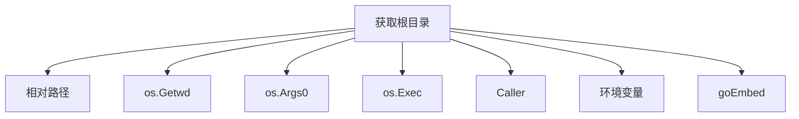

> 关联主卡：410-exec-dir-pitfall / 410-os-args-path / 410-os-executable / 410-runtime-caller / 410-env-root-dir
> 深挖门槛命中：L3（多方案横向对比 + 选型权衡）+ 版本翻转（os.Executable go1.8、go:embed go1.16）

## 思路与架构
获取根目录本质是"确定路径基准"。两条路线：① 运行时查进程/可执行文件位置（cwd、exe、Args、Caller）；② 编译期固化（环境变量、go:embed）。前者随部署变，后者与部署解耦。

文字版：① 相对路径与 Getwd 基准都是 cwd；② Args0 与 Exec 基准是可执行文件位置；③ Caller 基准是源文件位置；④ 环境变量与 goEmbed 在编译/部署期固化，最稳。

## 方案取舍
| 维度 | 相对路径/Getwd | Args0/Exec | runtime.Caller | 环境变量 | goEmbed |
|---|---|---|---|---|---|
| 基准 | 进程cwd | 可执行文件 | 源文件 | 部署配置 | 编译期 |
| 随执行目录变 | 是 | 否 | 否 | 否 | 否 |
| 受 go run 影响 | 是 | 是 | 否 | 否 | 否 |
| 软链处理 | - | 需EvalSymlinks | - | - | 内嵌无链 |
| 推荐度 | 低 | 中 | 高 | 高 | 资源场景高 |

选型结论：运行期读外部配置优先 runtime.Caller 上溯或环境变量；编译期打包静态资源用 go:embed。不适用边界：Caller 上溯层数硬编码脆弱，目录结构调整即失效。

## 性能量级与实测数据
路径解析均为系统调用级开销，无显著性能差异，选型看稳定性而非速度 `[经验]`。go:embed 把资源编入二进制，省一次磁盘 IO 与路径解析，但增大二进制体积。

## 答题技巧

## 细节与核心 API
- `os.Getwd()`：返回进程 cwd，等价于 `.` 基准 `[源码]` os 包。
- `os.Args[0]`：程序名/路径；`go run` 时为临时文件，`go build` 后为真实 exe `[经验]`。
- `os.Executable()`：go1.8 引入，返回当前 exe 绝对路径，不自动 Abs `[源码]`。
- `filepath.EvalSymlinks(p)`：解析软链为真实路径，部署用软链时必接。
- `runtime.Caller(skip int)`：返回调用栈文件/行号；skip=0 为 Caller 所在文件。
- `filepath.Abs/Dir`：取绝对路径/父目录；`os.Getenv`：读环境变量。
- `//go:embed assets` + `import _ "embed"` + `embed.FS`：编译期内嵌资源 `[源码]`。

- 30 秒版：相对路径/Getwd 随 cwd 变不靠谱；用 runtime.Caller 取源文件位置上溯，或环境变量/embed 固化。
- 3 分钟版：补 Args0/Exec 的 go run vs build 差异、EvalSymlinks 解析软链、go:embed go1.16 内嵌。
- 白板版：画"cwd / exe / 源文件 / 部署配置"四条基准与各自稳定性。
- 话术模板："我优先 runtime.Caller 上溯或读 APP_ROOT 环境变量；静态资源直接 go:embed 编进二进制。"
- 不会怎么接：诚实说"软链场景我只用过 EvalSymlinks，具体挂载方式我确认后补"，不编。

## 广度与深度延伸
- 横向：Python `__file__`、Node `__dirname`、Rust `env::current_exe` 同理。
- 纵向：go:embed 的指令只接受字符串字面量路径、支持 `all:` 前缀与 `embed.FS` 遍历。

## 反问环节
可反问："咱们配置根是走环境变量还是约定目录？静态资源是外挂还是打进二进制？"——体现部署意识。
