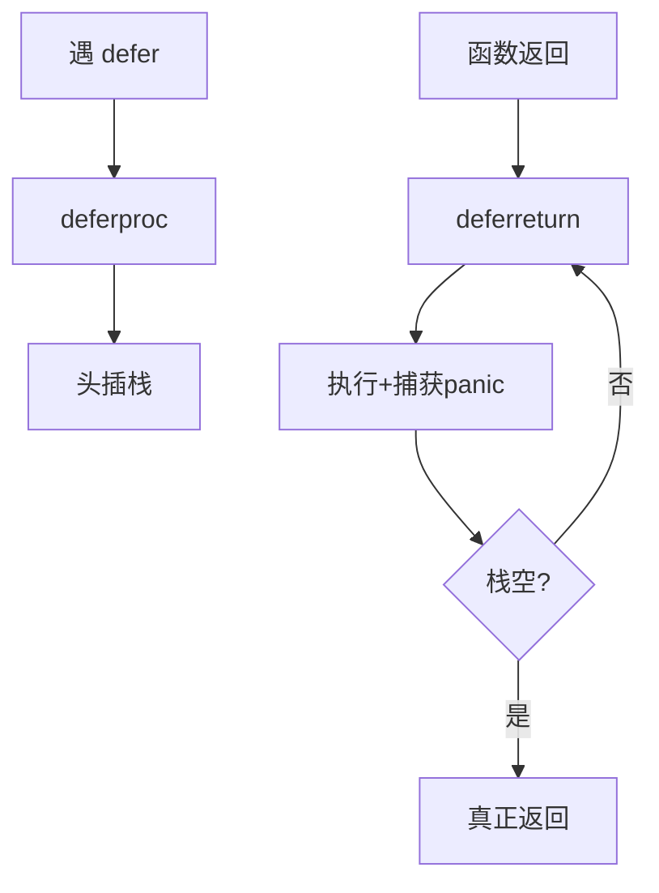

> 覆盖源 6-4 全文：_defer 结构体、link 头插 LIFO 栈、deferproc/deferreturn、开放编码优化。
> 主卡已详述结构体（604-defer-struct）、deferproc/deferreturn（604-deferproc-deferreturn）、开放编码（604-defer-opencoded）；用法层见 607 系列。

## 思路与架构



- 一条主线：defer 的"后声明先执行"来自 `link` 头插 + 从头部取，是数据结构的必然结果，不是语言特例。
- 开放编码是"编译期绕开运行时"的快路径；退化路径才走 deferproc 堆分配。

## 方案取舍

| 路径 | 触发 | 开销 | 何时 |
|---|---|---|---|
| 开放编码 defer | 顶层、少而固定、非循环 | 近零（内联） | 绝大多数小函数 |
| 普通 deferproc | 循环内/超量/动态 | 堆分配+链表 | 上述不满足时 |
| 堆 _defer | 无法开放编码 | 需 GC 回收 | 逃逸的延迟调用 |

- **选型结论**：写 defer 时保持"函数顶层、数量少"，天然吃到开放编码；循环内 defer 下沉到子函数既正确又高效。
- **不适用边界**：defer 不是免费糖——循环内大量 defer 会堆分配并延迟释放，是资源泄漏典型面。

## 性能量级与实测数据

- 607-defer.deep 实测：稳态循环外单个开放编码 defer 约 6 ns/op、0 allocs；闭包捕获外部变量时约 88 B/op、6 allocs/op `[实测]`。
- 退化到 deferproc 的 defer 每次多一次堆分配与链表操作，量级在十 ns 级、单次分配 `[经验]`。
- 性能差异只在高频路径才显著；语义正确性（循环内勿 defer）比微优化更重要 `[经验]`。

## 关键代码
```go
// 示意，未验证：退化路径——循环内 defer 每次堆分配 _defer 且返回才执行
func leaky(n int) {
    for i := 0; i < n; i++ {
        f, _ := os.Open("f") // 伪代码
        defer f.Close()      // 循环内：无法开放编码，每次堆分配且返回才执行 → 泄漏
    }
}
```

## 答题技巧

## 细节与核心 API

- `_defer.link`：单向链表，头插实现 LIFO `[源码]`。
- `_defer.sp` / `_defer.pc`：定位 defer 所在栈帧与待执行指令，函数返回时据此找回闭包与变量 `[源码]`。
- `_defer.heap`：该记录是否堆分配（非"优先级"）；开放编码失败时置 true `[经验]`。
- `runtime.deferproc` / `runtime.deferreturn`：注册与执行入口，均为 runtime 内部函数 `[源码]`。
- open-coded：编译器在 return 前内联清理代码，一个帧用一个 `_defer` 描述整组 `[源码]`。


- 30 秒版：背出"defer=_defer 链表栈、link 头插 LIFO、deferproc 注册/deferreturn 执行、1.14+ 开放编码零分配"。
- 3 分钟版：按"结构→头插→两 runtime 函数→开放编码"展开，顺带纠"heap≠优先级"。
- 白板版：画 defer 栈头插/弹出的两帧小图，标出 LIFO 因果。
- 话术模板：先给结论"后声明先执行是头插的必然"，再讲机制，最后补开放编码优化。
- 不会怎么接：被问到具体字段布局时，承认随版本微调（现代版含 varp/framepc），但 link/sp/pc/fn 长期稳定。

## 广度与深度延伸

- 横向：对比 607 用法层（估值时刻、命名返回值、循环变量）——本卡是底层实现，互补不重复。
- 纵向：open-coded defer 与逃逸分析、内联优化同源；panic/recover 的落点正是 defer 执行帧。
- 经典资料：Go 源码 `runtime/runtime2.go`（_defer 定义）、Go 官方博客 "Proposal: avoid heap allocation of defer records"。

## 反问环节

- "贵司对 defer 有性能 lint 吗？循环内 defer 是否被 staticcheck 拦？"——把单向考核变双向交流。
- "你们遇到过 defer 导致的资源泄漏吗？怎么定位的？"——展示你懂运行时而非只背结论。
