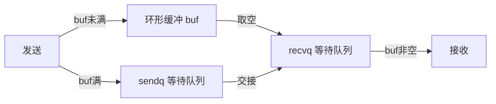

> 分类：Go 并发 | 难度：L4 | 题型：原理题 | 频率：高 | 关键词：**hchan**/**环形缓冲**/**select**
> 原文锚点：第 1~101 段（6-10 channel 区别 全篇）

## 思路与架构
channel 底层是 `runtime.hchan` 结构体：一个**环形缓冲区 `buf`**（仅缓冲 channel 有）、两个等待队列 `sendq`/`recvq`（存被挂起的 goroutine 的 `sudog`）、以及一把互斥锁 `lock`。无缓冲 channel 的 `buf` 长度为 0，发送直接走 recvq 交接。



文字说明：发送时优先与 recvq 中等待的接收者直接 handoff；否则若 buf 未满则入 buf；再否则挂 sendq。接收对称。这样无缓冲走"直接交接"，有缓冲走"buf 暂存 + 队列兜底"。

## 方案取舍
| 维度 | 无缓冲 | 有缓冲 |
| --- | --- | --- |
| 同步性 | 严格 rendezvous | 条件异步 |
| 解耦 | 弱（双方须同时在线） | 强（生产者可先行） |
| 内存 | 无 buf 开销 | 占用 cap*elemSize |
| 延迟 | 交接即达，低且确定 | 入 buf 有拷贝 |
| 结论 | 用作信号/同步 | 用作解耦/削峰 |
| 不适用 | 高频突发生产 | 严格同步语义场景 |

## 答题技巧
- 30 秒版：无缓冲=同步 rendezvous（双方同时就绪），有缓冲=条件非阻塞（buf 未满/非空），本质差异在 hchan 的 buf 与等待队列。
- 3 分钟版：画 hchan 三件套（buf/sendq/recvq），讲清发送三步（交接收者→入 buf→挂 sendq），再讲死锁=等待环。
- 白板：`send → 有recvq? handoff : buf未满? 入buf : 挂sendq`。
- 话术："我用 `go run -race` 验证数据竞争，用打印 goroutine 栈确认死锁位置。"
- 不会怎么接：诚实说"select 多 case 就绪时随机选一个"是语言保证的公平性，别编确定性。

## 版本与兼容性
| 结论成立版本 | 翻转点 | 现在该怎么答 |
| --- | --- | --- |
| Go 1.0+ | hchan 结构稳定 | 答"hchan 含 buf/sendq/recvq/lock，无缓冲 buf 长度 0" |

## 关键代码
```go
// select 多 case 就绪时随机公平
select {
case ch1 <- 1:
case ch2 <- 2:
default: // 非阻塞：所有 case 未就绪时走这里
}
// nil channel 的 case 永远不被选中，可动态禁用分支
```

## 总结与追问预判
hchan 三件套（buf/sendq/recvq）是理解一切 channel 行为的总纲；死锁归因"等待环 + 无推进者"。

## 细节与核心 API

```go
// 超时控制（不要裸等，防止永久阻塞）
select {
case v := <-ch:
    use(v)
case <-time.After(2 * time.Second):
    return ErrTimeout
}
// done 信号（级联取消）
done := make(chan struct{})
go func() { defer close(done); doWork() }()
<-done
// fan-in：多路合并
func fanIn(a, b <-chan int) <-chan int {
    out := make(chan int)
    go func() { defer close(out)
        for a != nil || b != nil {
            select {
            case v, ok := <-a: if !ok { a = nil } else { out <- v }
            case v, ok := <-b: if !ok { b = nil } else { out <- v }
            }
        }
    }()
    return out
}
// 限流：用 chan struct{} 作信号量（见并发控制卡）
```
